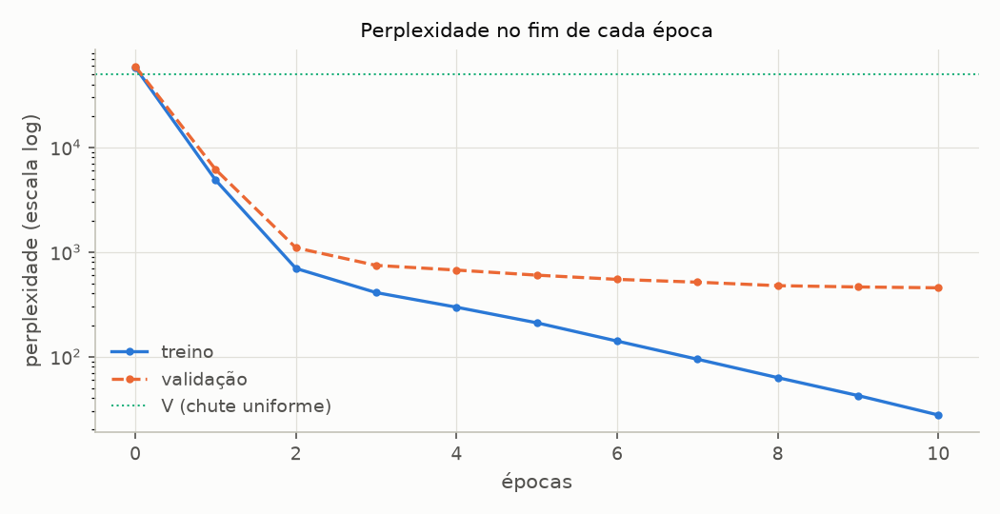
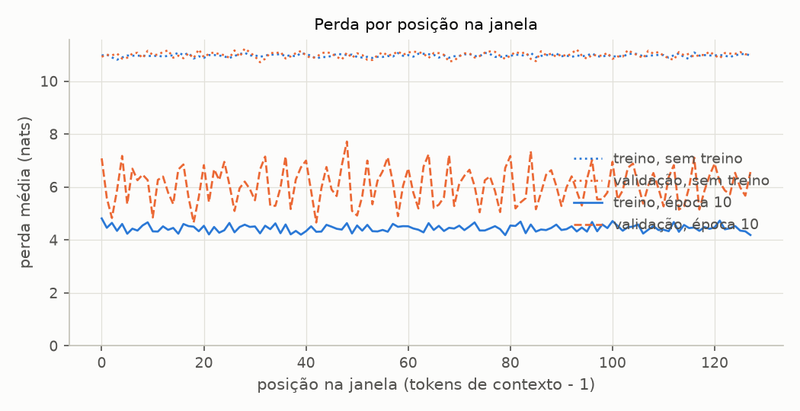
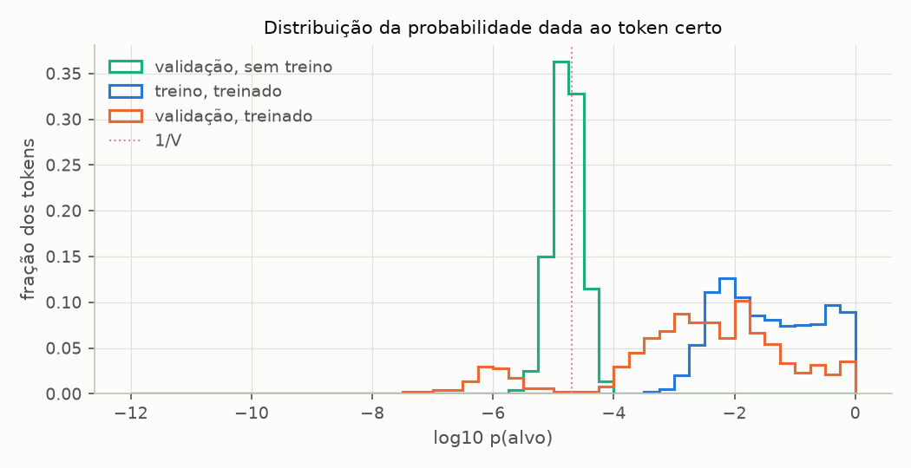

# Entregável 2 — Avaliação do modelo

**Um número para "quanto o modelo aposta no token certo".** Treinar exige medir: o otimizador precisa de um número para descer, e quem treina precisa saber se o modelo está aprendendo a tarefa ou só decorando o texto. Este documento explica a cross-entropy e a perplexidade, como as perdas de treino e de validação são calculadas em [`src/training/loss.py`](../../src/training/loss.py), e o que elas mostram sobre o modelo do projeto, do estado inicial ao fim do treino de referência. Os números vêm de [`avaliacao.md`](../../experimentos/sprint05/resultados/avaliacao.md) (experimentos AV1 a AV5) e de [`livro.md`](../../experimentos/sprint05/resultados/livro.md) (reprodução das seções 5.1.2 e 5.1.3).

---

## 1. O que a cross-entropy mede

Em cada posição t de uma sequência, o modelo devolve uma distribuição q(· | tokens 0..t) sobre os V = 50 257 tokens do vocabulário. O texto tem **um** token certo nessa posição, o yₜ que de fato vem a seguir. A cross-entropy olha só para a probabilidade que o modelo deu a ele:

```
perda = − (1 / N) · Σₜ log q(yₜ | tokens 0..t)        N = B · T posições do lote
```

O nome vem da teoria da informação. A cross-entropy entre a distribuição "verdadeira" p e a do modelo q é H(p, q) = −Σᵥ p(v) log q(v). Como p é um vetor one-hot no token certo, a soma se reduz a −log q(yₜ). A perda mede, portanto, a diferença entre o que o modelo previu e o token esperado, mas só pela coluna que importa. Ela não se interessa por como o resto da probabilidade foi distribuído.

O livro chega a esse número em seis passos (figura 5.7), e o projeto os refaz um a um no modelo de 124M com seed 123 ([`livro.md`](../../experimentos/sprint05/resultados/livro.md), L2):

| Passo | Livro (seção 5.1.2) | Projeto | Valor no exemplo do livro |
| ----- | ------------------- | ------- | ------------------------- |
| 1. logits | `model(inputs)` | `model(inputs)` | (2, 3, 50 257) |
| 2. probabilidades | `torch.softmax(logits, dim=-1)` | `torch.log_softmax` (passos 2 a 4 juntos) | ~2·10⁻⁵ cada |
| 3. probabilidade do alvo | `probas[i, [0, 1, 2], targets[i]]` | `.gather(-1, alvos)` | 7,45·10⁻⁵ ... 4,76·10⁻⁶ |
| 4. log | `torch.log(...)` | (já é log) | −9,5042 ... −12,2561 |
| 5. média | `torch.mean(...)` | `.mean()` | −10,7940 |
| 6. sinal trocado | `* -1` | `-` | **10,7940** |

`target_log_probabilities` faz os passos 2 a 4 com `log_softmax`, que dá o mesmo número que `log(softmax(...))` sem tirar o log de uma probabilidade da ordem de 10⁻⁵ já arredondada em float32. `batch_loss` é o atalho do PyTorch, `F.cross_entropy` sobre os tensores achatados ((B·T, V) contra (B·T,)), e é o que o treino usa. As três formas dão 10,7940 no exemplo do livro, e as 20 comparações da seção 5.1.2 conferem.

**Por que o logaritmo.** Três motivos, e cada um tem consequência prática:

- **Probabilidade do texto inteiro.** A probabilidade que o modelo dá a uma sequência é o produto das probabilidades de cada token. O log transforma o produto em soma, e a perda vira −log da probabilidade do texto, dividido pelo número de tokens. É a "surpresa" média por token, em nats.
- **Números legíveis.** Probabilidades de 10⁻⁵ multiplicadas por centenas de tokens dariam zero em float32. Os logs ficam entre 0 e ~20.
- **Um gradiente que não some.** A derivada de −log q(y) em relação aos logits é q − onehot(y), e ela é grande justamente quando o modelo está confiante e errado. O logaritmo pune erros confiantes: −log(0,5) = 0,69, mas −log(10⁻⁴) = 9,2. A seção 7 mostra que é desse tipo de erro que vem boa parte da perda.

O AV1 abre a conta no modelo do projeto sem treino, numa sequência de validação:

| posição | entrada | alvo | p(alvo) | p(alvo) · V | −log p(alvo) | alvo no ranking |
| ------- | ------- | ---- | ------- | ----------- | ------------ | --------------- |
| 2 | `' collapsed'` | `' like'` | 7,57·10⁻⁶ | 0,38 | 11,791 | 46 054 |
| 3 | `' like'` | `' a'` | 3,61·10⁻⁵ | 1,82 | 10,228 | 4 693 |
| 6 | `' of'` | `' cards'` | 7,03·10⁻⁶ | 0,35 | 11,865 | 46 932 |

A probabilidade do alvo fica entre 0,35 e 1,8 vezes a do chute uniforme (1/V), e o token certo cai em qualquer lugar do ranking: a posição mediana, no lote inteiro, é a 26 303ª de 50 257, perto do meio (25 129). O modelo sem treino não favorece nem rejeita o token certo, e a média de −log p(alvo) no lote dá 11,03, perto de ln V = 10,82.

---

## 2. Perplexidade

```
perplexidade = exp(perda) = 1 / (média geométrica de q(yₜ))
```

A leitura vem do caso uniforme. Se o modelo espalhasse a probabilidade por igual entre k candidatos, e o token certo estivesse sempre entre eles, a perda seria ln k e a perplexidade, k. Por isso a perplexidade se lê como **o número de tokens entre os quais o modelo hesita, em média, a cada passo**. É a mesma informação da perda, numa escala que se interpreta sem calculadora: perda 6,12 não diz muito, mas "hesita entre ~455 tokens" diz.

No exemplo do livro, a perda de 10,7940 vira perplexidade 48 725,8 (L2): o modelo sem treino hesita entre 97% do vocabulário. O projeto reproduz o número do livro com `torch.exp` em float32 (48 725,8203). `perplexity()` faz a conta em float64 e dá 48 725,8216, uma diferença de 0,0013 que vem só do arredondamento do `exp` em float32.

**A relação com prever o próximo token** é direta e limitada ao mesmo tempo:

- **Direta:** a perplexidade é o inverso da média geométrica de p(alvo). Perplexidade 455 quer dizer que o modelo dá, em média geométrica, 1/455 = 0,22% de probabilidade ao token certo.
- **Limitada:** ela não diz se o token certo é o **escolhido**. O acerto top-1 (o alvo é o argmax) é outra medida. No AV3, a perplexidade de validação cai de 6 139 para 455 entre as épocas 1 e 10 (13 vezes menor), enquanto o acerto top-1 sobe de 4,5% para 11,9% (2,6 vezes). A diferença vem do que cada medida enxerga: a perplexidade melhora sempre que p(alvo) sobe, mesmo com o alvo longe do topo do ranking; o top-1 só muda quando ele vira o argmax.

Três cuidados ao comparar perplexidades:

1. Ela é **por token do BPE**, não por palavra: o mesmo modelo, medido por palavra, teria outro número. Só se compara com o mesmo tokenizador e o mesmo texto de teste.
2. O `exp` amplifica: perdas de 6,12 e 6,13 viram perplexidades de 455 e 459. Uma diferença de 1% na perplexidade é uma diferença de ~0,01 na perda, abaixo do ruído deste conjunto de validação (seção 8).
3. Ela só vale para a perda **média por token, em nats**. A média por sequência, ou o log em base 2, dariam outro número com o mesmo nome.

---

## 3. Perdas de treino e de validação

A perda de um lote não diz nada sobre o conjunto; a de um conjunto inteiro, sim. [`loader_loss`](../../src/training/loss.py) (o `calc_loss_loader` do livro) percorre os lotes de um `DataLoader` e devolve a perda média por token, e `evaluate` (o `evaluate_model`) faz isso para o treino e para a validação. Três decisões de implementação:

- **Média ponderada pelos tokens de cada lote.** O livro tira a média das médias por lote. As duas coincidem quando todos os lotes têm o mesmo tamanho, que é sempre o caso no livro, e diferem quando o último lote vem incompleto (a validação usa `drop_last=False`). Aí só a ponderada é a perda média por token, que é o que a perplexidade pressupõe. Quando os lotes têm 2·256 tokens, uma potência de 2, a ponderação é exata em ponto flutuante, e o projeto reproduz o número do livro nos 16 algarismos impressos.
- **`eval()` e `no_grad()` dentro da função**, com o modo original devolvido no fim. Avaliar com dropout ligado daria um número diferente a cada chamada: o teste `test_loader_loss_avalia_em_eval_sem_grafo_e_devolve_o_modo` mede duas vezes e exige igualdade.
- **`max_batches`**, o `eval_iter` do livro, limita a avaliação aos primeiros lotes. O livro usa 5 durante o treino; o projeto usa os conjuntos inteiros ([Entregável 3](02-treinamento.md), seção 3).

Os conjuntos são os do livro: o The Verdict cortado em 90% / 10% nos caracteres, janelas sem sobreposição. No modelo base (contexto 128), são 36 janelas de treino (4 612 tokens) e 4 de validação (534 tokens).

**Um detalhe numérico que a reprodução expôs.** Matematicamente, a perda média de um conjunto não depende de como as sequências foram agrupadas em lotes. Em float32 depende, na 7ª casa: cada lote calcula a sua média em float32, com erro de ~10⁻⁶. Com os mesmos pesos, a perda inicial de treino da seção 5.1.3 dá 10,98758347829183 (o número do livro) ou 10,987583796183268 conforme quais sequências caíram juntas ([`livro.md`](../../experimentos/sprint05/resultados/livro.md), L3). Por isso o teste compara as perdas iniciais com tolerância de 10⁻⁶, e não por igualdade.

---

## 4. O estado inicial

**Configuração (AV2).** O modelo base sem treino, com 5 seeds diferentes, avaliado nos dois conjuntos inteiros.

**Resultado.**

| | Treino | Validação |
| - | ------ | --------- |
| Perda (média ± desvio, 5 seeds) | 10,982 ± 0,010 | 10,972 ± 0,016 |
| Perplexidade | 58 181 a 59 681 | 57 075 a 59 385 |
| Desvio dos logits | 0,577 (= 1/√3) em todas as seeds | |

| Referência | Perda | Perplexidade |
| ---------- | ----- | ------------ |
| Chute uniforme (ln V) | 10,825 | 50 257 |
| Logits aleatórios com σ² = 1/3 (ln V + σ²/2) | 10,992 | 59 372 |

**Análise.** O ponto de partida é uma propriedade da inicialização, e não dos dados nem da seed. Nenhuma das 5 inicializações se afasta mais de 0,03 da média, e treino e validação ficam iguais dentro desse ruído: sem aprendizado, não há o que diferencie os dois conjuntos.

O valor também é previsível. A LayerNorm final e a inicialização da cabeça de saída dão logits com desvio 1/√3 (Sprint 4, A2). Para logits independentes com variância σ², a perda esperada é E[logsumexp] − E[logit do alvo] ≈ (ln V + σ²/2) − 0 = 10,992, a 0,02 do medido. O modelo sem treino perde **mais** que o chute uniforme, e a perplexidade inicial (~58 mil) passa do tamanho do vocabulário: logits aleatórios concentram probabilidade em tokens arbitrários, e o token certo, em média, recebe menos que 1/V.

Isso faz da perda inicial um diagnóstico barato. Se o primeiro número de um treino estiver longe de ~11, alguma coisa está errada antes de o treino começar. Muito acima indica logits mal escalados. Muito abaixo indica vazamento do alvo, por exemplo uma máscara causal que deixa a posição t ver o token t+1. O modelo do livro começa no mesmo regime: 10,988 e 10,981 (L3).

---

## 5. A evolução durante o treino

**Configuração (AV3).** O treino de referência ([Entregável 3](02-treinamento.md)), medido no fim de cada época, nos conjuntos inteiros e em `eval()`. As medidas rodam entre chamadas de `train_model`, sem consumir o gerador global, e o treino sai idêntico ao do T1.

**Resultado.**

| Época | Perda treino | Perda validação | Diferença | Perplexidade treino | Perplexidade validação | Top-1 treino | Top-1 validação | Top-5 validação |
| ----- | ------------ | --------------- | --------- | ------------------- | ---------------------- | ------------ | --------------- | --------------- |
| 0 | 10,971 | 10,992 | 0,020 | 58 181 | 59 385 | 0,0% | 0,0% | 0,0% |
| 1 | 8,490 | 8,722 | 0,233 | 4 864 | 6 139 | 4,4% | 4,5% | 13,3% |
| 2 | 6,546 | 7,000 | 0,455 | 696 | 1 097 | 6,1% | 5,7% | 14,8% |
| 3 | 6,014 | 6,613 | 0,599 | 409 | 744 | 7,5% | 5,1% | 14,8% |
| 5 | 5,349 | 6,398 | 1,049 | 210 | 600 | 13,4% | 8,0% | 19,7% |
| 7 | 4,547 | 6,243 | 1,696 | 94 | 515 | 22,0% | 9,8% | 22,3% |
| 10 | 3,319 | 6,119 | 2,800 | 27,6 | 455 | 35,5% | 11,9% | 25,2% |



**Análise.** O treino passa por dois regimes, e a diferença entre as duas perdas separa um do outro.

- **Épocas 1 e 2: aprendizado que generaliza.** As duas perdas caem juntas e muito: a de validação vai de 10,99 para 7,00, e a perplexidade, de 59 mil para 1 097. A diferença entre treino e validação fica abaixo de 0,5. O que o modelo aprende primeiro vale para qualquer trecho do conto: quais tokens são frequentes e quais costumam vir depois de quais. As amostras mostram isso. No fim da época 1, o modelo do livro só gera vírgulas, o token mais frequente do conto, e na época 2 repete `, and` (L4). O acerto top-5 da validação já chega a 13% na época 1.
- **Da época 3 em diante: aprendizado que não generaliza.** A perda de treino continua caindo no mesmo ritmo, cerca de 0,4 por época, e a de validação quase para: 0,88 de queda nas 8 épocas seguintes, contra 3,99 nas duas primeiras. A diferença cresce de 0,6 para 2,8. Nas medidas de acerto, o top-1 de treino sobe de 7,5% para 35,5% e o de validação, de 5,1% para 11,9%. O modelo está ficando melhor em **este** texto, e não em texto em geral.

A perplexidade dá o tamanho da diferença. No fim, o modelo hesita entre ~28 tokens no texto de treino e entre ~455 no de validação: 16 vezes mais incerto diante de texto novo. É o mesmo padrão do treino do livro, cuja diferença chega a 6,06 na época 10 (L4).

Ao contrário do modelo do livro, porém, a validação do modelo base **ainda cai** na época 10: a menor perda de fim de época é a última, 6,119. O modelo de 28,9 milhões de parâmetros, com contexto 128, decora mais devagar que o de 162 milhões, cuja validação para de cair na época 7. O [Entregável 4](03-experimentos-de-treinamento.md) leva o treino a 30 épocas para encontrar esse ponto.

---

## 6. A perda por posição na janela

**Configuração (AV4).** A perda é a média sobre as 128 posições de cada janela, e a posição t prevê o token t+1 vendo só os tokens 0..t. Aqui a média é separada por posição, antes do treino e no fim da época 10. Com as janelas do treino (stride 128), a posição 0 seria sempre um dos mesmos 36 tokens que abrem as janelas, e a validação teria só 4 previsões por posição. Por isso a medida usa janelas deslocadas de 16 em 16 (281 de treino, 26 de validação), e cada token é previsto em até 8 posições diferentes.

**Resultado.**

| Posições | Treino, sem treino | Validação, sem treino | Treino, época 10 | Validação, época 10 |
| -------- | ------------------ | --------------------- | ---------------- | ------------------- |
| 0 | 10,969 | 10,925 | 4,813 | 7,083 |
| 1–3 | 10,905 | 11,007 | 4,483 | 5,431 |
| 4–15 | 10,964 | 10,999 | 4,422 | 6,128 |
| 16–31 | 10,962 | 10,998 | 4,443 | 6,020 |
| 32–63 | 10,966 | 10,996 | 4,421 | 6,092 |
| 64–127 | 10,972 | 10,990 | 4,451 | 6,048 |



**Análise.** Antes do treino, a perda é a mesma em todas as posições: o modelo aleatório não usa o contexto. Depois do treino, no conjunto de treino, a perda cai da posição 0 (4,81) para as posições 1 a 3 (4,48) e **fica plana** até a 127. Os primeiros tokens de contexto ajudam; os outros 120 não acrescentam nada. Na época 10, o modelo funciona como um preditor de contexto curto, parecido com um modelo de n-gramas, embora a atenção lhe dê acesso a 128 posições. Na validação, a posição 0 também é a pior (7,08). As diferenças entre as outras faixas (5,4 a 6,1) ficam dentro do ruído: cada faixa estreita é a média de poucas dezenas de tokens.

A tabela traz um resultado mais importante por comparação. Com as janelas do próprio treino, a perda de treino na época 10 é **3,32** (AV3). Com o **mesmo texto e o mesmo modelo**, apenas recortado em janelas deslocadas, ela passa para **~4,4**. A única diferença é a posição em que cada token cai na janela. Parte do que o modelo aprendeu sobre o texto de treino está presa às posições em que ele o viu: com stride igual ao contexto, cada token do conto ocupa sempre a mesma posição, época após época, e o modelo decora o par (trecho, posição). É sobreajuste à segmentação dos dados, que a perda de treino comum não mostra. O [Entregável 4](03-experimentos-de-treinamento.md) testa o remédio óbvio, janelas de treino sobrepostas (T7). Elas melhoram a validação, mas o modelo continua decorando o texto nas posições em que o viu. A sonda de recitação do T2 mostra o mesmo fenômeno na geração.

---

## 7. De onde vem a perda

**Configuração (AV5).** A probabilidade dada ao token certo em cada token dos conjuntos, antes do treino e no fim da época 10.

**Resultado.**

| Faixa de p(alvo) | Validação, sem treino | Treino, treinado | Validação, treinado |
| ---------------- | --------------------- | ---------------- | ------------------- |
| p ≥ 0,5 | 0,0% | 11,0% | 4,5% |
| 0,1 ≤ p < 0,5 | 0,0% | 22,7% | 6,6% |
| 0,01 ≤ p < 0,1 | 0,0% | 34,5% | 25,6% |
| 0,001 ≤ p < 0,01 | 0,0% | 31,1% | 30,5% |
| 10⁻⁴ ≤ p < 0,001 | 0,0% | 0,7% | 20,3% |
| p < 10⁻⁴ | 100,0% | 0,0% | 12,5% |
| p < 1/V (abaixo do chute uniforme) | 60,9% | 0,0% | 11,3% |
| p(alvo) mediana | 1,68·10⁻⁵ | 2,97·10⁻² | 3,25·10⁻³ |
| Média geométrica (= 1/perplexidade) | 1,68·10⁻⁵ | 3,62·10⁻² | 2,20·10⁻³ |
| Parte da perda nos piores 10% dos tokens | 10,9% | 18,5% | 22,8% |



Os tokens de cada ponta, na validação do modelo treinado (os 10 alvos mais frequentes de cada grupo):

| p(alvo) ≥ 0,1: 57 tokens, 20 distintos | p(alvo) < 10⁻⁴: 64 tokens, 60 distintos |
| -------------------------------------- | --------------------------------------- |
| `'\n'` (9), `','` (6), `'roud'` (6), `'.'` (5), `"'t"` (4) | `' question'` (3), `' alive'` (2), `' late'` (2), `' collapsed'`, `' cards'` |
| `' and'` (4), `'"'` (3), `' .'` (3), `' the'` (3), `' I'` (2) | `' sne'`, `'er'`, `'he'`, `' quietly'`, `'Are'` |

**Análise.** A média esconde duas populações de tokens. Antes do treino, todos recebem ~1/V, e os piores 10% respondem por 10,9% da perda, quase a fração "justa" de 10%. Depois do treino, a validação se espalha por cinco ordens de grandeza:

- **11,1% dos tokens recebem p ≥ 0,1.** São poucos tipos repetidos (57 ocorrências de 20 tokens distintos): quebra de linha, pontuação, `and`, `the`, `I`. Há também `roud`, o fim de "Stroud", um nome que o BPE corta em `St` + `roud` e que aparece 12 vezes no treino e 7 na validação: depois de `St`, o modelo sabe o que vem. É o que se aprende com estatística de vizinhança curta, e vale para qualquer trecho da história.
- **11,3% recebem menos que 1/V**, abaixo do chute uniforme. São erros confiantes: o modelo apostou alto em outro token e quase nada no certo. Aqui quase todo token é diferente (64 ocorrências de 60 tokens distintos): palavras de conteúdo como `question`, `alive`, `quietly`, `collapsed`, que o contexto não antecipa.

É esse segundo grupo que pesa: os piores 10% dos tokens carregam 22,8% da perda de validação. A cross-entropy é dominada pela cauda, porque −log p cresce sem limite quando p vai a zero. No conjunto de treino, praticamente nenhum token fica abaixo de 10⁻⁴ (0,0%): o modelo nunca é surpreendido assim por um texto que já viu.

Duas consequências práticas. Primeiro, a perplexidade de validação é limitada pelas palavras de conteúdo que o modelo não tem como prever num corpus de 4 600 tokens de treino. Mais épocas sobre o mesmo texto não as ensinam; só mais texto ensinaria. Segundo, a mediana (3,25·10⁻³) fica acima da média geométrica (2,20·10⁻³) na validação: o token "típico" é previsto melhor do que a perplexidade sugere, e a cauda puxa a média para baixo.

---

## 8. Limitações

- **Validação minúscula.** São 534 tokens, 4 janelas de 128. Só a seed já move a perda de validação inicial em ±0,016, e depois do treino o ruído entre seeds é maior ([Entregável 4](03-experimentos-de-treinamento.md), T1). Diferenças menores que esse ruído entre configurações não são conclusivas.
- **Um texto e um corte.** A validação é o desfecho do conto, e não uma amostra dele. Parte da diferença entre treino e validação pode vir de o fim da história ser diferente do resto. O Entregável 4 (T6) testa isso com a validação tirada do começo.
- **Perda não é qualidade de texto.** A cross-entropy mede quão bem o modelo prevê **este** texto. Um modelo que decora o conto tem perda de treino perto de zero e gera frases perfeitas, copiadas. Perda baixa no treino, sozinha, não é sinal de bom modelo; o que importa é a de validação, e a comparação entre as duas.
- **Perplexidade por token do BPE do GPT-2.** Não se compara com números publicados de outros corpora ou tokenizadores.
