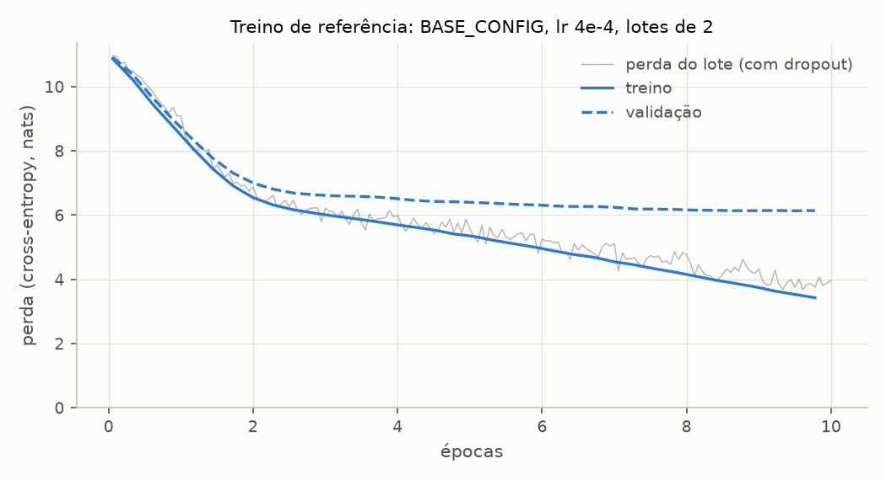

# Entregável 3 — Implementação do treinamento

**Do modelo que chuta ao modelo que prevê.** O `GPTModel` da Sprint 4 já produz uma distribuição sobre o próximo token, mas com pesos aleatórios ela é quase uniforme. O treino ajusta os 28,9 milhões de pesos do modelo base para que a probabilidade do token que de fato vem a seguir suba. São quatro operações repetidas lote a lote: perda, gradiente, passo do otimizador, gradiente zerado. Este documento descreve a rotina implementada em [`src/training/`](../../src/training/), os hiperparâmetros registrados e as duas verificações de que ela funciona: a reprodução número a número do treino do livro e o treino de referência do projeto.

| Arquivo | Conteúdo |
| ------- | -------- |
| [`trainer.py`](../../src/training/trainer.py) | `train_model` (o laço), `TrainingHistory`, `create_optimizer`, `train_gpt` |
| [`config.py`](../../src/training/config.py) | `TrainingConfig` e as configurações prontas do livro e do projeto |
| [`data.py`](../../src/training/data.py) | divisão treino/validação e os dois `DataLoader` |
| [`loss.py`](../../src/training/loss.py) | a perda de um lote e de um conjunto, a perplexidade ([Entregável 2](01-avaliacao-do-modelo.md)) |

---

## 1. O laço de treino

```
para cada época:
    model.train()                                  dropout ligado
    para cada lote (entrada, alvo) do train_loader:
        1. optimizer.zero_grad()                   apaga o gradiente do passo anterior
        2. perda = batch_loss(model, entrada, alvo)    forward + cross-entropy
        3. perda.backward()                        ∂perda/∂w para cada um dos pesos
        4. optimizer.step()                        pesos novos, a partir do gradiente
        5. a cada eval_freq passos:                perdas de treino e validação (eval, sem grafo)
    fim da época: amostra gulosa a partir de "Every effort moves you"
```

É a figura 5.11 do livro, e `train_model` segue o `train_model_simple` (listing 5.3) linha a linha. Os passos 1 a 4 são o treino propriamente dito; o 5 e a amostra só observam.

- **Passo 1, `zero_grad`.** O `backward()` do PyTorch **soma** o gradiente novo ao que já está em `.grad`. Sem apagar, cada passo usaria a soma de todos os gradientes desde o começo do treino. A soma tem uso (acumular gradientes de vários lotes pequenos para simular um lote grande), mas não é o caso aqui.
- **Passo 2, a perda.** O lote (B, T) passa pelo modelo e vira logits (B, T, V); a cross-entropy compara cada uma das B·T previsões com o token seguinte de verdade ([Entregável 2](01-avaliacao-do-modelo.md)). Em modo de treino, o dropout participa: a perda que o `backward` usa é a de uma versão do modelo com 10% das ativações zeradas a cada passo.
- **Passo 3, `backward`.** O autograd percorre o grafo da perda até cada peso e calcula ∂perda/∂w. É uma passada no sentido inverso, com custo de cerca de duas passadas para a frente.
- **Passo 4, `step`.** O AdamW move cada peso contra o seu gradiente (seção 2).
- **Passo 5, a avaliação.** `evaluate` mede as perdas dos dois conjuntos com o modelo em `eval()` e sob `no_grad()`, e devolve o modelo ao modo de treino. Sem o `eval()`, a avaliação mediria um modelo com dropout, e duas avaliações seguidas dariam números diferentes. Sem o `no_grad()`, guardaria ativações para um `backward` que nunca acontece. O passo global começa em 0 e é avaliado logo depois da primeira atualização, como no livro.
- **A amostra.** No fim de cada época, `generate_sample` continua o mesmo contexto com 50 tokens de decodificação gulosa. A amostra não entra em conta nenhuma; serve para ver o que os números significam em texto.

O laço registra tudo num `TrainingHistory`:

| O quê | Quando | Para quê |
| ----- | ------ | -------- |
| `steps`, `epochs`, `tokens_seen`, `train_losses`, `val_losses` | a cada avaliação | curvas de perda, ponto de mínimo da validação |
| `batch_losses` | a cada passo | a perda que o `backward` usou (com dropout, no lote do passo) |
| `samples`, `epoch_seconds`, `monitor_seconds` | a cada época | texto gerado e custo |
| `global_step`, `total_tokens` | sempre | continuar o treino depois |

A correspondência com o livro:

| livro (seções 5.1 e 5.2) | projeto |
| ------------------------ | ------- |
| `calc_loss_batch` | `batch_loss` |
| `calc_loss_loader` | `loader_loss` |
| `evaluate_model` | `evaluate` |
| `generate_and_print_sample` | `generate_sample` (o print fica no `log` do laço) |
| `train_model_simple` | `train_model` |
| `torch.optim.AdamW(model.parameters(), lr=0.0004, weight_decay=0.1)` | `create_optimizer(model, cfg)` |

---

## 2. O otimizador: AdamW

Na descida de gradiente simples, cada peso anda `lr · g`, com `g` o gradiente. O passo depende da escala do gradiente, e num GPT essa escala varia muito entre pesos: a linha da tabela de tokens de uma palavra rara recebe gradiente só nos lotes em que a palavra aparece; a cabeça de saída recebe gradiente em toda posição.

O Adam normaliza o passo de cada peso pela escala do seu próprio gradiente:

```
m ← β₁·m + (1 − β₁)·g          média móvel do gradiente        (β₁ = 0,9)
v ← β₂·v + (1 − β₂)·g²         média móvel do quadrado         (β₂ = 0,999)
w ← w − lr · m̂ / (√v̂ + ε)      m̂, v̂: m e v corrigidos do viés de começarem em zero
```

O quociente m̂/√v̂ tem módulo da ordem de 1 quando o gradiente aponta sempre para o mesmo lado, e encolhe quando ele oscila. Por isso a taxa de aprendizado do Adam é, aproximadamente, **o tamanho do passo em cada peso**, qualquer que seja a escala do gradiente. Com lr = 4·10⁻⁴, nenhum peso anda muito mais que isso por passo.

O **W** é o weight decay desacoplado (Loshchilov e Hutter). Antes do passo do Adam, todo peso encolhe pelo fator (1 − lr·wd), fora da conta do gradiente. No Adam com penalidade L2 na perda, o termo de decaimento entraria em `g` e seria normalizado junto com ele, o que enfraquece justamente o decaimento dos pesos de gradiente grande. Com lr = 4·10⁻⁴ e wd = 0,1, o fator por passo é 0,99996: em 180 passos (10 épocas do modelo base), os pesos encolhem 0,7% por causa dele. É um regularizador fraco neste treino curto, e o [T5](03-experimentos-de-treinamento.md) mede isso.

O preço do Adam é memória: dois números (m e v) para cada peso. O estado de treino em float32 tem pesos, gradientes, m e v, o que dá 16 bytes por parâmetro: 441 MB no modelo base e 2 478 MB no GPT de 124M do livro, sem contar as ativações ([T8](03-experimentos-de-treinamento.md)). O `create_optimizer` usa os padrões do PyTorch (β₁ = 0,9, β₂ = 0,999, ε = 10⁻⁸), que são os do livro, e aplica o weight decay a todos os parâmetros, inclusive bias e ganhos das LayerNorms, também como no livro.

---

## 3. Hiperparâmetros registrados

Os hiperparâmetros de um treino vivem numa dataclass congelada, [`TrainingConfig`](../../src/training/config.py), no mesmo molde do `GPTConfig` da Sprint 4: validação na construção (taxa negativa ou fração de treino fora de (0, 1) falham antes de treinar), variação de um campo por vez com `dataclasses.replace`, e `dataclasses.asdict` para registrar. `GPTConfig` + `TrainingConfig` identificam uma execução inteira.

| Campo | Significado | Livro (`BOOK_TRAINING_CONFIG`) | Projeto (`BASE_TRAINING_CONFIG`) |
| ----- | ----------- | ------------------------------ | -------------------------------- |
| `num_epochs` | passadas completas pelo treino | 10 | 10 |
| `batch_size` | sequências por lote | 2 | 2 |
| `learning_rate` | passo do AdamW | 4·10⁻⁴ | 4·10⁻⁴ |
| `weight_decay` | decaimento do AdamW | 0,1 | 0,1 |
| `eval_freq` | avaliação a cada quantos passos | 5 | 5 |
| `eval_iter` | lotes por avaliação | 5 | todos (`None`) |
| `train_ratio` | fração do texto para treino | 0,9 | 0,9 |
| `stride` | avanço da janela no treino | = contexto | = contexto |
| `seed` | pesos iniciais, ordem dos lotes, dropout | 123 | 42 |
| `start_context`, `sample_tokens` | a amostra de cada época | `Every effort moves you`, 50 | idem |

O modelo do livro é o `BOOK_MODEL_CONFIG`: GPT-2 small com contexto reduzido a 256 tokens (162 milhões de parâmetros). O do projeto é o `BASE_CONFIG` da Sprint 4: contexto 128, `emb_dim` 256, 4 cabeças, 4 blocos, dropout 0,1, 28,9 milhões de parâmetros.

O projeto difere do livro em dois pontos, os dois deliberados:

- **`eval_iter = None`.** O livro estima a perda de treino sobre 5 lotes sorteados; o projeto avalia os conjuntos inteiros. No modelo base, uma avaliação completa custa uma fração de segundo ([T8](03-experimentos-de-treinamento.md)), e a perda de treino passa a ser a do conjunto de treino, e não uma estimativa com o ruído de 5 lotes. A análise de sobreajuste compara as duas perdas e precisa disso.
- **`seed = 42`**, a seed dos experimentos do projeto desde a Sprint 4. A seed do livro (123) fica para os exemplos do livro.

O experimento T1 imprime a configuração **lida dos objetos que rodaram**: dataclasses do modelo e do treino, mais `param_groups` do otimizador. O que está na tabela é o que foi usado, não o que se pretendia usar.

---

## 4. Os dados do treino

[`create_train_val_loaders`](../../src/training/data.py) corta o texto **nos caracteres**, antes de tokenizar: os primeiros 90% treinam, os 10% finais validam. É um corte só, no fim, e não trechos sorteados: assim nenhum token da validação aparece numa janela de treino, e a perda de validação mede o que o modelo faz com texto que nunca viu. Os dois pedaços viram `DataLoader` da Sprint 2 com os padrões do livro:

| | Treino | Validação |
| - | ------ | --------- |
| Embaralha (`shuffle`) | sim: janelas vizinhas são trechos seguidos do mesmo texto | não: a ordem não muda a média |
| Descarta lote incompleto (`drop_last`) | sim: um lote menor seria um passo com outra variância | não: 10% de um conto curto não tem lote sobrando |
| `stride` | configurável (padrão: sem sobreposição) | sempre = contexto |

O `stride` da validação é fixo de propósito: a perda de validação precisa ser a mesma régua em todos os experimentos, qualquer que seja o stride do treino.

Com o modelo base (contexto 128) e lotes de 2, o The Verdict dá 36 janelas de treino (18 lotes, 4 608 tokens por época) e 4 de validação (2 lotes). Se algum dos dois conjuntos não formar nem um lote, `create_train_val_loaders` levanta `ValueError`. Sem isso, o erro só apareceria depois, como uma perda NaN ou um treino que não faz nada.

---

## 5. Verificação: o laço reproduz o treino do livro

**Configuração.** `train_gpt(BOOK_MODEL_CONFIG, BOOK_TRAINING_CONFIG, ...)`: a seed 123, o GPT de 124M com contexto 256, AdamW com lr 4·10⁻⁴ e weight decay 0,1, 10 épocas sobre o The Verdict, em CPU ([`livro_exemplos.py`](../../experimentos/sprint05/livro_exemplos.py), seção L4).

**Resultado.** **45 de 45 comparações com o livro conferem** ([`livro.md`](../../experimentos/sprint05/resultados/livro.md)). Entre elas:

- as seis linhas do log que o livro imprime, com 3 casas: de 9,781 / 9,933 no passo 0 a 0,391 / 6,452 no passo 85;
- as quatro amostras impressas, letra a letra (épocas 1, 2, 9 e 10), inclusive a da época 10, `Every effort moves you know," was one of the axioms he laid down across the Sevres and silver of an exquisitely appointed luncheon-table...`;
- as perdas iniciais da seção 5.1.3 nos 16 algarismos impressos (10,98758347829183 e 10,98110580444336).

O treino levou 223 s, cerca de 22 s por época, contra os "cerca de 5 minutos num MacBook Air" do livro.

**Análise.** Bater a 3ª casa de uma perda depois de 85 passos de AdamW é uma verificação forte. Exige o mesmo modelo, os mesmos pesos iniciais, a mesma ordem de lotes, as mesmas máscaras de dropout e as mesmas operações na mesma ordem. Os três últimos dependem de **como o laço consome o gerador global**. Cada época sorteia o embaralhamento do `DataLoader` (dois sorteios por iterador criado), cada passo sorteia as máscaras de dropout, e cada avaliação cria iteradores novos, que também sorteiam. `train_model` faz essas operações na ordem do `train_model_simple`. Avaliar antes do passo em vez de depois, por exemplo, não mudaria o que o treino faz, mas mudaria os números, e o projeto deixaria de reproduzir o capítulo. O teste [`test_book_checkpoints_ch5.py`](../../tests/test_book_checkpoints_ch5.py) trava as duas primeiras avaliações (passos 0 e 5), que já dependem de tudo isso. O treino inteiro fica no script, que leva 4 minutos.

A verificação também fixa o que o próprio livro mostra sobre este treino. A perda de treino cai de 9,78 para 0,39, e a de validação para de cair por volta da época 7 (mínimo de 6,134 no passo 55) e depois sobe. As amostras saem de vírgulas (época 1) e de `and, and, and` (época 2) para trechos do conto. Na época 10, 49 dos 50 tokens gerados são uma cópia contígua do texto de treino. O modelo do livro **decora** o conto, e as seções 3 e 8 do [Entregável 4](03-experimentos-de-treinamento.md) medem o mesmo fenômeno no modelo do projeto.

---

## 6. O treino de referência do projeto

**Configuração (T1).** `train_gpt(BASE_CONFIG, BASE_TRAINING_CONFIG, ...)`: 36 janelas de treino, 18 lotes por época, 180 passos de AdamW em 10 épocas. A configuração completa, lida dos objetos que rodaram, abre o [`treino.md`](../../experimentos/sprint05/resultados/treino.md).

**Resultado.** Trechos do log (36 avaliações no total):

| Época | Passo | Tokens vistos | Treino | Validação | Perplexidade validação |
| ----- | ----- | ------------- | ------ | --------- | ---------------------- |
| 1 | 0 | 256 | 10,868 | 10,913 | 54 888 |
| 1 | 15 | 4 096 | 8,765 | 8,980 | 7 939 |
| 2 | 35 | 9 216 | 6,546 | 7,000 | 1 097 |
| 5 | 85 | 22 016 | 5,414 | 6,416 | 612 |
| 10 | 170 | 43 776 | 3,531 | **6,135** | 462 |
| 10 | 175 | 45 056 | 3,429 | 6,140 | 464 |



| Época | Amostra (`Every effort moves you` + 50 tokens gulosos) |
| ----- | ------------------------------------------------------ |
| 1 | `Every effort moves you,,,,,,,,,,,,,,,,,,,,,,,,,,,,,,,,...` |
| 4 | `Every effort moves you.` |
| 6 | `Every effort moves you.  "I I had to the to the I had the to the. "I. "I. " the to me, and I had.` |
| 10 | `Every effort moves you know. "I have to me--and that I had been the fact. "I. "I. "I I had been the Riv it, and in the picture` |

| Seed | Validação mínima | Época da mínima | Treino final | Validação final |
| ---- | ---------------- | --------------- | ------------ | --------------- |
| 42 | 6,135 | 10 | 3,429 | 6,140 |
| 123 | 6,113 | 10 | 3,420 | 6,118 |
| 7 | 6,166 | 10 | 3,434 | 6,166 |
| desvio | 0,027 | | 0,007 | 0,024 |

**Análise: o modelo está aprendendo.** As duas perdas caem de forma monótona, avaliação após avaliação: a de treino de 10,87 para 3,43, e a de validação de 10,91 para 6,14. A perplexidade de validação cai 118 vezes, de 54 888 para 464. A perda de cada lote (a linha clara da figura), que o `backward` de fato usa, oscila em torno da avaliada e segue a mesma tendência: o ruído de um lote de 2 sequências não esconde o sinal.

As amostras mostram a ordem em que o modelo aprende. Nas épocas 1 e 2, ele repete a vírgula, o token mais frequente: é o melhor que um modelo de unigramas faz. Entre as épocas 3 e 5, aparecem pontuação, fim de frase e o `"I` que abre as falas do conto. Da época 6 em diante, surgem pedaços com o vocabulário da história (`I had been`, `the picture`, `Riv`, de *Riviera*), ainda sem frase coerente. É o retrato de uma perda de validação de 6,1: o modelo sabe que palavras aparecem neste conto e quais vêm juntas, mas não sabe montar uma frase nova.

**O resultado não depende da seed.** Em 3 seeds, a validação mínima fica entre 6,113 e 6,166 (desvio 0,027), sempre na época 10, e o treino final varia 0,007. Esse desvio é a régua do [Entregável 4](03-experimentos-de-treinamento.md): diferenças de validação menores que ~0,05 entre configurações são ruído.

**Comparado ao treino do livro** (seção 5), o modelo base aprende mais devagar. Na época 10, a perda de treino é 3,43, contra 0,39 no GPT de 124M, e a validação ainda cai, enquanto a do livro já passou do mínimo na época 7. O melhor valor de validação, porém, é praticamente o mesmo nos dois (6,135 e 6,134). Com 4 612 tokens de treino, o limite parece estar nos dados, e não no tamanho do modelo: o modelo maior só chega lá antes e começa a decorar mais cedo.

**Custo.** O treino levou 61 s em CPU: 33 s nos passos (1 388 tokens/s) e 27 s em avaliações e amostras. Avaliar os conjuntos inteiros a cada 5 passos custa **45%** do tempo, quase tanto quanto treinar. Num modelo pequeno com um corpus minúsculo, isso é aceitável em troca de curvas exatas; em escala, seria o primeiro custo a cortar (T8).

---

## 7. Como usar

`train_gpt` faz tudo na ordem do livro: monta os loaders, aplica a seed, cria o modelo e o otimizador e roda o laço.

```python
from src.corpus import load_verdict
from src.model import BASE_CONFIG
from src.tokenizer import BPETokenizer
from src.training import BASE_TRAINING_CONFIG, train_gpt

run = train_gpt(BASE_CONFIG, BASE_TRAINING_CONFIG, load_verdict(), BPETokenizer())
```

O `TrainingRun` devolvido tem o modelo treinado, o otimizador, o histórico e os dois loaders. Com a mesma configuração, o modelo é o mesmo do T1, peso a peso.

**Variar um hiperparâmetro** é trocar um campo da configuração:

```python
from dataclasses import replace
run = train_gpt(BASE_CONFIG, replace(BASE_TRAINING_CONFIG, learning_rate=1e-3), texto, tokenizer)
```

**Continuar um treino** é chamar `train_model` de novo com o histórico e o **mesmo** otimizador. Os momentos m e v do AdamW fazem parte do estado do treino: um otimizador novo recomeçaria as médias do zero, e os primeiros passos seriam diferentes dos de um treino sem pausa.

```python
train_model(run.model, run.train_loader, run.val_loader, run.optimizer,
            num_epochs=5, eval_freq=5, eval_iter=None, history=run.history)
```

Passos, tokens e épocas seguem a contagem do histórico. O teste `test_treino_retomado_e_identico_ao_continuo` verifica que 2 + 2 épocas, retomando, dão exatamente o mesmo modelo que 4 de uma vez.

**Registrar a execução** junto com os pesos: `dataclasses.asdict` das duas configurações e `run.history.to_dict()` viram JSON, e `TrainingHistory.from_dict` reconstrói o histórico. Para a continuação ser idêntica à de um treino sem pausa também num processo novo, o estado do gerador global (`torch.get_rng_state()`) precisa ir junto: é dele que saem a ordem dos lotes e as máscaras de dropout.

---

## 8. Decisões de implementação

| Decisão | Por quê |
| ------- | ------- |
| `batch_loss` move o lote para o device do modelo | Um lugar só: nem o laço nem a avaliação precisam saber onde o modelo está. |
| `loader_loss` roda em `eval()` e sob `no_grad()` e devolve o modo original | Avaliar com dropout ligado daria um número diferente a cada chamada; o mesmo contrato do `generate()` da Sprint 4. |
| `loader_loss` pondera cada lote pelos tokens | É a perda média por token mesmo com lote incompleto; nos lotes do livro, dá o mesmo número que a média das médias. |
| Um iterador do loader por chamada de `loader_loss` | É o que o livro faz, e a criação do iterador sorteia: qualquer outro padrão mudaria as perdas do treino. |
| Validação sempre com stride = contexto | A perda de validação é a mesma régua em todos os experimentos, inclusive nos que mudam o stride do treino (T7). |
| `train_model` termina com o modelo em modo de treino | Como no livro. `generate` e `loader_loss` colocam o modelo em `eval()` sozinhos. |
| Amostra de cada época com decodificação gulosa | Não sorteia: a amostra não muda o resto do treino. |
| `create_train_val_loaders` falha se um conjunto não formar nenhum lote | Sem isso, o problema apareceria depois, como perda NaN ou treino vazio. |
| `TrainingConfig` valida na construção | Taxa negativa ou `train_ratio` = 1 falham antes de treinar, e não no meio. |

Os testes ficam em [`test_training.py`](../../tests/test_training.py) (21 testes, poucos segundos, num modelo minúsculo que aprende o alfabeto em 70 passos):

- a perda passo a passo é a do PyTorch, e a perplexidade da uniforme sobre k candidatos é k;
- a perda de um loader pondera os lotes pelos tokens, roda em `eval()` sem grafo e devolve o modo;
- os loaders seguem os padrões do livro e mantêm o stride da validação;
- o treino reduz a perda e aprende a tarefa: depois de `abc`, gera o resto do alfabeto;
- todos os pesos recebem gradiente;
- o histórico é coerente (passos, tokens, épocas), o treino é reprodutível com a mesma seed e a retomada é idêntica ao treino contínuo.

[`test_book_checkpoints_ch5.py`](../../tests/test_book_checkpoints_ch5.py) (6 testes, ~30 s) trava os números do livro das seções 5.1 e 5.2, até a segunda avaliação do treino.

---

## 9. Limitações

- **Um texto minúsculo, muitas épocas.** O treino percorre 10 vezes um conto de 4 612 tokens de treino. O pré-treino de um LLM de verdade passa uma vez, ou poucas, por bilhões de tokens. Aqui o modelo decora o texto, e o [Entregável 4](03-experimentos-de-treinamento.md) mede isso. É o comportamento esperado para este volume de dados, não uma falha do laço.
- **Sem agendamento da taxa de aprendizado e sem gradient clipping.** A taxa é constante do primeiro ao último passo, como no `train_model_simple`. Aquecimento (warmup), decaimento cosseno e corte da norma do gradiente ficam no apêndice D do livro e fora desta entrega.
- **Avaliação cara em corpus grande.** Avaliar os conjuntos inteiros a cada 5 passos é barato no The Verdict e proibitivo num corpus de verdade. Lá, `eval_iter` limita a avaliação a alguns lotes, como faz o livro.
- **Reprodutibilidade frágil por construção.** Os números do livro só batem porque o laço consome o gerador global na mesma ordem. É a mesma propriedade que torna o projeto verificável e que faz qualquer mudança inocente no laço alterar as perdas. Em GPU, os números mudam (T8).
