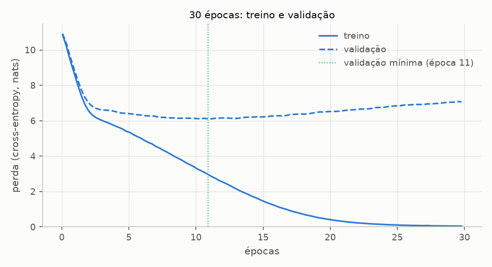
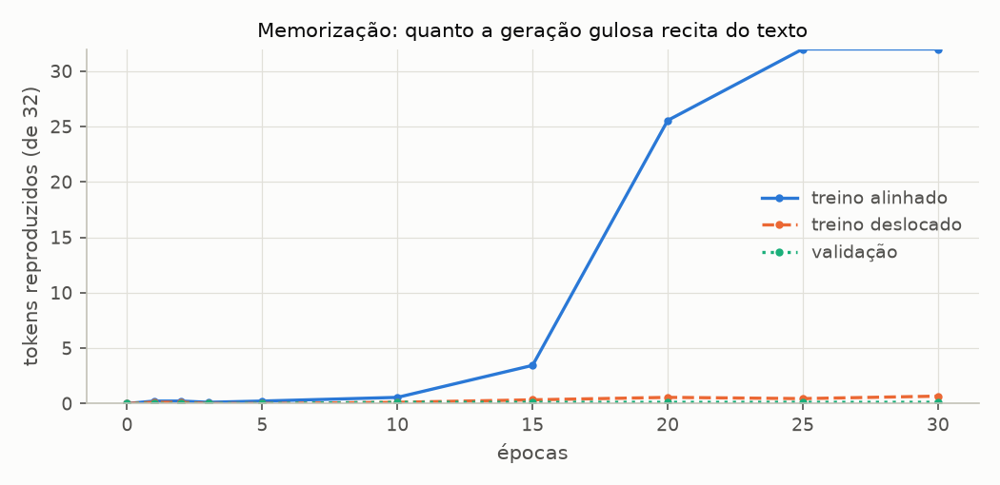
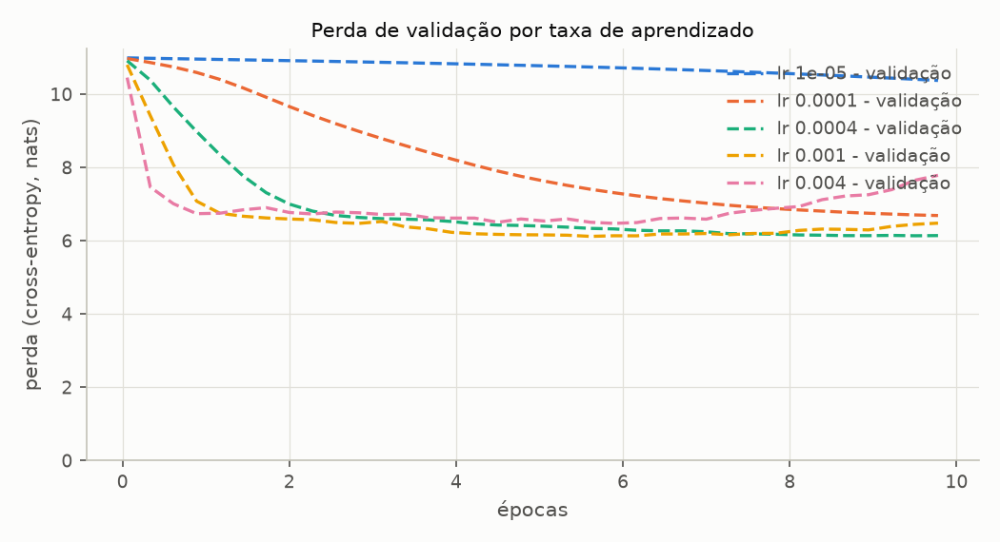
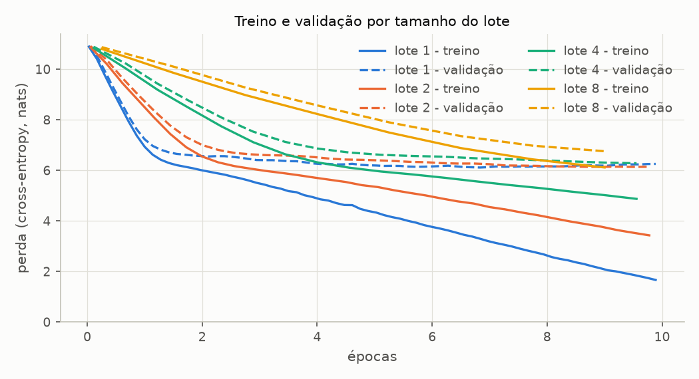
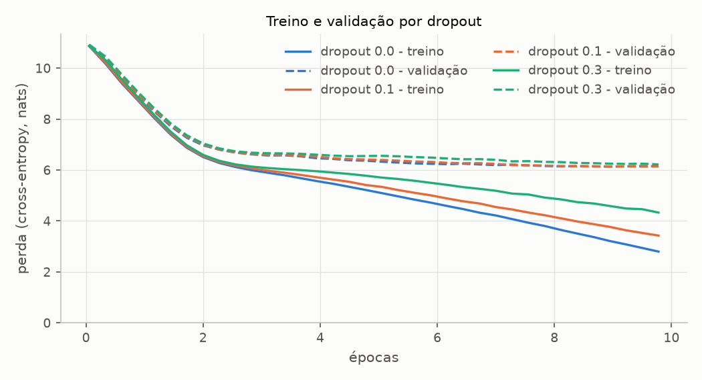
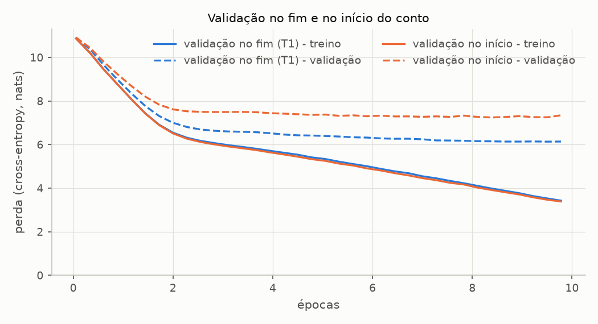
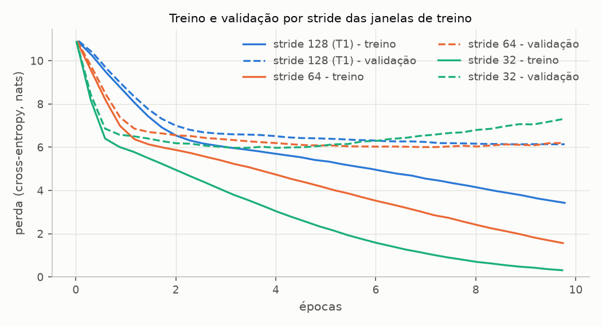

# Entregável 4 — Experimentos de treinamento

**O que cada escolha de treino muda, e quanto custa.** Cada experimento muda **um** hiperparâmetro do treino de referência e mantém os outros, e mede três coisas: a convergência (as perdas de treino e de validação ao longo do treino), a qualidade do texto gerado (as amostras, e quanto delas é cópia do texto de treino) e o custo computacional (tempo, passos, memória). As tabelas completas são geradas por [`treino_experimentos.py`](../../experimentos/sprint05/treino_experimentos.py) em [`treino.md`](../../experimentos/sprint05/resultados/treino.md) e não são editadas à mão; este documento interpreta os números de lá.

| Experimento | Muda | Seção |
| ----------- | ---- | ----- |
| T1 | nada (o treino de referência, em 3 seeds) | [Entregável 3](02-treinamento.md), seção 6, e seção 2 abaixo |
| T2 | número de épocas (até 30) | 3 |
| T3 | taxa de aprendizado | 4 |
| T4 | tamanho do lote | 5 |
| T5 | dropout e weight decay | 6 |
| T6 | qual trecho do conto é a validação | 7 |
| T7 | stride das janelas de treino | 8 |
| T8 | modelo e hardware (custo) | 9 |

---

## 1. Metodologia

**Treino de referência.** O `BASE_CONFIG` da Sprint 4 (28,9 milhões de parâmetros, contexto 128) com o `BASE_TRAINING_CONFIG`: AdamW com lr 4·10⁻⁴ e weight decay 0,1, lotes de 2 sequências, 10 épocas sobre o The Verdict (90% treino, 10% validação, janelas sem sobreposição), seed 42. São os hiperparâmetros do livro aplicados ao modelo do projeto. A única diferença em relação ao livro é a avaliação, que usa os conjuntos inteiros e não 5 lotes ([Entregável 3](02-treinamento.md), seção 3).

**Um hiperparâmetro por vez.** As variantes saem de `dataclasses.replace` sobre as duas configurações. Com a mesma seed, todas partem dos **mesmos pesos iniciais**, e as que não mexem nos dados (T3 a T5) veem as janelas na **mesma ordem** na primeira época. A diferença medida vem do hiperparâmetro alterado. Da segunda época em diante, a ordem pode divergir: o dropout consome o mesmo gerador, e com dropout 0 ele deixa de sortear.

**Medidas.**

| Medida | Definição |
| ------ | --------- |
| validação mínima | a menor perda de validação entre todas as avaliações (a cada 5 passos), e a época em que ocorreu |
| treino e validação finais | as perdas na última avaliação (passo 175 de 180, no treino de 10 épocas) |
| diferença | validação − treino: o tamanho do sobreajuste |
| maior cópia na amostra | o maior trecho contíguo da continuação gerada no fim do treino (50 tokens, decodificação gulosa) que aparece, token a token, no texto de treino |
| recitação (T2) | a partir de 32 tokens reais de um trecho, quantos dos 32 seguintes a geração gulosa reproduz antes do primeiro erro; média de 9 trechos em cada grupo: treino alinhado com as janelas, treino deslocado meia janela, validação |
| tempo | segundos de parede do treino inteiro, em CPU, com avaliações e amostras |

**Ruído.** O conjunto de validação tem 534 tokens. Antes de comparar variantes, o T1 mede quanto as perdas variam só com a seed (seção 2); diferenças menores que isso não são conclusivas.

**Reprodutibilidade.** Seeds fixas e CPU: rodar o script de novo reproduz todas as colunas, exceto as de tempo. O tempo é de uma máquina compartilhada (i5-13450HX, 10 threads do PyTorch): valem as razões entre linhas, não os valores absolutos.

---

## 2. O ruído de referência (T1)

**Configuração.** O treino de referência com as seeds 42, 123 e 7 ([Entregável 3](02-treinamento.md), seção 6).

**Resultado.** Validação mínima de 6,135, 6,113 e 6,166, sempre na época 10. O desvio entre seeds é **0,027** na validação mínima, 0,024 na final e 0,007 no treino final.

**Análise.** A seed muda os pesos iniciais, a ordem dos lotes e as máscaras de dropout, e mesmo assim a validação varia menos de 0,03. É essa a régua das seções seguintes: diferenças de validação abaixo de ~0,05 (cerca de 2 desvios) entre configurações não são conclusivas com uma execução só. A perda de treino varia ainda menos, porque é medida sobre 4 608 tokens, contra 512 da validação.

---

## 3. Número de épocas (T2)

**Configuração.** O T1 levado a 30 épocas. Em 10 pontos do treino, uma sonda de recitação mede a memorização em três grupos de 9 trechos. Os do treino **alinhado** começam onde começa uma janela do treino, nas mesmas posições em que o modelo os viu. Os do treino **deslocado** são os mesmos trechos 64 tokens adiante: o mesmo texto, em posições em que o modelo nunca o viu. O terceiro grupo vem da validação. Para cada trecho, a sonda dá ao modelo 32 tokens reais e conta quantos dos 32 seguintes a geração gulosa reproduz antes do primeiro erro.

**Resultado.** As 10 primeiras épocas deste treino **são** o T1: a maior diferença entre as 36 avaliações em comum é 0,0. Sem agendamento da taxa de aprendizado, o número de épocas não muda o caminho do treino, só onde ele para.

| Época | Treino | Validação | Diferença | Perplexidade validação | Recita: treino alinhado | Recita: treino deslocado | Recita: validação | Maior cópia na amostra |
| ----- | ------ | --------- | --------- | ---------------------- | ----------------------- | ------------------------ | ----------------- | ---------------------- |
| 1 | 8,765 | 8,980 | 0,22 | 7 939 | 0,2 | 0,1 | 0,0 | 0 |
| 2 | 6,546 | 7,000 | 0,46 | 1 097 | 0,2 | 0,1 | 0,0 | 2 |
| 3 | 6,068 | 6,635 | 0,57 | 761 | 0,1 | 0,0 | 0,0 | 1 |
| 5 | 5,414 | 6,416 | 1,00 | 612 | 0,2 | 0,0 | 0,0 | 4 |
| 10 | 3,429 | 6,140 | 2,71 | 464 | 0,6 | 0,1 | 0,1 | 4 |
| 15 | 1,532 | 6,215 | 4,68 | 500 | 3,4 | 0,3 | 0,1 | 7 |
| 20 | 0,434 | 6,511 | 6,08 | 672 | 25,6 | 0,6 | 0,1 | 35 |
| 25 | 0,109 | 6,835 | 6,73 | 930 | **32,0** | 0,4 | 0,1 | 50 |
| 30 | 0,043 | 7,067 | 7,02 | 1 173 | **32,0** | 0,7 | 0,1 | 50 |

A menor perda de validação é **6,106** (perplexidade 449), no passo 195, época 11.

**Análise — três fases.**

1. **Épocas 1 a 3: o que vale para o conto inteiro.** As duas perdas caem juntas, e a validação vai de 10,9 para 6,6.
2. **Épocas 4 a 11: a validação ainda melhora, devagar.** A perda de treino cai rápido; a de validação desce até o mínimo de 6,106 na época 11. A diferença entre as duas cresce de 0,6 (época 3) para 2,7 (época 10). É aqui que vale parar o treino.
3. **Épocas 12 a 30: o modelo decora.** A perda de treino vai a 0,043, perplexidade 1,04, certeza sobre cada próximo token do conto. A de validação sobe para 7,067 (perplexidade 1 173), pior que na época 3. Treinar 30 épocas custa três vezes o T1 e entrega um modelo pior para texto novo. A regra prática é parar pelo mínimo da validação (*early stopping*), e não pela perda de treino, que continua caindo até zero.

**Análise — qualidade do texto.** As amostras melhoram até o fim, e é aí que está a armadilha. Na época 15, o modelo já gera frases com sintaxe de inglês e o vocabulário do conto (`I wish you know I had to me with a little with a dozen, and my own the Russian in the end of Jack's open count`), e o maior trecho copiado tem só 7 tokens: são combinações novas. A partir da época 20, a continuação vira o mesmo trecho que o modelo do livro recita (`?" "Yes--quite insensible to the irony. She wanted him vindicated--and by me!"`). Nas épocas 25 e 30, os 50 tokens gerados são uma cópia literal do conto. O texto mais fluente é o decorado: fluência, aqui, não é generalização, e é a perda de validação que mostra o que a amostra esconde.

**Análise — a memorização tem endereço.** A sonda separa o que a perda média não mostra:

- Nos trechos do treino **alinhados**, a recitação salta de 0,6 tokens (época 10) para 25,6 (época 20) e 32 de 32 (épocas 25 e 30). O modelo reproduz o conto palavra por palavra.
- Nos **mesmos trechos deslocados** 64 tokens, ela fica abaixo de 1 em todas as épocas, tão perto de zero quanto na validação, que o modelo nunca viu.

Perda de treino 0,043, portanto, não quer dizer que o modelo "saiba" o conto: ele sabe o conto **nas posições em que o leu**. É a memorização de posições que o [AV4](01-avaliacao-do-modelo.md) mediu na perda, agora vista na geração. A cópia de 50 tokens na amostra segue a mesma regra. O trecho copiado começa no token 3 332 do texto de treino, a posição 4 da janela em que ele aparecia, e a continuação gerada também começa na posição 4. Essa janela abre com `she sent for you`. O prompt `Every effort moves you`, que não existe no conto, termina com o mesmo ` you` na mesma posição 3, e o modelo continua com o que vinha depois dele no treino.

---

## 4. Taxa de aprendizado (T3)

**Configuração.** O T1 com lr ∈ {10⁻⁵, 10⁻⁴, 4·10⁻⁴ (livro), 10⁻³, 4·10⁻³}, 10 épocas cada.

**Resultado.**

| lr | Validação no fim da época 1 | Validação mínima (época) | Treino final | Validação final | Diferença final | Maior cópia na amostra |
| -- | --------------------------- | ------------------------ | ------------ | --------------- | --------------- | ---------------------- |
| 10⁻⁵ | 10,958 | 10,374 (10) | 10,201 | 10,374 | 0,17 | 2 |
| 10⁻⁴ | 10,591 | 6,687 (10) | 6,068 | 6,687 | 0,62 | 2 |
| 4·10⁻⁴ | 8,980 | 6,135 (10) | 3,429 | 6,140 | 2,71 | 4 |
| 10⁻³ | 7,079 | **6,118 (6)** | 0,615 | 6,480 | 5,86 | 49 |
| 4·10⁻³ | 6,738 | 6,473 (6) | 0,837 | 7,785 | 6,95 | 5 |

**Análise — convergência.** A taxa de aprendizado decide a **velocidade**, e o melhor valor de validação ao alcance dela é limitado pelos dados. Três regimes:

- **Pequena demais (10⁻⁵, 10⁻⁴).** Com 10⁻⁵, o modelo mal sai do lugar: em 180 passos, a validação cai de 10,91 para 10,37, e a amostra final é uma sopa de tokens de todo o vocabulário (`theusion Fn ",treatment, correctional unauthorized`). Com 10⁻⁴, a validação ainda cai na época 10 (6,687), a diferença para o treino é pequena (0,62) e a amostra é `, the, the`: o modelo está subtreinado, não sobreajustado.
- **Na faixa (4·10⁻⁴, 10⁻³).** As duas chegam ao mesmo mínimo, 6,135 e 6,118, dentro do ruído de 0,027. A de 10⁻³ chega lá na época 6, com 40% menos passos. Depois disso, ela passa do ponto: a validação sobe para 6,480 e o treino cai para 0,615, e na época 10 a amostra é uma cópia de 49 tokens do conto (`I didn't know where to put it--_I had never known_. Only, with my sitters and my public...`).
- **Grande demais (4·10⁻³).** É a que mais cai na primeira época (6,738), mas o mínimo é pior (6,473), e o treino termina **acima** do de 10⁻³ (0,837 contra 0,615). Passos grandes demais atravessam o vale em vez de descer nele. Não há divergência: a perda de treino nunca sobe entre duas avaliações seguidas, em nenhuma taxa. A instabilidade aparece como um mínimo pior e um texto mais desconexo (`I didn't--I turned at the donkey, when I said.`), não como picos.

**Análise — custo.** As cinco variantes levam o mesmo tempo (51 a 61 s): a taxa não muda o custo de uma época, muda **quantas épocas** são necessárias. Com 10⁻³, o mínimo de validação custa 6 épocas em vez de 10. A taxa do livro é conservadora para este modelo, e a 10⁻³, combinada com parar na época 6, daria o mesmo resultado mais barato.

---

## 5. Tamanho do lote (T4)

**Configuração.** O T1 com lotes de 1, 2 (T1), 4 e 8 sequências, a mesma taxa de 4·10⁻⁴ e 10 épocas. Com `drop_last=True`, o lote de 8 usa 32 das 36 janelas por época.

**Resultado.**

| Lote | Passos por época | Passos no total | Validação no fim da época 1 | Validação mínima (época) | Treino final | Validação final | s por época (só treino) | Tokens/s |
| ---- | ---------------- | --------------- | --------------------------- | ------------------------ | ------------ | --------------- | ----------------------- | -------- |
| 1 | 36 | 360 | 7,224 | **6,112 (7)** | 1,664 | 6,254 | 4,20 | 1 097 |
| 2 | 18 | 180 | 8,980 | 6,135 (10) | 3,429 | 6,140 | 3,32 | 1 388 |
| 4 | 9 | 90 | 10,229 | 6,280 (10) | 4,872 | 6,280 | 2,44 | 1 890 |
| 8 | 4 | 40 | 10,874 | 6,756 (9) | 6,114 | 6,756 | 1,91 | 2 145 |

**Análise — convergência.** Com taxa e épocas fixas, dobrar o lote divide por dois o número de atualizações, e é isso que decide a convergência por época. O AdamW normaliza o passo: um lote maior dá um gradiente mais preciso, mas não um passo maior. Por isso o lote de 1 termina a primeira época com validação 7,22, e o de 8 mal saiu do lugar (10,87). O lote de 1 também chega antes ao melhor valor (6,112 na época 7, igual ao do T1 dentro do ruído) e passa do ponto até a época 10 (6,254). Os lotes de 4 e 8 ainda caíam no fim: com 90 e 40 passos, estão subtreinados. A diferença pequena entre treino e validação deles (1,41 e 0,64) é falta de treino, e não boa generalização.

**Análise — custo.** Lotes maiores aproveitam melhor a CPU: o débito sobe de 1 097 tokens/s (lote 1) para 2 145 (lote 8), quase o dobro, porque as multiplicações de matriz ficam maiores e o custo fixo de cada passo se dilui. Medido até o mínimo de validação, porém, o lote de 1 (7 épocas × 4,20 s ≈ 29 s) e o de 2 (10 × 3,32 s ≈ 33 s) custam quase o mesmo. Para os lotes grandes compensarem, a taxa de aprendizado teria que subir junto, a prática comum ao aumentar o lote; isso não foi testado, porque o T4 muda uma variável por vez.

---

## 6. Regularização: dropout e weight decay (T5)

**Configuração.** O T1 variando um regularizador de cada vez: dropout ∈ {0; 0,1; 0,3} (nas três posições do modelo) e weight decay ∈ {0; 0,1; 1,0}.

**Resultado.**

| Variante | Treino final | Validação mínima (época) | Validação final | Diferença final | Maior cópia na amostra |
| -------- | ------------ | ------------------------ | --------------- | --------------- | ---------------------- |
| dropout 0 | 2,800 | 6,138 (9) | 6,150 | 3,35 | 6 |
| dropout 0,1 (T1) | 3,429 | 6,135 (10) | 6,140 | 2,71 | 4 |
| dropout 0,3 | 4,331 | 6,221 (10) | 6,221 | 1,89 | 3 |
| weight decay 0 | 3,381 | 6,138 (10) | 6,143 | 2,76 | 5 |
| weight decay 0,1 (T1) | 3,429 | 6,135 (10) | 6,140 | 2,71 | 4 |
| weight decay 1,0 | 3,830 | 6,126 (10) | 6,128 | 2,30 | 3 |

**Análise.** Os dois regularizadores fazem o que prometem com a **diferença** entre treino e validação: mais dropout leva a diferença de 3,35 para 1,89, e mais weight decay, de 2,76 para 2,30. Mas a diferença diminui porque o **treino piora**, e não porque a validação melhora. A perda de treino final sobe de 2,80 para 4,33 com o dropout, enquanto a validação mínima fica igual (6,138 e 6,135, dentro do ruído) ou piora um pouco (6,221 com dropout 0,3, que aprende mais devagar e ainda caía na época 10).

O weight decay é ainda mais fraco neste treino. Com lr 4·10⁻⁴, o fator de encolhimento por passo é 1 − lr·wd: os pesos encolhem 0,7% em 180 passos com wd 0,1, e 7% com wd 1,0. As três validações mínimas (6,138, 6,135 e 6,126) cabem no ruído entre seeds.

A conclusão vale para este regime, 10 épocas sobre 4 612 tokens: **regularizar adia a memorização, mas não cria informação que o corpus não tem**. O melhor valor de validação fica em ~6,1 com ou sem regularização. Num treino mais longo, que passa do mínimo como o T2, o dropout talvez segurasse a subida da validação; isso não foi medido.

---

## 7. Treino x validação: qual trecho é a validação (T6)

**Configuração.** O T1 com a validação tirada do **começo** do conto em vez do fim. O texto é girado em 2 048 caracteres e cortado como sempre, e o treino passa a ser todo o resto.

**Resultado.**

| Validação | Validação no passo 0 | Validação mínima (época) | Treino final | Validação final | Diferença final |
| --------- | -------------------- | ------------------------ | ------------ | --------------- | --------------- |
| fim do conto (T1) | 10,913 | 6,135 (10) | 3,429 | 6,140 | 2,71 |
| começo do conto | 10,917 | 7,247 (9) | 3,388 | 7,345 | 3,96 |

**Análise.** O mesmo modelo, com o mesmo treino, chega a perdas de validação que diferem em **1,1 nat** conforme o trecho que fica de fora: perplexidade ~1 400 com o começo, ~460 com o fim. As curvas de treino são quase iguais (3,388 e 3,429), e o ponto de partida também (10,917 e 10,913). A diferença não vem do modelo, e sim do trecho. Também não vem de nomes que o treino não tem: os dois trechos compartilham personagens com o resto do conto (Gisburn aparece 6 vezes nos 10% iniciais e 14 no meio; Stroud, 7 nos finais e 12 no meio).

Daí duas conclusões. Primeiro, o sobreajuste é real nos dois cortes: a validação estaciona enquanto o treino segue caindo, e a diferença final passa de 2,7 em ambos. Segundo, **o valor absoluto da perda de validação depende do trecho escolhido**, numa escala (1,1) 40 vezes maior que o ruído entre seeds (0,027). As comparações entre configurações continuam válidas, porque todas usam o mesmo corte. Mas "perplexidade de validação 460" descreve o modelo **neste** desfecho do conto, e não a sua capacidade de prever texto em inglês. Com 534 tokens de validação, não há como separar as duas coisas.

---

## 8. Janelas sobrepostas e a memorização de posições (T7)

**Configuração.** O [AV4](01-avaliacao-do-modelo.md) mostrou que o modelo de referência tem perda 3,3 no texto de treino recortado nas janelas em que treinou e ~4,4 no mesmo texto recortado em janelas deslocadas. Com `stride = 128`, cada token do conto ocupa sempre a mesma posição da janela, em todas as épocas. O T7 treina com janelas sobrepostas (stride 64 e 32): cada token passa a aparecer em 2 e em 4 posições diferentes. Depois mede a perda do texto de treino na grade das janelas do treino e na mesma grade deslocada 16 tokens, uma posição que nenhum dos três strides viu.

**Resultado.**

| Stride | Janelas por época | Passos | Validação mínima (época) | Validação com 45 056 tokens vistos | Validação final | Treino, grade do treino | Treino, grade deslocada | Diferença entre grades |
| ------ | ----------------- | ------ | ------------------------ | ---------------------------------- | --------------- | ----------------------- | ----------------------- | ---------------------- |
| 128 (T1) | 36 | 180 | 6,135 (10) | 6,140 | 6,140 | 3,319 | 4,580 | 1,26 |
| 64 | 71 | 350 | 6,007 (8) | 6,076 | 6,200 | 1,476 | 3,236 | 1,76 |
| 32 | 141 | 700 | **5,974 (4)** | 6,072 | 7,297 | 0,290 | 2,584 | 2,29 |

**Análise — generalização.** Janelas sobrepostas funcionam como aumento de dados: o mesmo texto aparece em contextos e posições diferentes. Com o **mesmo custo** (45 056 tokens processados), a validação melhora de 6,140 para ~6,07. O melhor valor de todos os experimentos é o do stride 32, 5,974 na época 4, 0,13 abaixo do melhor do T2 com stride 128 (6,106), cerca de 5 vezes o ruído entre seeds. O preço é que cada época passa por cada token 2 ou 4 vezes, e o sobreajuste chega antes **em épocas**: com stride 32, o mínimo é na época 4, e na 10 a validação já está em 7,30 e a amostra é uma cópia de 50 tokens.

**Análise — posições.** A hipótese de que a sobreposição acabaria com a memorização de posições **não se confirmou**. A perda na grade deslocada cai muito (4,58 → 2,58): o modelo passa a conhecer o texto em mais posições. Mas a perda na grade do treino cai mais ainda (3,32 → 0,29), e a diferença entre as duas cresce de 1,26 para 2,29. O modelo continua decorando o texto **nas posições em que o viu**. A sobreposição multiplica essas posições, mas não as torna irrelevantes. Contra isso, o caminho seria outro: um corpus maior, em que o mesmo trecho não se repete época após época, ou começos de janela sorteados a cada época, que não foram testados.

---

## 9. Custo computacional (T8)

**Configuração.** Um passo de treino completo (forward, backward e AdamW) com lotes de 2 sequências cheias, no modelo do projeto e no do livro, em CPU e na GPU da máquina (RTX 3050 de 6 GB): mediana de 10 passos depois de 3 de aquecimento. A memória do estado de treino conta pesos, gradientes e os dois momentos do AdamW, 16 bytes por parâmetro em float32, sem as ativações. Os FLOPs contam as multiplicações de matriz, com o backward valendo dois forwards.

**Resultado.**

| Modelo | Device | Estado de treino | Pico na GPU | GFLOP por passo | ms por passo | Tokens/s | GFLOP/s |
| ------ | ------ | ---------------- | ----------- | --------------- | ------------ | -------- | ------- |
| `BASE_CONFIG` (28,9 M) | CPU | 441 MB | — | 25,0 | 155 | 1 651 | 161 |
| `BASE_CONFIG` (28,9 M) | GPU | 441 MB | 577 MB | 25,0 | 33 | 7 794 | 761 |
| `BOOK_MODEL_CONFIG` (162,4 M) | CPU | 2 478 MB | — | 394,0 | 1 808 | 283 | 218 |
| `BOOK_MODEL_CONFIG` (162,4 M) | GPU | 2 478 MB | 3 139 MB | 394,0 | 236 | 2 171 | 1 670 |

| Avaliação (treino + validação) | ms |
| ------------------------------ | -- |
| 5 lotes (livro) | 194 |
| conjuntos inteiros (projeto) | 572 |

**Análise — modelo.** O modelo do livro tem 5,6 vezes mais parâmetros e custa 15,8 vezes mais operações por passo, porque também processa janelas de 256 tokens em vez de 128. Em CPU, ele leva 11,7 vezes mais tempo por passo: a CPU aproveita melhor as matrizes grandes (218 contra 161 GFLOP/s), e isso compensa parte da diferença. O estado de treino passa de 441 MB para 2,5 GB, o que explica o cuidado de memória do teste dos checkpoints do livro. Na prática, as 10 épocas do livro levam 223 s ([`livro.md`](../../experimentos/sprint05/resultados/livro.md)), contra 61 s do T1.

**Análise — hardware.** A GPU é 4,7 vezes mais rápida no modelo base e 7,7 vezes no do livro. Ela também rende mais com matrizes maiores (761 contra 1 670 GFLOP/s): o modelo base é pequeno demais para ocupar a placa. O pico de memória do modelo do livro, 3,1 GB com as ativações, cabe nos 6 GB da RTX 3050. Ainda assim, todos os relatórios usam a CPU, porque é nela que o projeto reproduz os números do livro e é ela que todo integrante tem. Treinar em GPU daria perdas diferentes a partir da 3ª ou 4ª casa.

**Análise — observar custa.** No T1, o passo de treino custou 185 ms em média, e avaliações e amostras ficaram com **45%** do tempo das épocas. Avaliar os conjuntos inteiros custa 3 vezes avaliar 5 lotes, como faz o livro. Neste corpus, a troca vale a pena: as curvas são exatas, e a análise de sobreajuste depende delas. Num corpus de verdade, seria o primeiro custo a cortar.

**Análise — custo dos experimentos.** O que muda o custo de um treino é o **número de passos e o tamanho de cada passo**, e não a taxa de aprendizado nem a regularização. As cinco taxas do T3 e as variantes do T5 levam praticamente o mesmo tempo (49 a 61 s). O lote muda o custo por época (T4), e o stride o multiplica (T7: 61, 95 e 185 s). O script inteiro, com 18 treinos, leva ~23 minutos em CPU.

---

## 10. Conclusões

1. **O laço de treino funciona e está verificado.** Ele reproduz o treino do livro número a número (45 de 45 comparações), e no modelo do projeto as duas perdas caem de forma monótona até a época 10, com variação de 0,027 entre seeds.
2. **O limite está nos dados, não no modelo.** Com o corte do livro, a melhor validação do modelo base é 6,106 (perplexidade ~450), praticamente a mesma do GPT de 124M (6,134). Nenhuma taxa, lote ou regularizador dentro da faixa razoável ficou abaixo de ~6,1; só mudar a forma de recortar os dados (T7) chegou a 5,97.
3. **O sobreajuste começa cedo e é visível nas três medidas.** A diferença entre treino e validação passa de 0,5 na época 3. A validação para de melhorar na época 11. Depois disso, o modelo recita o conto: 32 de 32 tokens nos trechos alinhados e amostras que são cópias de 50 tokens. Mais épocas tornam o texto mais fluente e o modelo pior, e a decisão de parar tem que vir da validação.
4. **A taxa de aprendizado decide a velocidade.** A do livro (4·10⁻⁴) é conservadora para este modelo: 10⁻³ chega ao mesmo mínimo com 40% menos passos, e 4·10⁻³ já piora o mínimo. Taxas de 10⁻⁵ e 10⁻⁴ subtreinam em 10 épocas.
5. **O lote troca atualizações por débito.** Lotes menores aprendem mais por época e lotes maiores processam até 2 vezes mais tokens por segundo. Com taxa fixa, o custo até o mínimo de validação fica parecido entre os lotes de 1 e 2.
6. **Regularizar adia a memorização, mas não melhora o melhor resultado.** Dropout e weight decay reduzem a diferença entre treino e validação piorando o treino; a validação mínima fica dentro do ruído.
7. **O trecho de validação pesa mais que qualquer hiperparâmetro razoável.** Trocar o fim do conto pelo começo muda a perda de validação em 1,1 nat, 40 vezes o ruído entre seeds. As comparações entre configurações valem; o número absoluto descreve o desfecho do conto, não o inglês.
8. **A memorização tem endereço.** O modelo decora o texto nas posições da janela em que o viu (AV4, T2, T7). Janelas sobrepostas dão a melhor validação de todos os experimentos (5,974), mas não removem esse efeito.
9. **Custo.** A GPU é 4,7 a 7,7 vezes mais rápida, e o modelo do livro custa 11,7 vezes mais por passo que o do projeto em CPU. No treino de referência, monitorar o treino custa 45% do tempo.

Os experimentos sugerem uma configuração melhor que a de referência para este corpus: janelas sobrepostas ou taxa de 10⁻³, com parada pelo mínimo da validação (época 4 com stride 32, época 6 com lr 10⁻³). Cada uma foi medida isoladamente; a combinação das duas não foi testada.

---

## 11. Limitações

- **Uma execução por configuração.** Só o treino de referência foi repetido com outras seeds. Diferenças de validação abaixo de ~0,05 entre variantes não são conclusivas.
- **Dez épocas para quase todas as variantes.** Algumas ainda melhoravam no fim (lr 10⁻⁴, lotes de 4 e 8, dropout 0,3). O melhor valor delas não foi medido, e a comparação é "em 10 épocas", não "no melhor ponto de cada uma".
- **Um conto, um corte, 534 tokens de validação.** O T6 mostra que o trecho validado move a perda em 1,1 nat, mais que qualquer hiperparâmetro dentro da faixa razoável.
- **Sem agendamento da taxa e sem gradient clipping**, como no `train_model_simple` do livro.
- **Qualidade de texto medida por inspeção e por cópia.** As amostras são gulosas e de um contexto só; não há avaliação humana nem métrica de coerência. Estratégias de geração (temperatura, top-k) são o Entregável 5.
- **Tempo numa máquina compartilhada.** Execuções equivalentes variam até ~20% (49 a 61 s nos treinos de 10 épocas do T5).
