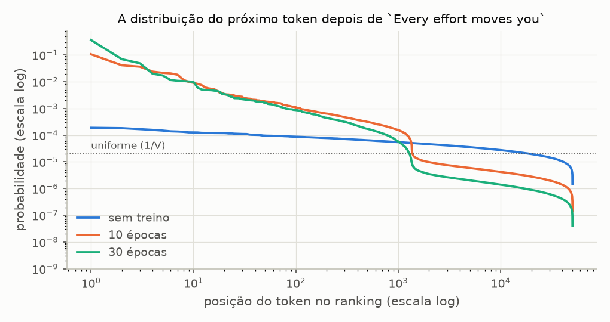
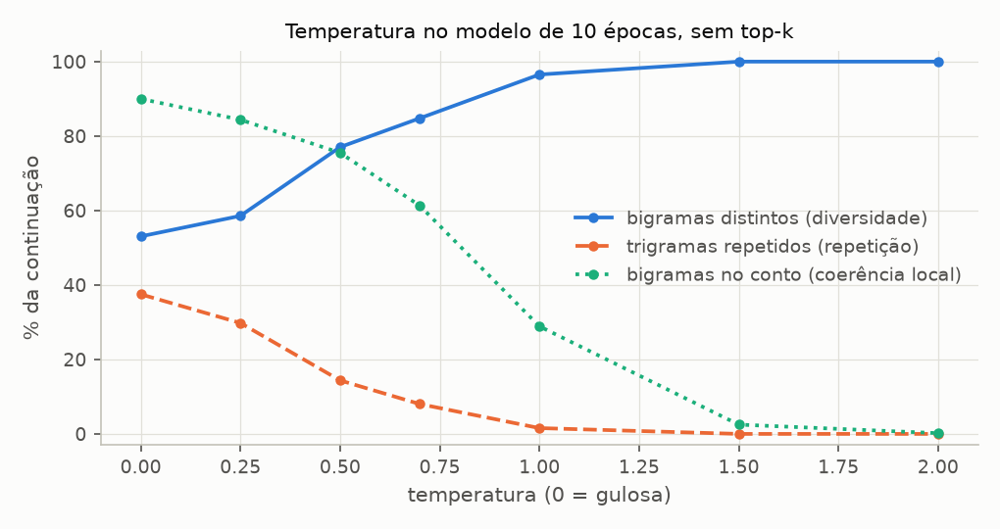
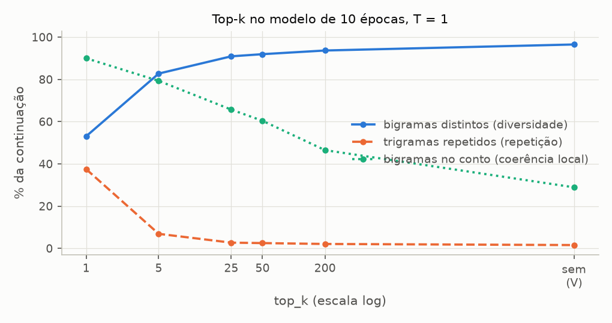
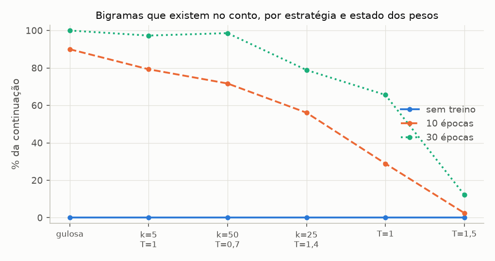

# Entregável 5 — Estratégias de geração de texto

**A estratégia redistribui a probabilidade; quem a fornece é o treino.** Este documento compara a decodificação gulosa, a amostragem, a temperatura e o top-k a partir do mesmo contexto, e mede em cada texto gerado a diversidade, a repetição e a coerência. Para separar o efeito da estratégia do efeito dos pesos, cada estratégia roda sobre três estados do mesmo modelo: sem treino, com 10 épocas e com 30. O código de decodificação é o da Sprint 4, [`src/generation/`](../../src/generation/), sem alteração. As tabelas completas são geradas por [`geracao_experimentos.py`](../../experimentos/sprint05/geracao_experimentos.py) em [`geracao.md`](../../experimentos/sprint05/resultados/geracao.md) e não são editadas à mão; este documento interpreta os números de lá.

| Experimento | Pergunta | Seção |
| ----------- | -------- | ----- |
| D1 | Que distribuição cada estratégia recebe, antes e depois do treino? | 3 |
| D2 | Com os mesmos pesos, o que muda quando só a estratégia muda? | 4 |
| D3 | O que a temperatura faz com o texto? | 5 |
| D4 | O que o top-k faz que a temperatura não faz? | 6 |
| D5 | O que é efeito da estratégia e o que é efeito do treino? | 7 |

---

## 1. As estratégias

O modelo devolve, para a última posição do contexto, um logit por token do vocabulário. A estratégia de decodificação é o que acontece entre esse vetor e o token escolhido ([Sprint 4, Entregável 4](../sprint04/03-inferencia-e-geracao.md), seção 2). São quatro mecanismos, todos em `generate`:

| Estratégia | O que faz com a distribuição | Em `generate` |
| ---------- | ---------------------------- | ------------- |
| Gulosa | ignora a distribuição: escolhe o token de maior logit | `temperature=0` (padrão) |
| Amostragem | sorteia o token com a probabilidade que o modelo lhe deu | `temperature=1` |
| Temperatura | divide os logits por T antes do softmax: T < 1 concentra, T > 1 achata | `temperature=T` |
| Top-k | zera a probabilidade de tudo que não está entre os k maiores logits | `top_k=k` |

Os experimentos usam seis combinações, da mais para a menos determinística: gulosa; top-k 5 com T = 1; top-k 50 com T = 0,7; top-k 25 com T = 1,4, a que o livro usa na seção 5.3.3; T = 1 sem top-k, a amostragem pura; e T = 1,5 sem top-k. As cinco primeiras e a última são as do G5 da Sprint 4, medidas lá no modelo sem treino.

---

## 2. Metodologia

**Pesos × estratégia.** Um único treino (o de referência: `BASE_CONFIG`, `BASE_TRAINING_CONFIG`, seed 42) fornece três estados dos mesmos pesos. O script treina 10 épocas, copia os pesos e segue por mais 20 com o mesmo otimizador.

| Estado | O que é | Perda de treino | Perda de validação | Perplexidade de validação |
| ------ | ------- | --------------- | ------------------ | ------------------------- |
| sem treino | os pesos sorteados pela seed: o modelo dos G1 a G7 da Sprint 4 | 10,971 | 10,992 | 59 385 |
| 10 épocas | o [T1](02-treinamento.md), com a validação perto do mínimo | 3,319 | 6,119 | 455 |
| 30 épocas | o fim do [T2](03-experimentos-de-treinamento.md), com o conto decorado | 0,041 | 7,065 | 1 170 |

O script confere a última avaliação das épocas 10 e 30 com as publicadas em `treino.md` (3,429 / 6,140 e 0,043 / 7,067): as duas conferem. São os mesmos pesos dos Entregáveis 3 e 4, e o que este documento diz sobre o texto gerado vale para aqueles modelos.

**O mesmo contexto.** Toda geração parte de `Every effort moves you`, o contexto do livro e das amostras do treino, e produz 50 tokens. As estratégias que sorteiam geram 20 continuações num lote, com um `torch.Generator` de seed 42, e as tabelas trazem a média das 20. A gulosa gera uma só, porque não sorteia.

**Medidas.** Todas sobre a continuação, sem o contexto.

| Eixo | Medida | Definição |
| ---- | ------ | --------- |
| Diversidade | bigramas distintos | pares de tokens vizinhos diferentes sobre o total: 100% se nenhum par se repete |
| Diversidade | continuações diferentes | quantas das 20 continuações são textos distintos |
| Repetição | trigramas repetidos | fração dos trigramas que já tinham aparecido antes no mesmo texto |
| Repetição | maior repetição | a maior sequência do mesmo token em seguida |
| Coerência | tokens nunca vistos | fração dos tokens gerados que não aparecem nenhuma vez no texto de treino |
| Coerência | bigramas no conto | fração dos pares vizinhos que existem em algum lugar do The Verdict |
| Coerência | log-prob média | média de ln p(token) segundo o próprio modelo (T = 1, sem top-k) |
| Cópia | maior cópia do treino | o maior trecho contíguo que aparece, token a token, no texto de treino |

**Coerência é medida por aproximação.** Não há avaliação humana nem métrica de sentido. "Bigramas no conto" mede plausibilidade local: se dois tokens vizinhos aparecem juntos no conto, aquela junção é inglês válido. "Tokens nunca vistos" mede o oposto: um token que o treino nunca mostrou só pode ter saído do ruído dos pesos iniciais. A "maior cópia" existe para separar duas coisas que as outras confundem: um texto pode ser plausível porque o modelo combinou pedaços, ou porque recitou. As medidas valem lidas junto com as amostras, que este documento transcreve.

**Ruído.** Entre as 20 continuações de uma estratégia, os bigramas no conto têm desvio-padrão de 5 a 8 pontos percentuais e os bigramas distintos, de 4 a 10. A média de 20 tem, portanto, um erro de 1 a 2 pontos: diferenças de 5 pontos ou mais entre duas estratégias são do método, não do sorteio.

**Reprodutibilidade.** Seeds fixas e CPU: rodar o script de novo reproduz todos os números. Leva 13 a 14 minutos num Intel Core 5 220U, 7 de treino e 6 a 7 de geração. Duas execuções seguidas deram relatórios idênticos, exceto pela linha de tempo.

---

## 3. A distribuição que cada estratégia recebe (D1)

**Configuração.** A distribuição do próximo token, sem ajuste nenhum (T = 1, sem top-k), nos três estados: na última posição de `Every effort moves you` e na média das 512 posições do conjunto de validação.

**Resultado.**

| Estado | Token mais provável | Maior probabilidade | Candidatos efetivos (e^entropia) | Tokens para 90% da massa | Massa nunca vista |
| ------ | ------------------- | ------------------- | -------------------------------- | ------------------------ | ----------------- |
| sem treino | `' ski'` | 0,0002 | 42 569 | 38 133 | 97,2% |
| 10 épocas | `' know'` | 0,107 | 868 | 6 843 | 14,0% |
| 30 épocas | `'?"'` | 0,367 | 89 | 575 | 4,6% |

Na média da validação, os candidatos efetivos são 42 543, 302 e 39, e a massa nunca vista, 97,3%, 7,4% e 2,5%.



**Análise — o treino concentra.** Sem treino, a distribuição é quase plana: 42 569 candidatos efetivos num vocabulário de 50 257, e o token mais provável tem 0,02%. Depois de 10 épocas são 868 candidatos, e depois de 30, 89. É essa concentração que dá às estratégias algo com que trabalhar. No modelo sem treino, escolher o mais provável, sortear entre os 5 mais prováveis ou sortear entre todos são três maneiras de pegar um token ao acaso.

**Análise — a cauda.** O texto de treino usa **1 360 tokens diferentes** dos 50 257 do vocabulário. Os outros 48 897 nunca apareceram, nem como entrada nem como alvo. O treino os empurra para baixo em bloco, e a figura mostra isso como um degrau exatamente nessa posição do ranking: até o token 1 360 a curva desce devagar, e dali em diante cai uma ordem de grandeza e fica plana. A fronteira é quase exata: no modelo de 10 épocas, dos 1 360 primeiros do ranking neste contexto, 1 357 são tokens do texto de treino, e o token nunca visto mais provável está na posição 1 356. Na validação, o melhor nunca visto nunca aparece antes da posição 1 310 (mediana 1 359); no modelo de 30 épocas, nunca antes da 1 018. Cada um desses tokens tem probabilidade minúscula, mas são 48 897. Somados, ficam com 14,0% da probabilidade depois de 10 épocas neste contexto, e 7,4% na média da validação. A amostragem pura sorteia um token que o modelo nunca viu **uma vez a cada 7** aqui, e uma a cada 13 em média. Sem treino, essa massa é 97,2%, a fração do vocabulário que eles ocupam (48 897 / 50 257 = 97,3%): o modelo ainda não distingue os dois grupos.

**Análise — o que o top-k mantém e o que ele custa.** Na validação, "massa" é a probabilidade somada dos k tokens mantidos, e "alvo dentro" é a fração das posições em que o token que de fato vem a seguir está entre eles:

| top_k | 10 épocas: massa / alvo dentro | 30 épocas: massa / alvo dentro |
| ----- | ------------------------------ | ------------------------------ |
| 1 | 17,8% / 11,9% | 39,5% / 11,7% |
| 5 | 32,5% / 25,2% | 57,1% / 22,3% |
| 50 | 54,4% / 56,1% | 76,8% / 46,1% |
| 1 000 | 89,4% / 86,1% | 96,6% / 84,4% |

No modelo de 10 épocas, as duas colunas andam juntas: os 50 primeiros somam 54% da probabilidade e contêm o token certo em 56% das posições. O modelo está razoavelmente calibrado, e o top-k descarta o que ele mesmo considera improvável. No de 30 épocas, as colunas se separam: 77% da massa nos 50 primeiros, com o alvo entre eles em só 46% das vezes, **menos** que na época 10. É o sobreajuste visto na distribuição. O modelo ficou mais confiante e menos certo, e o top-k passa a cortar o token correto com mais frequência. O `top_k = 1`, que é a gulosa, acerta o próximo token da validação em 11,9% das posições, o mesmo acerto top-1 do [AV3](01-avaliacao-do-modelo.md).

**Análise — a temperatura age sobre a cauda.** Candidatos efetivos na última posição do contexto:

| Temperatura | sem treino | 10 épocas | 30 épocas |
| ----------- | ---------- | --------- | --------- |
| 0,5 | 25 982 | 5 | 1 |
| 0,7 | 35 848 | 31 | 4 |
| 1 | 42 569 | 868 | 89 |
| 1,5 | 46 674 | 15 385 | 7 097 |
| 2 | 48 207 | 32 334 | 25 377 |

Entre T = 0,5 e T = 1,5, o número de candidatos do modelo sem treino cresce 1,8 vez. No de 10 épocas, vai de 5 para 15 385, cerca de 3 000 vezes. A temperatura multiplica as diferenças entre logits, e o modelo treinado tem diferenças grandes para multiplicar. O efeito, porém, não é simétrico. Abaixo de 1, ela aperta a distribuição sobre os poucos tokens do topo. Acima de 1, ela devolve probabilidade justamente aos 48 897 tokens da cauda: com T = 1,5, o modelo treinado volta a ter 15 mil candidatos, e quase todos são tokens que ele nunca viu.

---

## 4. Estratégias lado a lado (D2)

**Configuração.** As seis estratégias sobre o modelo de 10 épocas.

**Resultado.**

| Estratégia | Bigramas distintos | Trigramas repetidos | Tokens nunca vistos | Bigramas no conto | Log-prob média | Maior cópia do treino | Continuações diferentes |
| ---------- | ------------------ | ------------------- | ------------------- | ----------------- | -------------- | --------------------- | ----------------------- |
| gulosa | 53,1% | **37,5%** | 0,0% | **90,0%** | −1,917 | 4,0 | 1 de 1 |
| top-k 5, T = 1 | 82,8% | 6,9% | 0,0% | 79,3% | −2,530 | 4,9 | 20 de 20 |
| top-k 50, T = 0,7 | 80,4% | 10,4% | 0,0% | 71,7% | −2,739 | 4,7 | 20 de 20 |
| top-k 25, T = 1,4 (livro) | 95,1% | 0,9% | 0,0% | 56,1% | −3,635 | 4,0 | 20 de 20 |
| T = 1, sem top-k | 96,5% | 1,6% | 7,2% | 28,9% | −5,488 | 3,6 | 20 de 20 |
| T = 1,5, sem top-k | **100,0%** | 0,0% | **39,3%** | 2,5% | −9,636 | 1,7 | 20 de 20 |

A primeira continuação de cada uma (`Every effort moves you` + 50 tokens; as quebras de linha aparecem como espaços):

| Estratégia | Texto |
| ---------- | ----- |
| gulosa | `know. "I have to me--and that I had been the fact.        "I.     "I. "I I had been the Riv it, and in the picture` |
| top-k 5, T = 1 | `know. "--as to I had not that I felt of it was not. "I had not to me, with the to have. "I looked was a had been his pictures. Gisburn. I me to` |
| top-k 50, T = 0,7 | `know. "'t bear't you get it--and that- he was not.         He her through of it'sI'd was the to me--I.    "I me to` |
| top-k 25, T = 1,4 | `! She at me't an't an: not--- that- he was I. " one of the hisisburn. I couldn for the moment the him, on the to me."  "Well--as of, so.` |
| T = 1, sem top-k | `frame. happened think't followed't painted myself claimed the breathing tently out of time quality 2021. shecing not his holding culicated going her he't as the curtains peopleWhen on nearhadond When sent are.  "Amid, when` |
| T = 1,5, sem top-k | `Juno it happened think'tforestation Only, myself claimedinlineCC sourcedently NULLigned time quality 2021 eng overwhelmed manners not Panzer holding culicated going her he canonicalIt the curtains peopleWhenauts nearhad ABC When Dism are hall Coral hide sprungAmid Match Mountains` |

**Análise — diversidade.** A gulosa tem um texto só, e dentro dele quase metade dos bigramas é repetição (53,1% distintos). Qualquer sorteio resolve as duas coisas: as 20 continuações saem diferentes em todas as estratégias sorteadas, e os bigramas distintos passam de 80%. A diversidade entre execuções cresce na ordem esperada. No primeiro token gerado, as 20 continuações usam 4 tokens diferentes com top-k 5, 9 com top-k 50 e T = 0,7, 15 com a configuração do livro, 19 com a amostragem pura e 20 com T = 1,5.

**Análise — repetição.** O laço é da gulosa: 37,5% dos trigramas repetem um anterior, e a maior sequência do mesmo token tem 8, uma fila de quebras de linha. O texto entra em `"I.` seguido de linhas em branco e não sai. O mecanismo é o do argmax: o mesmo contexto leva sempre ao mesmo token, e basta o modelo cair num estado que já visitou para repetir o caminho. O sorteio quebra o ciclo. Com top-k 5 a repetição cai para 6,9%, e com a configuração do livro, para 0,9%. Baixar a temperatura traz o laço de volta: top-k 50 com T = 0,7 repete mais (10,4%) que top-k 5 com T = 1 (6,9%), embora tenha dez vezes mais candidatos.

**Análise — coerência.** Nenhum dos seis textos é coerente no sentido de dizer alguma coisa. Com perda de validação 6,1, o modelo conhece o vocabulário do conto e quais palavras andam juntas, e não monta uma frase. O que as estratégias mudam é o quanto do texto é feito desse material:

- Com **top-k**, qualquer que seja o k até 50, nenhum token gerado está fora do vocabulário do treino, e de 56% a 79% dos bigramas existem no conto. Os textos são colagens de pedaços reconhecíveis: `I had not`, `his pictures`, `Gisburn`, `for the moment`.
- Na **amostragem pura**, 7,2% dos tokens nunca foram vistos no treino: `2021`, `peopleWhen`, `Amid`. É a massa de 7,4% do D1, agora no texto. Cada um deles também estraga o contexto dos tokens seguintes, e os bigramas no conto caem para 28,9%.
- Com **T = 1,5**, 39,3% dos tokens são da cauda, e 2,5% dos bigramas existem no conto. O texto é indistinguível do de um modelo sem treino (seção 7).

A gulosa tem os números mais altos de coerência local (90,0%) e a maior log-prob. As duas medidas premiam o laço: `"I.` é um trecho válido do conto todas as vezes que aparece. Por isso a coerência local só diz algo lida ao lado da repetição.

**Análise — cópia.** Em nenhuma estratégia o maior trecho copiado do treino passa de 5 tokens. O modelo de 10 épocas não recita, com ou sem sorteio. A cópia é assunto do modelo de 30 épocas (seção 7).

---

## 5. Temperatura (D3)

**Configuração.** O modelo de 10 épocas, sem top-k, com T de 0 (gulosa) a 2.

**Resultado.**

| Temperatura | Bigramas distintos | Trigramas repetidos | Tokens nunca vistos | Bigramas no conto | Log-prob média |
| ----------- | ------------------ | ------------------- | ------------------- | ----------------- | -------------- |
| 0 (gulosa) | 53,1% | 37,5% | 0,0% | 90,0% | −1,917 |
| 0,25 | 58,6% | 29,8% | 0,0% | 84,4% | −2,023 |
| 0,5 | 77,0% | 14,4% | 0,0% | 75,5% | −2,511 |
| 0,7 | 84,8% | 8,0% | 0,6% | 61,3% | −3,327 |
| 1 | 96,5% | 1,6% | 7,2% | 28,9% | −5,488 |
| 1,5 | 100,0% | 0,0% | 39,3% | 2,5% | −9,636 |
| 2 | 100,0% | 0,0% | 64,2% | 0,2% | −11,574 |



**Análise.** A temperatura é um botão só, e ele troca repetição por ruído. De 0 a 2, os trigramas repetidos caem de 37,5% para 0, e os bigramas no conto, de 90,0% para 0,2%. As duas curvas descem juntas, e não há temperatura em que a primeira já tenha caído e a segunda ainda não:

- Em T = 0,25, o texto ainda é quase o da gulosa: 29,8% de repetição. As 20 continuações são diferentes, mas cada uma entra no seu próprio laço.
- Em T = 0,5 e 0,7, a repetição cai para 14,4% e 8,0%, e a coerência local já perdeu de 15 a 29 pontos.
- Em T = 1, a repetição praticamente acabou (1,6%), e dois terços da coerência local também (28,9%).
- Acima de 1, o texto é ruído. Com T = 2, a log-prob média é −11,574, **abaixo** de ln(1/V) = −10,825, a de um token sorteado uniformemente: o modelo considera o próprio texto menos provável que um sorteio às cegas, porque a temperatura alta favorece justamente os tokens que ele rebaixou.

A razão está no D1. A temperatura trata o vocabulário inteiro com a mesma regra. Para tirar o modelo do laço, ela precisa devolver probabilidade ao segundo e ao terceiro candidatos, e ao fazer isso devolve também aos 48 897 da cauda.

---

## 6. Top-k (D4)

**Configuração.** O modelo de 10 épocas, T = 1, com k de 1 a 200 e sem top-k, mais uma grade de temperatura × top-k.

**Resultado.**

| top_k | Bigramas distintos | Trigramas repetidos | Tokens nunca vistos | Bigramas no conto | Log-prob média |
| ----- | ------------------ | ------------------- | ------------------- | ----------------- | -------------- |
| 1 | 53,1% | 37,5% | 0,0% | 90,0% | −1,917 |
| 5 | 82,8% | 6,9% | 0,0% | 79,3% | −2,530 |
| 25 | 90,9% | 2,7% | 0,0% | 65,7% | −3,167 |
| 50 | 91,9% | 2,5% | 0,0% | 60,4% | −3,415 |
| 200 | 93,7% | 2,1% | 0,0% | 46,5% | −4,051 |
| sem top-k | 96,5% | 1,6% | 7,2% | 28,9% | −5,488 |



Bigramas no conto / bigramas distintos, combinando os dois parâmetros:

| Temperatura | top_k = 5 | top_k = 50 | sem top-k |
| ----------- | --------- | ---------- | --------- |
| T = 0,7 | 81,1% / 77,1% | 71,7% / 80,4% | 61,3% / 84,8% |
| T = 1 | 79,3% / 82,8% | 60,4% / 91,9% | 28,9% / 96,5% |
| T = 1,5 | 76,1% / 88,1% | 42,6% / 96,9% | 2,5% / 100,0% |

**Análise — o top-k separa o que a temperatura junta.** Com k = 1, o sorteio tem um candidato só e as 20 continuações são o texto da gulosa. De k = 1 para k = 5, a repetição cai de 37,5% para 6,9% e a coerência local perde 11 pontos (90,0% → 79,3%). A temperatura, para chegar à mesma repetição (8,0% em T = 0,7), perde 29 pontos. O top-k quebra o laço dando chance aos poucos candidatos seguintes, sem abrir a porta para o resto.

**Análise — a cauda some com qualquer k.** Até k = 200, nenhum token gerado está fora do vocabulário do treino: 0,0% em todas as linhas. Sem top-k, 7,2%. O corte é rígido, e os 48 897 tokens da cauda estão sempre depois da posição 1 310 do ranking na validação (D1). Qualquer k abaixo disso os elimina de uma vez. É a função que o [G4 da Sprint 4](../sprint04/04-experimentos-e-analise.md) não tinha como mostrar: sem treino, cortar em k = 20 descartava 99,7% da massa sem critério nenhum; agora, o corte coincide com o que o modelo aprendeu a rebaixar.

**Análise — com top-k, a temperatura vira um ajuste fino.** Na grade, a coluna `top_k = 5` quase não se mexe com a temperatura: a coerência local vai de 81,1% a 76,1% entre T = 0,7 e T = 1,5. Sem top-k, a mesma variação de temperatura a leva de 61,3% a 2,5%. Com os candidatos delimitados, a temperatura só reparte a probabilidade entre eles, e subir a temperatura passa a ser seguro. O melhor exemplo é top-k 5 com T = 1,5: 88,1% de bigramas distintos e 76,1% no conto. A temperatura sozinha, para a mesma diversidade (84,8% em T = 0,7), entrega 61,3%.

**Análise — a configuração do livro.** Top-k 25 com T = 1,4 é a mais diversa das que usam top-k (95,1% de bigramas distintos, 0,9% de repetição), com 56,1% de coerência local. No modelo do livro, que decora o conto, a escolha faz sentido: o objetivo declarado é sair da recitação. No modelo de 10 épocas do projeto, que não recita, ela paga em coerência por uma diversidade que top-k 5 já dava.

---

## 7. Estratégia × treino (D5)

**Configuração.** As seis estratégias em cada um dos três estados dos pesos: 18 combinações, com o mesmo contexto e a mesma seed nos sorteios.

**Resultado.**

Bigramas no conto (coerência local):

| Estratégia | sem treino | 10 épocas | 30 épocas |
| ---------- | ---------- | --------- | --------- |
| gulosa | 0,0% | 90,0% | 100,0% |
| top-k 5, T = 1 | 0,0% | 79,3% | 97,3% |
| top-k 50, T = 0,7 | 0,0% | 71,7% | 98,6% |
| top-k 25, T = 1,4 (livro) | 0,0% | 56,1% | 78,9% |
| T = 1, sem top-k | 0,0% | 28,9% | 65,6% |
| T = 1,5, sem top-k | 0,0% | 2,5% | 12,2% |

Trigramas repetidos:

| Estratégia | sem treino | 10 épocas | 30 épocas |
| ---------- | ---------- | --------- | --------- |
| gulosa | 0,0% | 37,5% | 0,0% |
| top-k 5, T = 1 | 0,0% | 6,9% | 0,6% |
| top-k 50, T = 0,7 | 0,0% | 10,4% | 0,1% |
| top-k 25, T = 1,4 (livro) | 0,0% | 0,9% | 1,1% |
| T = 1, sem top-k | 0,0% | 1,6% | 1,1% |
| T = 1,5, sem top-k | 0,0% | 0,0% | 0,0% |

Maior cópia do treino (tokens, de 50):

| Estratégia | sem treino | 10 épocas | 30 épocas |
| ---------- | ---------- | --------- | --------- |
| gulosa | 0,0 | 4,0 | **50,0** |
| top-k 5, T = 1 | 0,9 | 4,9 | 37,5 |
| top-k 50, T = 0,7 | 0,8 | 4,7 | 44,1 |
| top-k 25, T = 1,4 (livro) | 0,7 | 4,0 | 9,5 |
| T = 1, sem top-k | 0,7 | 3,6 | 9,8 |
| T = 1,5, sem top-k | 0,8 | 1,7 | 2,7 |

De onde vem a variação entre as 18 médias de cada medida: a parcela explicada pelos pesos (a média de cada coluna), pela estratégia (a média de cada linha) e pela interação, que é a estratégia agindo de forma diferente em cada estado.

| Medida | Pesos | Estratégia | Interação |
| ------ | ----- | ---------- | --------- |
| tokens nunca vistos | **94,5%** | 3,4% | 2,0% |
| log-prob média | **62,0%** | 31,2% | 6,8% |
| bigramas no conto | **61,8%** | 24,8% | 13,3% |
| maior cópia do treino | 51,1% | 17,3% | 31,6% |
| maior repetição | 38,6% | 22,5% | 38,9% |
| bigramas distintos | 35,0% | 21,8% | 43,1% |
| trigramas repetidos | 25,4% | 23,9% | **50,8%** |



**Análise — a coerência é dos pesos.** Sem treino, a coluna inteira é zero: nenhuma estratégia produz um único bigrama do conto, e de 97% a 100% dos tokens estão fora do vocabulário do treino em todas elas. Não há nada na distribuição para a estratégia aproveitar. Dos três estados, é o treino que explica 62% da variação da coerência local e da log-prob, e 94,5% da dos tokens nunca vistos. A estratégia responde por um quarto: ela decide **quanto** do que os pesos sabem chega ao texto, de 2,5% a 90,0% na coluna do meio, mas não cria o que eles não têm.

**Análise — a repetição não é de nenhum dos dois sozinho.** Metade da variação dos trigramas repetidos (50,8%) é interação, mais que os pesos e a estratégia somados em separado. A tabela mostra por quê: a repetição existe numa célula só, a gulosa sobre o modelo de 10 épocas (37,5%), e em menor grau nas vizinhas de temperatura baixa. Sem treino, a gulosa não repete (0,0%), porque a distribuição plana não tem para onde voltar. Com 30 épocas, também não (0,0%): o modelo recita o conto, e o conto não se repete. O laço é o comportamento do argmax sobre um modelo **meio treinado**, que já concentra a probabilidade em poucos tokens e ainda não sabe encadeá-los.

**Análise — o sorteio desfaz a recitação, não a memorização.** No modelo de 30 épocas, a gulosa copia 50 tokens de 50: é o trecho do conto que começa em `?" "Yes--quite insensible to the irony`. Top-k 5 ainda copia 37,5 em média, e top-k 50 com T = 0,7, 44,1. A configuração do livro reduz a cópia a 9,5 tokens, e a amostragem pura, a 9,8, mantendo 78,9% e 65,6% dos bigramas no conto. É o efeito que a seção 5.3 do livro promete, medido: o sorteio tira o modelo do trilho do texto decorado, e ele passa a recombinar os pedaços. O que o sorteio não muda é o modelo. A perda de validação continua 7,065, pior que a da época 10, e a fluência do texto vem de fragmentos memorizados. Trocar a estratégia melhora a amostra de um modelo sobreajustado sem melhorar o modelo.

**Análise — o mesmo sorteio em pesos diferentes.** O gerador tem a mesma seed nos três estados. Quando o modelo treinado gera, numa certa posição, o mesmo token que o modelo sem treino gerou ali, quem escolheu foi o sorteio, e não os pesos.

| Estratégia | Tokens iguais aos do modelo sem treino: 10 épocas | 30 épocas |
| ---------- | ------------------------------------------------- | --------- |
| qualquer uma com top-k | 0,0% | 0,0% |
| T = 1, sem top-k | 8,6% | 3,6% |
| T = 1,5, sem top-k | 36,7% | 28,6% |

Com T = 1,5, mais de um terço do texto do modelo de 10 épocas é, token a token, o texto do modelo sem treino: `Juno`, `forestation`, `inlineCC`, `NULL`, `Panzer`, `Coral`, `Match Mountains` aparecem nas duas amostras, na mesma ordem. O número é quase o dos tokens nunca vistos (39,3%). A cauda da distribuição é o que sobrou dos pesos iniciais, e a temperatura alta a devolve intacta. Com top-k, a coincidência é zero: todo token gerado passou pelo que o treino aprendeu.

**Outro contexto.** A grade foi refeita a partir dos 32 primeiros tokens do texto de validação, que o modelo não viu no treino. No modelo de 10 épocas, os bigramas no conto ficam em 84,0% (gulosa), 82,2% (top-k 5), 74,8% (top-k 50 com T = 0,7), 29,2% (amostragem pura) e 1,7% (T = 1,5), contra 90,0%, 79,3%, 71,7%, 28,9% e 2,5% no contexto do livro. A ordem das estratégias e o tamanho dos efeitos são os mesmos. A diferença está na cópia do modelo de 30 épocas: a gulosa recita 17 tokens em vez de 50. O contexto do livro termina em ` you` na posição em que uma janela do treino também tinha ` you` ([T2](03-experimentos-de-treinamento.md)), e o da validação não tem esse encaixe.

---

## 8. As previsões da Sprint 4, conferidas

O [Entregável 5 da Sprint 4](../sprint04/04-experimentos-e-analise.md) mediu as mesmas estratégias no modelo sem treino e deixou três previsões para depois do treino.

| Previsão (Sprint 4, seção 8) | Resultado |
| ---------------------------- | --------- |
| "Num modelo treinado, a mesma temperatura teria um efeito muito mais forte" (G3) | **Confirmada.** Entre T = 0,5 e 1,5, os candidatos efetivos crescem 1,8 vez sem treino e cerca de 3 000 vezes com 10 épocas (D1). |
| O top-k "só é razoável quando o modelo concentra a probabilidade nos primeiros lugares, o que acontece depois do treino" (G4) | **Confirmada.** Os 50 primeiros somam 0,6% da massa sem treino e 54,4% com 10 épocas, e contêm o token certo em 56,1% das posições (D1). |
| "A repetição característica da decodificação gulosa é um fenômeno de modelos treinados" (G5) | **Confirmada em parte.** Ela aparece com 10 épocas (37,5%) e some com 30 (0,0%): é um fenômeno de modelos meio treinados (D5). |

A Sprint 4 também observou que os textos de T = 1 e T = 1,5 do modelo sem treino coincidiam em boa parte, por usarem os mesmos números aleatórios sobre distribuições quase iguais. O D5 transforma a observação em medida: a fração de tokens que o modelo treinado repete do modelo sem treino diz quanto do texto veio do sorteio.

---

## 9. Conclusões

1. **A estratégia redistribui, o treino fornece.** Sem treino, nenhuma das seis estratégias gera um bigrama do conto. Dos três estados dos pesos, o treino explica 62% da variação da coerência local e 94,5% da dos tokens nunca vistos; a estratégia, 25% e 3%.
2. **A cauda é o problema da amostragem.** O conto usa 1 360 dos 50 257 tokens. Os outros 48 897 ficam com 14% da probabilidade depois de 10 épocas, e a amostragem pura sorteia um deles a cada 7 tokens neste contexto. O texto resultante tem 7,2% de tokens que o modelo nunca viu e 28,9% de coerência local.
3. **A temperatura troca repetição por ruído.** Ela é um botão só para o vocabulário inteiro: de 0 a 2, a repetição cai de 37,5% para 0 e a coerência local, de 90% para 0,2%, juntas. Acima de 1, ela devolve probabilidade à cauda.
4. **O top-k corta a cauda, e é isso que a temperatura não faz.** O melhor token nunca visto nunca fica antes da posição 1 310 do ranking, e com qualquer k até 200 os tokens nunca vistos no texto são 0%. De k = 1 para k = 5, a repetição cai de 37,5% para 6,9% ao custo de 11 pontos de coerência local; a temperatura cobra 29 pontos pela mesma queda.
5. **Os dois juntos.** Com top-k, a temperatura vira ajuste fino: entre T = 0,7 e 1,5, a coerência local com `top_k = 5` varia 5 pontos, contra 59 sem top-k. Para o modelo de 10 épocas, top-k entre 5 e 50 com T entre 0,7 e 1 dá texto sem tokens estranhos, com 60% a 80% de coerência local, menos de 11% de repetição e 20 continuações diferentes em 20.
6. **A repetição da gulosa é de modelos meio treinados.** Ela não aparece sem treino nem depois da memorização: metade da variação da medida é interação entre os dois fatores.
7. **O sorteio desfaz a recitação, não o sobreajuste.** No modelo de 30 épocas, a configuração do livro reduz a cópia de 50 para 9,5 tokens. A perda de validação do modelo continua 7,065.
8. **A gulosa é a mais "provável" e a pior amostra.** Ela tem a maior log-prob e a maior coerência local, e as duas medidas premiam o laço. Nenhuma medida isolada escolhe a estratégia.

---

## 10. Limitações

- **Coerência por aproximação.** Bigramas no conto e tokens nunca vistos medem plausibilidade local, não sentido. Nenhum texto do modelo de 10 épocas é uma frase coerente, e as medidas não distinguem graus disso. Não houve avaliação humana.
- **As medidas dependem do corpus.** "Existir no conto" só é um critério de inglês válido porque o modelo foi treinado nesse conto e em nada mais. Um bigrama correto que o conto não tem conta como erro.
- **Dois contextos, 50 tokens.** O contexto do livro e um trecho da validação deram a mesma ordem entre estratégias. Textos mais longos, em que a janela de 128 tokens desliza, não foram medidos.
- **Vinte continuações, uma seed.** O erro da média é de 1 a 2 pontos; diferenças menores que 5 pontos entre estratégias vizinhas não são conclusivas.
- **Um modelo pequeno num corpus minúsculo.** A cauda de 48 897 tokens nunca vistos é um efeito de treinar com 1 360 tokens diferentes. Num modelo treinado em bilhões de tokens, quase todo o vocabulário foi visto, e o papel do top-k é outro: cortar o improvável, não o desconhecido.
- **Sem top-p, sem penalidade de repetição, sem busca em feixe.** Ficam fora do capítulo 5 do livro e desta entrega.

---

## 11. Como reproduzir

```bash
python experimentos/sprint05/geracao_experimentos.py            # ~14 min: treina 30 épocas e gera
python experimentos/sprint05/geracao_experimentos.py --rapido   # só confere que o script roda (~2 min)
```

Gerar texto com o modelo treinado, em outro código:

```python
import torch
from src.generation import generate_text
from src.tokenizer import BPETokenizer
from src.training import load_checkpoint

modelo = load_checkpoint("checkpoints/sprint05-base-10-epocas.pth").model   # Entregável 6
texto = generate_text(
    modelo, BPETokenizer(), "Every effort moves you", max_new_tokens=50,
    temperature=1.0, top_k=5, generator=torch.Generator().manual_seed(42),
)
```

`temperature=0` (o padrão) é a gulosa e ignora o gerador. Com a mesma seed, a mesma chamada devolve o mesmo texto.
