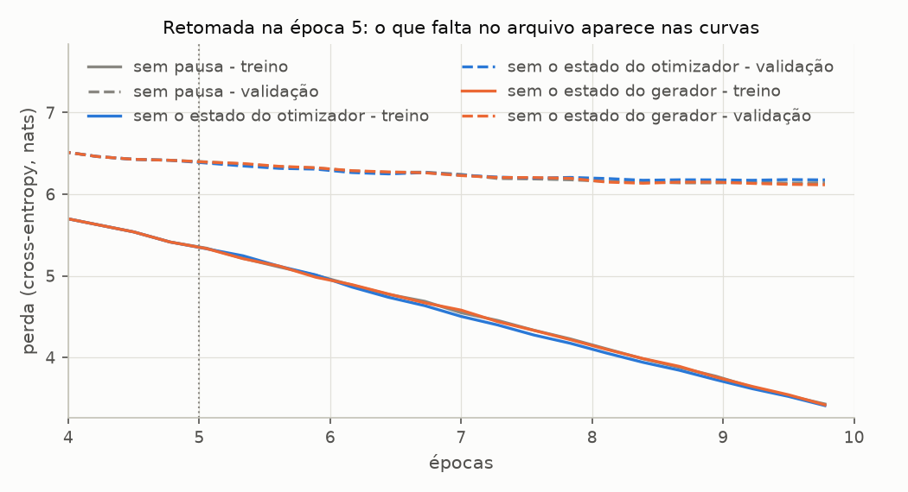

# Entregável 6 — Salvamento e carregamento dos pesos

**Um treino que não se guarda precisa ser refeito.** O treino de referência leva dois minutos; o do livro, quatro; um LLM de verdade, semanas. Este documento descreve como o projeto grava um treino em arquivo e o reconstrói depois: o que vai no arquivo e por quê, a verificação de que o modelo carregado é o mesmo e gera o mesmo texto, e o que cada parte do arquivo muda quando o treino é retomado. Os números vêm de [`checkpoint_experimentos.py`](../../experimentos/sprint05/checkpoint_experimentos.py), em [`checkpoint.md`](../../experimentos/sprint05/resultados/checkpoint.md).

| Arquivo | Conteúdo |
| ------- | -------- |
| [`checkpoint.py`](../../src/training/checkpoint.py) | `save_checkpoint`, `load_checkpoint`, `Checkpoint` |
| [`test_checkpoint.py`](../../tests/test_checkpoint.py) | 11 testes, poucos segundos |

| Experimento | Pergunta | Seção |
| ----------- | -------- | ----- |
| C1 | O que vai no arquivo, quanto pesa, quanto custa? | 2 |
| C2 | O modelo carregado é o mesmo, e gera o mesmo texto? | 4 |
| C3 | Um treino retomado do arquivo é o mesmo treino? | 5 |
| C4 | Que enganos o formato recusa? | 6 |

---

## 1. Do livro ao projeto

A seção 5.4 do livro salva dois dicionários de tensores e os carrega numa sessão nova:

```python
torch.save({"model_state_dict": model.state_dict(),
            "optimizer_state_dict": optimizer.state_dict()}, "model_and_optimizer.pth")

checkpoint = torch.load("model_and_optimizer.pth")
model = GPTModel(GPT_CONFIG_124M)
model.load_state_dict(checkpoint["model_state_dict"])
optimizer = torch.optim.AdamW(model.parameters(), lr=5e-4, weight_decay=0.1)
optimizer.load_state_dict(checkpoint["optimizer_state_dict"])
```

Repare no que o código de carga precisa saber e o arquivo não diz: a arquitetura (`GPT_CONFIG_124M`) e os hiperparâmetros do otimizador. No notebook, eles estão na célula de cima. Num processo novo, ou meses depois, não estão. O projeto guarda as duas coisas no próprio arquivo, mais o histórico e o estado do gerador:

```python
from src.training import save_checkpoint, load_checkpoint

save_checkpoint("checkpoints/modelo.pth", run.model, BASE_TRAINING_CONFIG, run.history,
                optimizer=run.optimizer, rng_state=torch.get_rng_state())

checkpoint = load_checkpoint("checkpoints/modelo.pth")
checkpoint.model        # GPTModel remontado da configuração salva, em eval()
checkpoint.optimizer    # AdamW com m e v restaurados (None se não foi salvo)
checkpoint.history      # TrainingHistory, para curvas e para retomar a contagem
```

---

## 2. O que vai no arquivo (C1)

**Configuração.** O modelo do treino de referência depois de 10 épocas, salvo com otimizador e gerador.

**Resultado.**

| Chave | Conteúdo | Tamanho | Para quê |
| ----- | -------- | ------- | -------- |
| `model_state_dict` | 28 920 832 parâmetros em 57 tensores, mais 4 buffers (as máscaras causais) | 110,4 MB | gerar texto e avaliar |
| `optimizer_state_dict` | passo, m e v de cada um dos 57 tensores | 220,6 MB | retomar o treino |
| `history` | 36 avaliações, 180 perdas de lote, 10 amostras | 7,0 kB | curvas, contagem de passos e épocas |
| `model_config` | `asdict(GPTConfig)`, 12 campos | 246 bytes | remontar a arquitetura |
| `training_config` | `asdict(TrainingConfig)`, 11 campos | 228 bytes | recriar o otimizador e os dados |
| `rng_state` | `torch.get_rng_state()` | 4,9 kB | retomada idêntica |
| `format_version`, `torch_version` | 1, `2.13.0+cpu` | — | recusar formato desconhecido; registro |

| Arquivo | Em disco | Salvar | Carregar |
| ------- | -------- | ------ | -------- |
| só pesos | 110,4 MB | 0,10 s | 0,17 s |
| completo | 331,1 MB | 0,25 s | 0,28 s |

**Análise — o otimizador pesa o dobro do modelo.** O AdamW guarda dois números por peso, m e v, e cada um tem o tamanho do modelo inteiro: 220,6 MB contra 110,4 MB. O arquivo completo tem três vezes o tamanho do arquivo só de pesos. Para gerar texto, o otimizador não serve para nada, e `save_checkpoint` sem `optimizer` grava só o necessário. Para continuar treinando, ele é indispensável (seção 5).

**Análise — o que identifica o treino custa quase nada.** As duas configurações e o histórico somam menos de 8 kB, 0,002% do arquivo. É o que transforma um conjunto de tensores num treino descrito: qual arquitetura, com que hiperparâmetros, quantos passos, que perdas. O estado do gerador tem 5 kB.

**Análise — custo.** Treinar as 10 épocas levou 135 s nesta máquina; carregar o arquivo completo, 0,28 s, 486 vezes menos. Os tempos de disco são de um arquivo já no cache do sistema; a primeira leitura, de um SSD frio, leva mais.

---

## 3. Decisões do formato

| Decisão | Por quê |
| ------- | ------- |
| Salvar o `state_dict`, e não o modelo inteiro com `torch.save(model)` | O modelo inteiro em pickle guarda o caminho das classes Python, e o arquivo deixa de abrir se um módulo for renomeado ou movido. O `state_dict` só tem nomes de parâmetros e tensores. |
| Configurações como dicionários (`asdict`), e não as dataclasses | A leitura usa `weights_only=True`, que só aceita tensores e tipos simples. Uma dataclass seria recusada. `GPTConfig(**dados)` e `TrainingConfig(**dados)` a reconstroem, e a validação do `__post_init__` roda de novo. |
| `torch.load(..., weights_only=True)` | O `.pth` é pickle, e abrir um pickle executa o que estiver nele. Com `weights_only`, um arquivo com qualquer outro objeto é recusado (C4). É o padrão do PyTorch desde a 2.6; o projeto o deixa explícito. |
| `map_location=device` | Os tensores vão para o device pedido, qualquer que seja o device em que foram salvos. Um arquivo salvo em GPU abre numa máquina sem GPU. |
| `format_version` | Se uma chave mudar de nome ou de sentido, a versão sobe e o código antigo recusa o arquivo com uma mensagem clara, em vez de falhar adiante com um `KeyError`. |
| Modelo devolvido em `eval()` | O uso mais comum depois de carregar é gerar texto; `train_model` devolve o modo de treino sozinho. |
| Carregar não mexe no gerador global | Criar o `GPTModel` sorteia pesos (que o `state_dict` sobrescreve em seguida). `load_checkpoint` guarda o estado do gerador antes e o devolve depois: quem chama sorteia como se não tivesse carregado nada. Com `restore_rng=True`, o estado aplicado é o do arquivo, e só depois de o modelo existir. |
| `torch_version` como `str` | `torch.__version__` é um objeto `TorchVersion`, que o próprio `weights_only` recusa. Foi o primeiro erro dos testes. |
| `.pth` fora do repositório | O `.gitignore` já ignora `*.pth`. O modelo é regenerado pelo script (seção 7). |

---

## 4. Ida e volta: o modelo carregado gerando texto (C2)

**Configuração.** `load_checkpoint` do arquivo do C1, num `GPTModel` novo, comparado com o modelo que ficou na memória depois do treino. Depois, o mesmo arquivo carregado por **outro processo do Python** (`checkpoint_experimentos.py --gerar`), sem nada em comum com o primeiro além do arquivo.

**Resultado.**

| O que se compara | Na memória | Carregado | Resultado |
| ---------------- | ---------- | --------- | --------- |
| maior diferença entre pesos | — | 0 | igual |
| perda de treino | 3,319154 | 3,319154 | igual |
| perda de validação | 6,119448 | 6,119448 | igual |
| `GPTConfig`, `TrainingConfig` | `BASE_CONFIG`, `BASE_TRAINING_CONFIG` | do arquivo | iguais |
| histórico | 36 avaliações | 36 avaliações | igual |

O modelo carregado gerando 50 tokens a partir de `Every effort moves you`:

| Estratégia | Texto | Contra a memória | Contra outro processo |
| ---------- | ----- | ---------------- | --------------------- |
| gulosa | `Every effort moves you know. "I have to me--and that I had been the fact.        "I.     "I. "I I had been the Riv it, and in the picture` | igual | igual |
| top-k 50, T = 0,7 | `Every effort moves you know. He was I felt to the him, and he was one of and I had been it. Gisburn, with that he was dead it, you know. Gisburn's long of his own.  " his his` | igual | igual |

**Análise.** O arquivo preserva o modelo bit a bit: diferença zero nos 28,9 milhões de pesos, as mesmas perdas até a sexta casa, o mesmo texto na decodificação gulosa e na amostragem com gerador semeado, também num processo novo. A amostra gulosa é a mesma do fim da época 10 do [T1](02-treinamento.md) e do [D2](04-estrategias-de-geracao.md): é o modelo descrito nos Entregáveis 3 a 5, agora em arquivo.

Um detalhe da medição: a perda de treino precisou da mesma seed antes de cada medida. O loader de treino embaralha, e somar as perdas dos lotes em outra ordem muda a última casa do float. Na primeira versão do script, as duas perdas de treino eram iguais nas 6 casas impressas e diferentes na 15ª, e a tabela dizia "DIFERENTE" para dois modelos idênticos.

---

## 5. Retomar o treino do arquivo (C3)

**Configuração.** O treino de referência é salvo no fim da época 5 e segue até a 10 sem parar: é o T1, e o script confere a última avaliação com a publicada (3,429 / 6,140). O arquivo da pausa é carregado três vezes, num modelo novo, e treinado pelas 5 épocas que faltam:

- **otimizador + gerador:** tudo o que está no arquivo;
- **sem o estado do otimizador:** pesos e gerador do arquivo, AdamW novo (m e v recomeçam do zero);
- **sem o estado do gerador:** pesos e AdamW do arquivo, e `torch.manual_seed(42)` no lugar do estado salvo, que é o que faria quem guardou só a seed.

**Resultado.**

| Retomada | Perda do 1º lote depois da pausa | Do 2º lote | Validação final | Maior diferença de validação para o T1 | Maior diferença entre pesos |
| -------- | -------------------------------- | ---------- | --------------- | -------------------------------------- | --------------------------- |
| sem pausa (T1) | 5,3265 | 5,1599 | 6,140 | — | — |
| otimizador + gerador | 5,3265 | 5,1599 | 6,140 | **0,000** | **0** |
| sem o estado do otimizador | 5,3265 | 5,1809 | 6,175 | 0,043 | 2,9·10⁻² |
| sem o estado do gerador | 5,4067 | 5,2022 | 6,115 | 0,025 | 3,3·10⁻² |



**Análise — com tudo, é o mesmo treino.** A retomada completa termina com os mesmos pesos do treino sem pausa, diferença zero, e as mesmas perdas em todas as avaliações. O histórico segue a contagem: 180 passos e 10 épocas no fim. O teste `test_retomada_pelo_arquivo_e_identica_ao_treino_continuo` trava essa propriedade no modelo minúsculo, com o gerador global propositalmente bagunçado antes da carga.

**Análise — sem o otimizador, diverge no segundo passo.** O primeiro lote depois da pausa tem a mesma perda (5,3265): os pesos são os mesmos, e o lote também, porque o gerador foi restaurado. A diferença está no passo que vem depois. O AdamW novo tem m = v = 0, e a correção de viés faz o primeiro passo dele ter tamanho ~lr em **todo** peso, na direção do sinal do gradiente, sem a média acumulada que suavizava o treino. O segundo lote já tem outra perda (5,1809 contra 5,1599), e as trajetórias se separam.

**Análise — sem o gerador, diverge no primeiro passo.** Com `manual_seed(42)`, a época 6 sorteia a ordem dos lotes e as máscaras de dropout a partir do estado que o gerador tinha antes de criar o modelo, e não do ponto em que estava na pausa. O primeiro lote depois da pausa já é outro (5,4067). Guardar a seed não basta: a seed descreve o **começo** do treino, e o que a retomada precisa é do ponto em que o gerador estava na pausa.

**Análise — o tamanho do erro.** As duas retomadas incompletas terminam com validação de 6,175 e 6,115, a 0,043 e 0,025 do treino sem pausa, da ordem do desvio entre seeds (0,027, T1). São treinos válidos, tão bons quanto o original. O que se perde não é qualidade, e sim a **identidade** com o treino sem pausa, e com ela a possibilidade de reproduzir os números publicados. As amostras gulosas mostram o quanto a trajetória mudou: as duas retomadas incompletas geram textos que se afastam do T1 nos primeiros tokens (`know't you` e `know. "I the picture`, contra `know. "I have to me`).

---

## 6. O que o formato recusa (C4)

**Configuração.** Oito tentativas de carga. As quatro primeiras fazem como o livro: montam um `GPTModel` com uma configuração escrita à mão e chamam `load_state_dict` com os pesos do arquivo. As outras usam `load_checkpoint`.

**Resultado.**

| Tentativa | Erro |
| --------- | ---- |
| `load_state_dict` com `emb_dim` 128 em vez de 256 | `RuntimeError`: size mismatch na tabela de tokens |
| `load_state_dict` com 2 blocos em vez de 4 | `RuntimeError`: chaves inesperadas (`trf_blocks.2...`) |
| `load_state_dict` com `context_length` 256 em vez de 128 | `RuntimeError`: size mismatch na tabela de posições |
| `load_state_dict` com `drop_rate` 0,5 em vez de 0,1 | **nenhum**: carrega e segue |
| `load_checkpoint` de um arquivo só com o `state_dict` | `ValueError`: faltam as chaves do formato |
| `load_checkpoint` de um arquivo com `format_version` 2 | `ValueError`: formato 2, o código lê o 1 |
| `load_checkpoint(..., restore_rng=True)` de um arquivo sem gerador | `ValueError`: não há o que restaurar |
| `load_checkpoint` de um arquivo com um objeto que não é tensor | `UnpicklingError`: `relatorio.Report` não é permitido |

**Análise — o erro silencioso.** O `load_state_dict` pega tudo o que muda o **shape** de um tensor: largura, profundidade, contexto. Não pega o que não tem tensor nenhum. O dropout não tem parâmetros, e um modelo carregado com `drop_rate` 0,5 recebe todos os pesos sem reclamar. Gera o mesmo texto em `eval()`, mas se o treino for continuado, continua com cinco vezes mais dropout do que o treino original usou. O mesmo vale para os hiperparâmetros do otimizador, que o código da seção 5.4 escreve de novo à mão na carga: nada confere se a taxa de aprendizado e o weight decay passados ao AdamW novo são os do treino que está sendo retomado. Com a configuração dentro do arquivo, `load_checkpoint` remonta o modelo e o otimizador exatamente como foram treinados, e esse tipo de engano deixa de existir.

**Análise — o pickle.** O último caso grava no arquivo um objeto qualquer do projeto (um `Report`), e `weights_only=True` o recusa antes de reconstruí-lo. Um arquivo `.pth` baixado da internet pode conter código; com essa opção, o pior que ele faz é não abrir.

---

## 7. Como reproduzir e como usar

```bash
python tests/test_checkpoint.py                                    # 11 testes, poucos segundos
python experimentos/sprint05/checkpoint_experimentos.py            # ~6 min: treina, salva, retoma, gera o relatório
python experimentos/sprint05/checkpoint_experimentos.py --gerar    # só carrega o arquivo e gera texto
```

O script completo grava o modelo de referência em `checkpoints/sprint05-base-10-epocas.pth` (331 MB, fora do repositório). Quem clona o projeto roda o script uma vez e passa a ter o arquivo; o `--gerar` imprime:

```
sprint05-base-10-epocas.pth: 28 920 832 parâmetros, 10 épocas, última avaliação com treino 3.429 e validação 6.140
gulosa: Every effort moves you know. "I have to me--and that I had been the fact. ...
top-k 50, T = 0,7: Every effort moves you know. He was I felt to the him, and he was one of ...
```

**Gerar texto em outro código:**

```python
import torch
from src.generation import generate_text
from src.tokenizer import BPETokenizer
from src.training import load_checkpoint

modelo = load_checkpoint("checkpoints/sprint05-base-10-epocas.pth").model
print(generate_text(modelo, BPETokenizer(), "Every effort moves you", 50,
                    temperature=0.7, top_k=50, generator=torch.Generator().manual_seed(42)))
```

**Continuar o treino** (por exemplo, mais 5 épocas, como no exercício 5.4 do livro):

```python
from dataclasses import replace
import torch
from src.corpus import load_verdict
from src.tokenizer import BPETokenizer
from src.training import create_train_val_loaders, load_checkpoint, save_checkpoint, train_model

ck = load_checkpoint("checkpoints/sprint05-base-10-epocas.pth", restore_rng=True)
cfg = ck.train_cfg
train_loader, val_loader = create_train_val_loaders(
    load_verdict(), BPETokenizer(), ck.model_cfg.context_length, cfg.batch_size, cfg.train_ratio, cfg.stride)
train_model(ck.model, train_loader, val_loader, ck.optimizer, num_epochs=5,
            eval_freq=cfg.eval_freq, eval_iter=cfg.eval_iter, history=ck.history)
save_checkpoint("checkpoints/15-epocas.pth", ck.model, replace(cfg, num_epochs=15), ck.history,
                ck.optimizer, torch.get_rng_state())
```

Com `restore_rng=True` e o otimizador do arquivo, as 5 épocas saem idênticas às épocas 11 a 15 de um treino de 15 épocas sem pausa (C3).

---

## 8. Limitações

- **Só o gerador da CPU.** `rng_state` é o gerador global da CPU. Um treino em GPU sorteia o dropout no gerador da GPU, que não é salvo, e a retomada em GPU não seria idêntica.
- **Os dados não vão no arquivo.** O arquivo guarda como os loaders foram montados (`train_ratio`, `stride`, `batch_size`), mas não o texto. A retomada idêntica pressupõe o mesmo The Verdict e o mesmo tokenizador; `load_verdict` confere o tamanho do arquivo baixado, não o conteúdo.
- **Um arquivo por treino, sem rotação.** Não há salvamento automático a cada época nem escolha do melhor ponto pela validação. Com o T2 mostrando que o melhor modelo está na época 11, guardar o checkpoint do mínimo da validação seria o próximo passo natural.
- **Sem os pesos da OpenAI.** A seção 5.5 do livro (carregar o GPT-2 pré-treinado) fica fora desta entrega.
- **Compatibilidade entre versões do PyTorch não testada.** O arquivo registra `torch_version`, mas só foi lido pela mesma versão (2.13) que o gravou.
