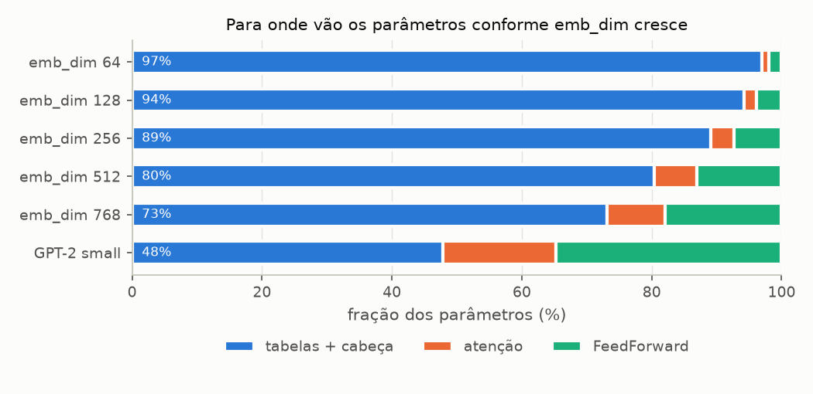
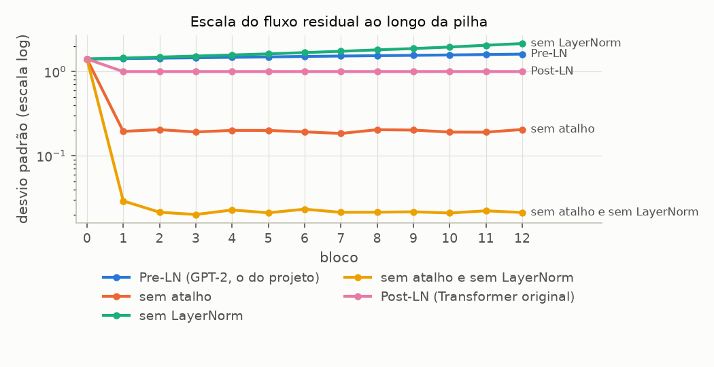
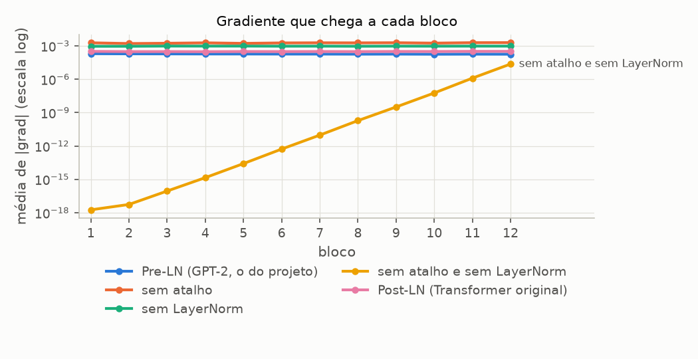

# Sprint 4 - Arquitetura: resultados dos experimentos

Gerado por `experimentos/sprint04/arquitetura_experimentos.py`. Não editar à mão: rode o script novamente.

Modelos em `eval()` e sob `torch.no_grad()`, exceto o A8 (dropout em `train()`) e o A9 (backward). Seed 42 antes de cada modelo. Tempos em CPU, mediana de 11 medidas após 3 de aquecimento: valem as razões entre linhas, não os valores absolutos, e diferenças de 1-2 ms são ruído. Memória em float32 (4 bytes por número). Figuras em `resultados/figuras/`.

## A1 - Anatomia do modelo base

**Pergunta:** que shape o tensor tem em cada etapa do forward, e em quais componentes estão os parâmetros?

**Configuração:** BASE_CONFIG -- vocab_size 50257, context_length 128, emb_dim 256, n_heads 4 (head_dim 64), n_layers 4, FeedForward 1024, drop_rate 0.1. Entrada: o lote do The Verdict, (8, 128).

### Shapes medidos (ganchos de forward)

| etapa                                              | entrada         | saída                            |
| -------------------------------------------------- | --------------- | -------------------------------- |
| 1. tabela de tokens (Sprint 2)                     | (8, 128)        | (8, 128, 256)                    |
| 2. tabela de posições (Sprint 2)                   | T = 128         | (128, 256)                       |
| 3. soma tokens + posições                          | (8, 128)        | (8, 128, 256)                    |
| 4. dropout dos embeddings                          | (8, 128, 256)   | (8, 128, 256)                    |
| 5. bloco 0: LayerNorm 1                            | (8, 128, 256)   | (8, 128, 256)                    |
| 6. bloco 0: projeção Q (K e V iguais)              | (8, 128, 256)   | (8, 128, 256)                    |
| 7. bloco 0: Q, K e V divididos em cabeças          | (8, 4, 128, 64) | (8, 4, 128, 64) por matriz       |
| 8. bloco 0: atenção multi-cabeça (contexto, pesos) | (8, 128, 256)   | (8, 128, 256) e (8, 4, 128, 128) |
| 9. bloco 0: LayerNorm 2                            | (8, 128, 256)   | (8, 128, 256)                    |
| 10. bloco 0: FeedForward, Linear 1                 | (8, 128, 256)   | (8, 128, 1024)                   |
| 11. bloco 0: FeedForward, GELU                     | (8, 128, 1024)  | (8, 128, 1024)                   |
| 12. bloco 0: FeedForward, Linear 2                 | (8, 128, 1024)  | (8, 128, 256)                    |
| 13. saída do bloco 0 (dois atalhos somados)        | (8, 128, 256)   | (8, 128, 256)                    |
| 14. saída da pilha de 4 blocos                     | (8, 128, 256)   | (8, 128, 256)                    |
| 15. LayerNorm final                                | (8, 128, 256)   | (8, 128, 256)                    |
| 16. cabeça de saída: logits                        | (8, 128, 256)   | (8, 128, 50257)                  |

Legenda: B = 8 sequências, T = 128 tokens, D = emb_dim = 256, H = 4 cabeças de 64, FeedForward com 1024 = 4·D, V = 50257. Os blocos 1 a 3 repetem as linhas 5 a 13 com os mesmos shapes.

### Parâmetros por componente

| componente           | base       | fração | GPT-2 small | fração |
| -------------------- | ---------- | ------ | ----------- | ------ |
| token_embedding      | 12 865 792 | 44.5%  | 38 597 376  | 23.7%  |
| positional_embedding | 32 768     | 0.1%   | 786 432     | 0.5%   |
| attention            | 1 049 600  | 3.6%   | 28 320 768  | 17.4%  |
| feed_forward         | 2 102 272  | 7.3%   | 56 669 184  | 34.8%  |
| block_norms          | 4 096      | 0.0%   | 36 864      | 0.0%   |
| final_norm           | 512        | 0.0%   | 1 536       | 0.0%   |
| out_head             | 12 865 792 | 44.5%  | 38 597 376  | 23.7%  |
| **total**            | 28 920 832 | 100%   | 163 009 536 | 100%   |

Tabelas de embedding e cabeça de saída somam 89.1% do modelo base e 47.8% do GPT-2 small. Em float32 o modelo base ocupa 110.32 MB.

Um bloco do modelo base (788 992 parâmetros):

| subpeça      | parâmetros | fração do bloco |
| ------------ | ---------- | --------------- |
| atenção      | 262 400    | 33.3%           |
| FeedForward  | 525 568    | 66.6%           |
| 2 LayerNorms | 1 024      | 0.1%            |

## A2 - O modelo sem treino: logits, probabilidades e perda

**Pergunta:** antes de qualquer treino, o que o modelo prevê? Os logits já são uma distribuição útil, ou ainda não dizem nada?

**Configuração:** BASE_CONFIG (seed 42) e GPT-2 small (seed 123, a do livro), os dois em eval(), sobre o lote do The Verdict. A perda é a cross-entropy entre os logits de cada posição e o token seguinte (o alvo do DataLoader). Referência: uma distribuição uniforme sobre V tokens tem entropia e perda iguais a ln V.

| grandeza                                  | base         | GPT-2 small  | uniforme sobre V |
| ----------------------------------------- | ------------ | ------------ | ---------------- |
| média dos logits                          | -0.0001      | 0.0002       | -                |
| desvio dos logits                         | 0.5774       | 0.5772       | -                |
| faixa dos logits                          | -3.28 a 3.17 | -3.13 a 3.25 | -                |
| maior probabilidade (média por posição)   | 1.93e-04     | 1.96e-04     | 1.99e-05         |
| probabilidade dada ao token certo (média) | 2.05e-05     | 2.02e-05     | 1.99e-05         |
| entropia da previsão (nats)               | 10.658       | 10.658       | 10.825           |
| cross-entropy (nats)                      | 10.976       | 10.975       | 10.825           |
| acerto do argmax                          | 0.00%        | 0.00%        | 0.0020%          |

## A3 - Número de blocos (n_layers)

**Pergunta:** empilhar mais blocos custa quanto, e o que acontece com a escala do fluxo residual e dos logits?

**Configuração:** BASE_CONFIG com n_layers em 1, 2, 4, 8, 12. GFLOP e tempo para 1 sequência de 128 tokens. O desvio do fluxo residual é medido na saída do último bloco, antes da LayerNorm final; o dos logits, depois da cabeça.

| n_layers | parâmetros | nos blocos | float32  | GFLOP | tempo (ms) | desvio do fluxo residual | desvio dos logits | perda inicial |
| -------- | ---------- | ---------- | -------- | ----- | ---------- | ------------------------ | ----------------- | ------------- |
| 1        | 26 553 856 | 3.0%       | 101.3 MB | 3.51  | 11.9       | 1.425                    | 0.577             | 11.001        |
| 2        | 27 342 848 | 5.8%       | 104.3 MB | 3.73  | 14.3       | 1.442                    | 0.577             | 10.970        |
| 4        | 28 920 832 | 10.9%      | 110.3 MB | 4.17  | 14.8       | 1.475                    | 0.577             | 10.976        |
| 8        | 32 076 800 | 19.7%      | 122.4 MB | 5.04  | 19.5       | 1.544                    | 0.577             | 10.970        |
| 12       | 35 232 768 | 26.9%      | 134.4 MB | 5.91  | 24.1       | 1.610                    | 0.577             | 11.000        |

## A4 - Número de cabeças (n_heads), com emb_dim fixo

**Pergunta:** o resultado da Sprint 3 (mais cabeças não mudam os parâmetros, mas multiplicam a matriz de scores) vale para o modelo inteiro?

**Configuração:** BASE_CONFIG com n_heads em 1, 2, 4, 8, 16 e emb_dim 256. As células de scores são as de todos os blocos juntos, L·H·T², para 1 sequência de T tokens.

| n_heads | head_dim | parâmetros | células de scores (L·H·T²) | scores em float32 | tempo (ms) | perda inicial |
| ------- | -------- | ---------- | -------------------------- | ----------------- | ---------- | ------------- |
| 1       | 256      | 28 920 832 | 65 536                     | 0.25 MB           | 16.2       | 10.975        |
| 2       | 128      | 28 920 832 | 131 072                    | 0.50 MB           | 16.6       | 10.976        |
| 4       | 64       | 28 920 832 | 262 144                    | 1.00 MB           | 13.4       | 10.976        |
| 8       | 32       | 28 920 832 | 524 288                    | 2.00 MB           | 13.4       | 10.975        |
| 16      | 16       | 28 920 832 | 1 048 576                  | 4.00 MB           | 13.8       | 10.976        |

## A5 - Dimensão do embedding (emb_dim)

**Pergunta:** quanto custa alargar o modelo, e como muda a divisão dos parâmetros entre as tabelas (tokens, posições, cabeça) e os blocos?

**Configuração:** BASE_CONFIG com emb_dim em 64, 128, 256, 512, 768 e n_heads 4 fixo (head_dim = emb_dim / 4). A FeedForward acompanha: 4·emb_dim. Na última linha, o GPT-2 small como referência (contado no device meta).

| emb_dim                      | head_dim | parâmetros  | tabelas + cabeça | atenção | FeedForward | float32  | GFLOP | tempo (ms) | perda inicial |
| ---------------------------- | -------- | ----------- | ---------------- | ------- | ----------- | -------- | ----- | ---------- | ------------- |
| 64                           | 16       | 6 640 384   | 97.0%            | 1.0%    | 2.0%        | 25.3 MB  | 0.89  | 5.6        | 11.013        |
| 128                          | 32       | 13 673 984  | 94.2%            | 1.9%    | 3.9%        | 52.2 MB  | 1.88  | 9.1        | 10.944        |
| 256                          | 64       | 28 920 832  | 89.1%            | 3.6%    | 7.3%        | 110.3 MB | 4.17  | 16.1       | 10.976        |
| 512                          | 128      | 64 133 120  | 80.3%            | 6.5%    | 13.1%       | 244.6 MB | 9.94  | 36.2       | 10.960        |
| 768                          | 192      | 105 636 864 | 73.2%            | 8.9%    | 17.9%       | 403.0 MB | 17.33 | 56.6       | 10.982        |
| 768 (GPT-2 small, 12 blocos) | 64       | 163 009 536 | 47.8%            | 17.4%   | 34.8%       | 621.8 MB | 32.23 | -          | -             |

Atenção e FeedForward somam todos os blocos; "tabelas + cabeça" são as tabelas de tokens e de posições mais a cabeça de saída. As LayerNorms (menos de 0,1% em todas as linhas) ficam fora da figura; os valores exatos estão na tabela.

## A6 - Dimensão da FeedForward (ff_hidden_dim)

**Pergunta:** o fator 4 da FeedForward pesa quanto no bloco e no custo?

**Configuração:** BASE_CONFIG com ff_hidden_dim = fator · emb_dim, fator em 1, 2, 4, 8 (4 é o do GPT-2).

| fator | ff_hidden_dim | parâmetros da FFN (1 bloco) | fração do bloco | parâmetros do modelo | GFLOP total | GFLOP dos blocos | tempo (ms) | perda inicial |
| ----- | ------------- | --------------------------- | --------------- | -------------------- | ----------- | ---------------- | ---------- | ------------- |
| 1     | 256           | 131 584                     | 33.3%           | 27 344 896           | 3.76        | 0.40             | 12.1       | 10.985        |
| 2     | 512           | 262 912                     | 50.0%           | 27 870 208           | 3.90        | 0.54             | 13.3       | 11.001        |
| 4     | 1024          | 525 568                     | 66.6%           | 28 920 832           | 4.17        | 0.81             | 13.9       | 10.976        |
| 8     | 2048          | 1 050 880                   | 80.0%           | 31 022 080           | 4.70        | 1.34             | 17.3       | 10.997        |

## A7 - Tamanho do contexto (context_length)

**Pergunta:** a Sprint 3 mostrou que a atenção é quadrática em T. No modelo inteiro, esse termo já domina o custo?

**Configuração:** BASE_CONFIG com context_length em 32, 64, 128, 256, 512, 1024, forward de 1 sequência com T = context_length (os primeiros tokens do The Verdict). Os FLOPs são separados pela origem: projeções dos blocos (linear em T), scores e média ponderada da atenção (T²) e cabeça de saída (linear em T, vezes V).

| T    | parâmetros | tabela de posições | scores (L·H·T²) | logits (T·V) | GFLOP blocos | GFLOP atenção | GFLOP cabeça | atenção no total | tempo (ms) | perda inicial |
| ---- | ---------- | ------------------ | --------------- | ------------ | ------------ | ------------- | ------------ | ---------------- | ---------- | ------------- |
| 32   | 28 896 256 | 8 192              | 0.06 MB         | 6.13 MB      | 0.20         | 0.00          | 0.82         | 0.4%             | 5.8        | 11.152        |
| 64   | 28 904 448 | 16 384             | 0.25 MB         | 12.27 MB     | 0.40         | 0.02          | 1.65         | 0.8%             | 9.3        | 10.853        |
| 128  | 28 920 832 | 32 768             | 1.00 MB         | 24.54 MB     | 0.81         | 0.07          | 3.29         | 1.6%             | 14.1       | 10.977        |
| 256  | 28 953 600 | 65 536             | 4.00 MB         | 49.08 MB     | 1.61         | 0.27          | 6.59         | 3.2%             | 22.9       | 11.039        |
| 512  | 29 019 136 | 131 072            | 16.00 MB        | 98.16 MB     | 3.22         | 1.07          | 13.17        | 6.1%             | 49.0       | 11.004        |
| 1024 | 29 150 208 | 262 144            | 64.00 MB        | 196.32 MB    | 6.44         | 4.29          | 26.35        | 11.6%            | 104.1      | 10.956        |

Ponto em que os FLOPs da atenção (4·L·T²·D) igualariam os da cabeça (2·T·D·V): T = V / (2·L) = 6282 tokens, para L = 4.

## A8 - Dropout

**Pergunta:** quanto o dropout mexe na saída do modelo durante o treino, e ele some mesmo em eval()? Qual dos três lugares do exercício 4.3 mais perturba a saída?

**Configuração:** BASE_CONFIG com a taxa variando. Em train(), duas passadas sobre o mesmo lote: a variação relativa é o desvio da diferença entre elas dividido pelo desvio dos logits. A perda em train() é a média de 5 passadas. Os pesos são os mesmos em todas as linhas (seed fixa): só a taxa muda.

| drop_rate | variação entre 2 passadas em train() | perda em train() | perda em eval() | eval() determinístico |
| --------- | ------------------------------------ | ---------------- | --------------- | --------------------- |
| 0.0       | 0.000                                | 10.9758          | 10.9758         | sim                   |
| 0.1       | 0.468                                | 10.9787          | 10.9758         | sim                   |
| 0.2       | 0.659                                | 10.9853          | 10.9758         | sim                   |
| 0.5       | 1.027                                | 10.9924          | 10.9758         | sim                   |

### As três taxas separadas (exercício 4.3), cada uma sozinha em 0,1

| onde                      | variação entre 2 passadas em train() | perda em train() | perda em eval() | eval() determinístico |
| ------------------------- | ------------------------------------ | ---------------- | --------------- | --------------------- |
| só embeddings             | 0.448                                | 10.9798          | 10.9758         | sim                   |
| só pesos de atenção       | 0.045                                | 10.9759          | 10.9758         | sim                   |
| só antes dos atalhos      | 0.142                                | 10.9766          | 10.9758         | sim                   |
| as três (padrão do livro) | 0.468                                | 10.9787          | 10.9758         | sim                   |

## A9 - Ablação do bloco: atalho e LayerNorm

**Pergunta:** qual a contribuição do atalho e da LayerNorm para a estabilidade? O que muda quando cada um sai, ou quando a norma vai para depois da soma (Post-LayerNorm, como no Transformer original)?

**Configuração:** BASE_CONFIG com 12 blocos e dropout 0. As cinco variantes têm os MESMOS pesos (cópia do mesmo modelo); só o forward do bloco muda. 'Sem LayerNorm' tira as duas normas de cada bloco e a final. 'Sem atalho e sem LayerNorm' é a rede profunda pura, o caso da rede de demonstração da seção 4.4. Forward e backward da cross-entropy sobre o lote do The Verdict. Gradiente por bloco: média de |grad| sobre todos os parâmetros do bloco (o critério do livro na seção 4.4).

| variante                       | desvio após embeddings | desvio após bloco 12 | desvio dos logits | perda inicial | |grad| bloco 1 | |grad| bloco 12 | bloco 1 / último |
| ------------------------------ | ---------------------- | -------------------- | ----------------- | ------------- | -------------- | --------------- | ---------------- |
| Pre-LN (GPT-2, o do projeto)   | 1.410                  | 1.610                | 0.577             | 11.000        | 1.98e-04       | 1.78e-04        | 1.11             |
| sem atalho                     | 1.410                  | 0.205                | 0.579             | 11.068        | 1.88e-03       | 1.96e-03        | 0.959            |
| sem LayerNorm                  | 1.410                  | 2.149                | 1.241             | 11.614        | 9.15e-04       | 9.45e-04        | 0.968            |
| sem atalho e sem LayerNorm     | 1.410                  | 0.021                | 0.012             | 10.824        | 1.82e-18       | 2.34e-05        | 7.8e-14          |
| Post-LN (Transformer original) | 1.410                  | 1.000                | 0.577             | 10.999        | 3.18e-04       | 3.20e-04        | 0.995            |

Desvio do fluxo residual depois de cada bloco (0 = depois dos embeddings):

| variante                       | 0    | 1    | 2    | 3    | 4    | 5    | 6    | 7    | 8    | 9    | 10   | 11   | 12   |
| ------------------------------ | ---- | ---- | ---- | ---- | ---- | ---- | ---- | ---- | ---- | ---- | ---- | ---- | ---- |
| Pre-LN (GPT-2, o do projeto)   | 1.41 | 1.42 | 1.44 | 1.46 | 1.48 | 1.49 | 1.51 | 1.53 | 1.54 | 1.56 | 1.57 | 1.59 | 1.61 |
| sem atalho                     | 1.41 | 0.20 | 0.20 | 0.19 | 0.20 | 0.20 | 0.19 | 0.18 | 0.20 | 0.20 | 0.19 | 0.19 | 0.21 |
| sem LayerNorm                  | 1.41 | 1.44 | 1.48 | 1.53 | 1.57 | 1.62 | 1.68 | 1.74 | 1.81 | 1.87 | 1.95 | 2.05 | 2.15 |
| sem atalho e sem LayerNorm     | 1.41 | 0.03 | 0.02 | 0.02 | 0.02 | 0.02 | 0.02 | 0.02 | 0.02 | 0.02 | 0.02 | 0.02 | 0.02 |
| Post-LN (Transformer original) | 1.41 | 1.00 | 1.00 | 1.00 | 1.00 | 1.00 | 1.00 | 1.00 | 1.00 | 1.00 | 1.00 | 1.00 | 1.00 |

Gradiente médio absoluto por bloco:

| variante                       | 1       | 2       | 3       | 4       | 5       | 6       | 7       | 8       | 9       | 10      | 11      | 12      |
| ------------------------------ | ------- | ------- | ------- | ------- | ------- | ------- | ------- | ------- | ------- | ------- | ------- | ------- |
| Pre-LN (GPT-2, o do projeto)   | 2.0e-04 | 1.9e-04 | 1.9e-04 | 1.9e-04 | 1.9e-04 | 1.8e-04 | 1.8e-04 | 1.8e-04 | 1.8e-04 | 1.8e-04 | 1.8e-04 | 1.8e-04 |
| sem atalho                     | 1.9e-03 | 1.6e-03 | 1.7e-03 | 1.9e-03 | 1.7e-03 | 1.8e-03 | 1.9e-03 | 1.9e-03 | 1.9e-03 | 1.8e-03 | 1.9e-03 | 2.0e-03 |
| sem LayerNorm                  | 9.2e-04 | 9.2e-04 | 9.6e-04 | 9.5e-04 | 9.6e-04 | 9.3e-04 | 9.4e-04 | 9.2e-04 | 9.4e-04 | 9.4e-04 | 9.5e-04 | 9.5e-04 |
| sem atalho e sem LayerNorm     | 1.8e-18 | 5.5e-18 | 8.9e-17 | 1.4e-15 | 2.6e-14 | 5.3e-13 | 9.5e-12 | 1.9e-10 | 3.2e-09 | 5.8e-08 | 1.3e-06 | 2.3e-05 |
| Post-LN (Transformer original) | 3.2e-04 | 3.0e-04 | 3.1e-04 | 3.0e-04 | 3.1e-04 | 3.1e-04 | 3.1e-04 | 3.0e-04 | 3.1e-04 | 3.1e-04 | 3.2e-04 | 3.2e-04 |

