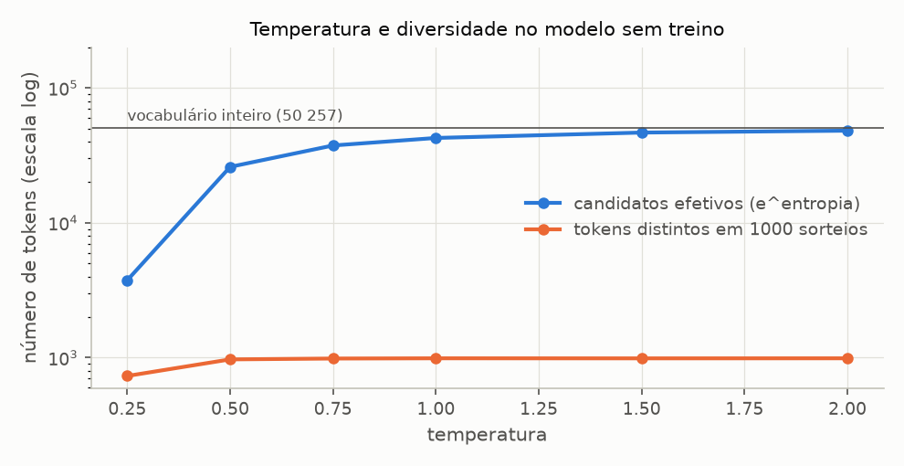
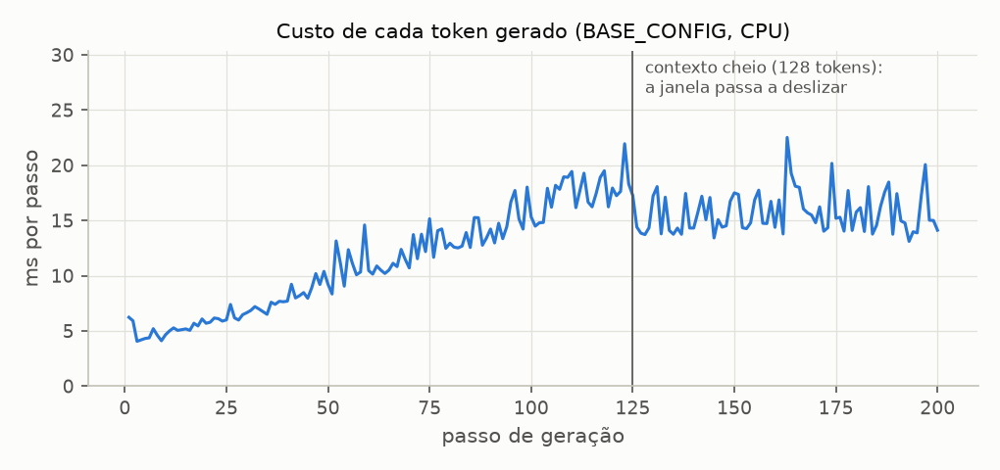

# Sprint 4 - Inferência e geração: resultados dos experimentos

Gerado por `experimentos/sprint04/geracao_experimentos.py`. Não editar à mão: rode o script novamente.

Modelo: BASE_CONFIG com seed 42, **sem treino** -- os textos gerados são incoerentes, e o que se mede é o mecanismo. Prompt: `Every effort moves you` (seção 5.3 do livro). Sorteios com `torch.Generator` semeado em 42; a única fonte de variação entre execuções são as colunas de tempo. Figuras em `resultados/figuras/`.

## G1 - Um passo de geração por dentro

**Pergunta:** como o vetor de logits da última posição vira um token? E o que são as outras linhas que o modelo devolve?

**Configuração:** BASE_CONFIG (seed 42, sem treino), prompt `Every effort moves you` = [6109, 3626, 6100, 345].

| etapa                    | shape         | observação                        |
| ------------------------ | ------------- | --------------------------------- |
| Token IDs do prompt      | (1, 4)        | lote de 1 sequência de 4 tokens   |
| logits do modelo         | (1, 4, 50257) | uma linha de V logits por posição |
| logits da última posição | (50257,)      | a única linha usada na geração    |
| softmax                  | (50257,)      | soma = 1.000000; todos > 0        |
| argmax                   | ()            | o próximo token na escolha gulosa |

Os 5 maiores logits da última posição, de 50257:

| posição no ranking | Token ID | token       | logit  | probabilidade | razão para 1/V |
| ------------------ | -------- | ----------- | ------ | ------------- | -------------- |
| 1                  | 19984    | `' ski'`    | 2.4126 | 1.891e-04     | 9.50x          |
| 2                  | 40099    | `'versive'` | 2.3806 | 1.832e-04     | 9.21x          |
| 3                  | 40262    | `' Kirin'`  | 2.2965 | 1.684e-04     | 8.46x          |
| 4                  | 49464    | `'ctx'`     | 2.2315 | 1.578e-04     | 7.93x          |
| 5                  | 6936     | `' armed'`  | 2.1729 | 1.488e-04     | 7.48x          |

argmax dos logits = argmax das probabilidades: True. Somar 100 a todos os logits muda as probabilidades em no máximo 5.5e-10: o softmax só enxerga diferenças entre logits.

**Uma passada, T previsões.** Cada linha dos logits prevê o token seguinte à sua posição:

| posição | token de entrada | argmax da linha | token seguinte de fato              | prob. dada a ele |
| ------- | ---------------- | --------------- | ----------------------------------- | ---------------- |
| 0       | `'Every'`        | `' AMERICA'`    | `' effort'`                         | 1.38e-05         |
| 1       | `' effort'`      | `' Giving'`     | `' moves'`                          | 1.74e-05         |
| 2       | `' moves'`       | `'rosse'`       | `' you'`                            | 1.57e-05         |
| 3       | `' you'`         | `' ski'`        | (ainda não existe: é o que se gera) | -                |

## G2 - O laço autoregressivo

**Pergunta:** o que muda a cada passo do laço, e a geração token a token concorda com uma passada única sobre o texto final?

**Configuração:** decodificação gulosa, 10 passos. Cada linha é uma chamada de `generate(..., max_new_tokens=1)` sobre o contexto da linha anterior; as probabilidades são o softmax da última linha de logits daquele passo.

| passo | tokens no contexto | Token ID escolhido | token             | probabilidade | entropia (nats) |
| ----- | ------------------ | ------------------ | ----------------- | ------------- | --------------- |
| 1     | 4                  | 19984              | `' ski'`          | 1.89e-04      | 10.659          |
| 2     | 5                  | 18700              | `' lightweight'`  | 1.76e-04      | 10.658          |
| 3     | 6                  | 37268              | `' deceit'`       | 1.56e-04      | 10.659          |
| 4     | 7                  | 45605              | `' civilisation'` | 1.64e-04      | 10.656          |
| 5     | 8                  | 34218              | `' cunning'`      | 1.67e-04      | 10.660          |
| 6     | 9                  | 49424              | `'GMT'`           | 1.66e-04      | 10.660          |
| 7     | 10                 | 7863               | `' 59'`           | 1.84e-04      | 10.660          |
| 8     | 11                 | 1907               | `' fight'`        | 2.02e-04      | 10.657          |
| 9     | 12                 | 40219              | `'oreAnd'`        | 1.87e-04      | 10.656          |
| 10    | 13                 | 24618              | `'>"'`            | 1.84e-04      | 10.658          |

Texto final: `Every effort moves you ski lightweight deceit civilisation cunningGMT 59 fightoreAnd>"`

| verificação                                                    | resultado                                        |
| -------------------------------------------------------------- | ------------------------------------------------ |
| logits de cada passo contra a mesma posição numa passada única | diferença máxima 1.8e-06                         |
| argmax da passada única = tokens gerados pelo laço             | True                                             |
| tokens processados pelo modelo no laço                         | 85 para gerar 10 (contexto refeito a cada passo) |

## G3 - Temperatura

**Pergunta:** como a temperatura muda a distribuição do próximo token do modelo, e quantos tokens diferentes a amostragem passa a produzir?

**Configuração:** logits da última posição do prompt (os do G1). Para cada temperatura: probabilidade do token mais provável, entropia, número efetivo de candidatos (e^entropia: o tamanho de um vocabulário uniforme com a mesma entropia) e 1000 sorteios com o gerador semeado. Temperatura 0 é a escolha gulosa. Referência: ln V = 10.825 nats.

| temperatura | maior probabilidade | entropia (nats) | candidatos efetivos | tokens distintos em 1000 | sorteios = argmax |
| ----------- | ------------------- | --------------- | ------------------- | ------------------------ | ----------------- |
| 0 (gulosa)  | 1.0000              | 0.000           | 1                   | 1                        | 100.0%            |
| 0.25        | 0.0226              | 8.228           | 3746                | 731                      | 1.9%              |
| 0.5         | 0.0013              | 10.165          | 25982               | 970                      | 0.2%              |
| 0.75        | 0.0004              | 10.530          | 37437               | 984                      | 0.0%              |
| 1           | 0.0002              | 10.659          | 42569               | 988                      | 0.0%              |
| 1.5         | 0.0001              | 10.751          | 46674               | 987                      | 0.0%              |
| 2           | 0.0001              | 10.783          | 48207               | 988                      | 0.0%              |

Os 5 tokens mais prováveis, com a probabilidade de cada um em cada temperatura:

| token       | T = 0.25 | T = 0.5  | T = 1    | T = 2    |
| ----------- | -------- | -------- | -------- | -------- |
| `' ski'`    | 2.26e-02 | 1.29e-03 | 1.89e-04 | 6.39e-05 |
| `'versive'` | 1.99e-02 | 1.21e-03 | 1.83e-04 | 6.29e-05 |
| `' Kirin'`  | 1.42e-02 | 1.02e-03 | 1.68e-04 | 6.03e-05 |
| `'ctx'`     | 1.09e-02 | 8.99e-04 | 1.58e-04 | 5.84e-05 |
| `' armed'`  | 8.66e-03 | 7.99e-04 | 1.49e-04 | 5.67e-05 |

## G4 - Top-k

**Pergunta:** quanto da distribuição o top-k descarta, e quanto ele limita a diversidade dos sorteios, sozinho e combinado com a temperatura?

**Configuração:** os mesmos logits do G1. Massa mantida = soma das probabilidades originais (T = 1) dos k tokens mantidos. 1000 sorteios com o gerador semeado. `None` = sem top-k (todo o vocabulário).

| top_k | massa original mantida | entropia (nats) | maior probabilidade | tokens distintos em 1000 |
| ----- | ---------------------- | --------------- | ------------------- | ------------------------ |
| 1     | 0.02%                  | 0.000           | 1.0000              | 1                        |
| 5     | 0.08%                  | 1.605           | 0.2232              | 5                        |
| 20    | 0.27%                  | 2.984           | 0.0696              | 20                       |
| 100   | 1.05%                  | 4.589           | 0.0180              | 100                      |
| 1000  | 6.91%                  | 6.885           | 0.0027              | 612                      |
| None  | 100.00%                | 10.659          | 0.0002              | 988                      |

Tokens distintos em 1000 sorteios, combinando temperatura e top-k:

| temperatura | top_k = 5 | top_k = 50 | top_k = None |
| ----------- | --------- | ---------- | ------------ |
| T = 0.5     | 5         | 50         | 970          |
| T = 1       | 5         | 50         | 988          |
| T = 1.5     | 5         | 50         | 987          |

## G5 - Estratégias lado a lado

**Pergunta:** o que cada estratégia produz a partir do mesmo prompt, quais são reprodutíveis, e o que acontece se a geração rodar com o dropout ligado?

**Configuração:** 30 tokens novos a partir de `Every effort moves you`. Repetição = maior sequência do mesmo token em seguida. Log-prob média = média de ln p(token) segundo o próprio modelo (T = 1, sem top-k), calculada numa passada sobre o texto final: quanto mais perto de 0, mais "provável" o texto é para o modelo. Reprodutibilidade: a mesma estratégia com o gerador na mesma seed, e com outra seed.

| estratégia         | tokens distintos | maior repetição | log-prob média | igual com a mesma seed | igual com outra seed |
| ------------------ | ---------------- | --------------- | -------------- | ---------------------- | -------------------- |
| gulosa (T = 0)     | 30/30            | 1               | -8.625         | sim                    | sim                  |
| top-k 5, T = 1     | 30/30            | 1               | -8.706         | sim                    | não                  |
| top-k 50, T = 0,7  | 30/30            | 1               | -9.007         | sim                    | não                  |
| T = 1, sem top-k   | 30/30            | 1               | -10.843        | sim                    | não                  |
| T = 1,5, sem top-k | 30/30            | 1               | -10.924        | sim                    | não                  |

Referência: ln(1/V) = -10.825, a log-prob de um token sorteado uniformemente.

Textos gerados (o prompt é o começo de todos):

- **gulosa (T = 0):** `'Every effort moves you ski lightweight deceit civilisation cunningGMT 59 fightoreAnd>"Urlrelitschunitedmart cheactivate Hugeience Aly abyssSince balcon tu Nationwideopianč adoptivevuifting'`
- **top-k 5, T = 1:** `'Every effort moves youctxc HB ultimatelyhm deployedActually favorable containerssay husband fondnexusaples warehousesEnoughOwn Sinai freeingounding Barbara Stanley forge fiercely------------------------------------------------gap705mil HAM Abuse'`
- **top-k 50, T = 0,7:** `'Every effort moves youctx Siberiaending forwardssusp shortenanglingmonth clarity sourcingré fond )deb1997OPER 1910 passengers Across RexImages derive tragediesournals Nickel worst imposes constituencies669 tug'`
- **T = 1, sem top-k:** `'Every effort moves you Juno fairy nuances lobbyists furnace Request dst dependenciesMoreover107 Zurich******** Subjectseston Gear Glad weighed notifications Publishing berries bacon farewell YamatoARE)." Takes eighteenthkey AC versa'`
- **T = 1,5, sem top-k:** `'Every effort moves you Juno fairy nuances lobbyists furnace Request dst dependenciesMoreover107 Zurich******** Subjectseston Gear Glad weighedspective Publishing berries bacon farewell YamatoARE)." Takes989ultz AC versa'`

### Dropout ligado durante a geração

Decodificação gulosa de 30 tokens, duas vezes, com o modelo em `train()` (drop_rate 0.1) num laço manual -- o mesmo laço de `generate`, sem o `eval()` que ela impõe. Depois, as mesmas duas execuções por `generate`.

| modo                      | posições diferentes entre as 2 execuções (de 30) | primeira divergência |
| ------------------------- | ------------------------------------------------ | -------------------- |
| laço manual em train()    | 28                                               | token 2              |
| generate() (força eval()) | 0                                                | -                    |

## G6 - Custo por token e a janela de contexto

**Pergunta:** quanto custa cada token gerado, e o que muda quando o texto passa do context_length?

**Configuração:** BASE_CONFIG (context_length 128), 200 tokens gulosos a partir do prompt de 4 tokens. Cada passo é uma chamada de `generate(..., max_new_tokens=1)`, cronometrada 3 vezes (mediana). Tempos em CPU: valem as razões.

| passos  | tokens que o modelo enxerga | mediana (ms/passo) |
| ------- | --------------------------- | ------------------ |
| 1-25    | 4-28                        | 5.2                |
| 26-50   | 29-53                       | 7.6                |
| 51-75   | 54-78                       | 11.1               |
| 76-100  | 79-103                      | 14.1               |
| 101-125 | 104-128                     | 17.7               |
| 126-150 | 128-128                     | 14.4               |
| 151-175 | 128-128                     | 15.7               |
| 176-200 | 128-128                     | 15.0               |

O contexto enche no passo 125 (128 tokens). Total: 200 tokens gerados, 17 850 posições processadas pelo modelo -- 89 por token novo. Texto final com 204 tokens, dos quais o modelo só enxerga os últimos 128.

## G7 - Custo por token e tamanho do modelo

**Pergunta:** quanto o tamanho do modelo pesa no tempo de cada token?

**Configuração:** 20 tokens gulosos a partir do prompt, depois de uma geração curta de aquecimento. Tempo total dividido pelo número de tokens.

| modelo                    | parâmetros  | float32 | ms por token | tokens por segundo |
| ------------------------- | ----------- | ------- | ------------ | ------------------ |
| BASE_CONFIG (4 blocos)    | 28 920 832  | 110 MB  | 4.3          | 233                |
| BASE_CONFIG com 12 blocos | 35 232 768  | 134 MB  | 9.4          | 107                |
| GPT-2 small (124M)        | 163 009 536 | 622 MB  | 25.4         | 39                 |

