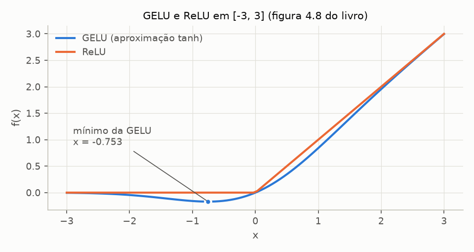
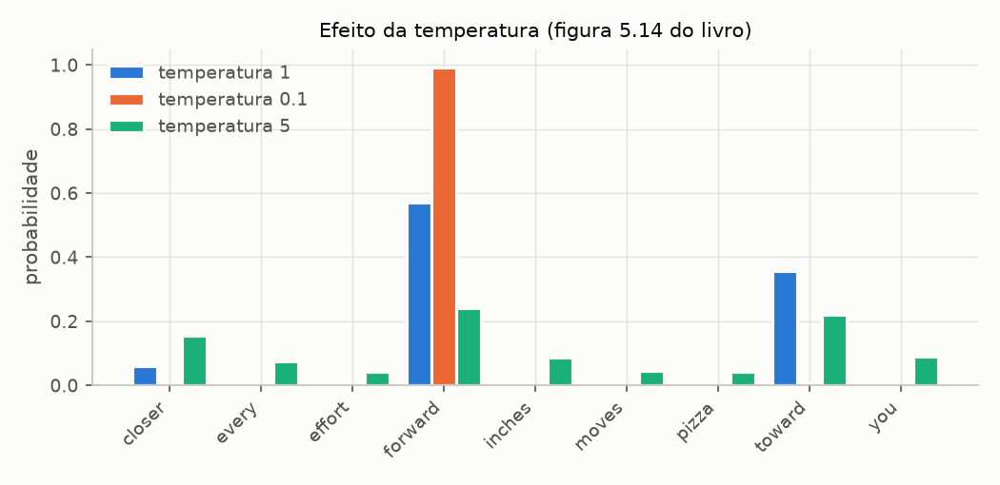

# Sprint 4 - Exemplos do livro reproduzidos

Gerado por `experimentos/sprint04/livro_exemplos.py`. Não editar à mão: rode o script novamente.

Cada exemplo do capítulo 4 (e da seção 5.3) foi refeito com o código de `src/`, com a seed do livro, e comparado com o valor impresso. Valores de 4 casas conferem com tolerância de meia unidade na última casa; contagens e Token IDs, com igualdade exata. Fonte dos valores do livro: `tests/book_reference.py`.

## Resumo

**66 de 66 comparações conferem.**

| seção do livro | comparações | conferem |
| -------------- | ----------- | -------- |
| 4.1 | 10 | 10 |
| 4.2 | 7 | 7 |
| 4.3 | 2 | 2 |
| 4.4 | 5 | 5 |
| 4.5 | 3 | 3 |
| 4.6 | 17 | 17 |
| 4.7 | 4 | 4 |
| 5.3 | 18 | 18 |

## L1 - Seção 4.1: o lote de entrada e o esqueleto (p. 97-99)

**Exemplo do livro:** dois textos tokenizados pelo BPE do GPT-2 e empilhados num lote; um `DummyGPTModel` com seed 123 produz os logits.

**Como foi refeito:** o `DummyGPTModel` é o `GPTModel` do projeto com `n_layers=0` e a `final_norm` trocada por identidade. Os blocos falsos do livro não têm pesos, então não sorteiam nada: a ordem dos sorteios (tabela de tokens, tabela de posições, cabeça de saída) é a mesma. A passada roda em `train()`, como no livro, com o dropout de 0,1 ligado.

| texto                    | livro                   | obtido                  | confere |
| ------------------------ | ----------------------- | ----------------------- | ------- |
| `Every effort moves you` | [6109, 3626, 6100, 345] | [6109, 3626, 6100, 345] | sim     |
| `Every day holds a`      | [6109, 1110, 6622, 257] | [6109, 1110, 6622, 257] | sim     |

Shape dos logits: `(2, 4, 50257)` (livro: `(2, 4, 50257)`).

| texto | posição | livro (3 primeiros ... 3 últimos)                          | obtido                                                     | dif. máx. | confere |
| ----- | ------- | ---------------------------------------------------------- | ---------------------------------------------------------- | --------- | ------- |
| 0     | 0       | [-1.2034, 0.3201, -0.7130] ... [-1.5548, -0.2390, -0.4667] | [-1.2034, 0.3201, -0.7130] ... [-1.5548, -0.2390, -0.4667] | 4.6e-05   | sim     |
| 0     | 1       | [-0.1192, 0.4539, -0.4432] ... [0.2392, 1.3469, 1.2430]    | [-0.1192, 0.4539, -0.4432] ... [0.2392, 1.3469, 1.2430]    | 4.8e-05   | sim     |
| 0     | 2       | [0.5307, 1.6720, -0.4695] ... [1.1966, 0.0111, 0.5835]     | [0.5307, 1.6720, -0.4695] ... [1.1966, 0.0111, 0.5835]     | 4.8e-05   | sim     |
| 0     | 3       | [0.0139, 1.6755, -0.3388] ... [1.1586, -0.0435, -1.0400]   | [0.0139, 1.6754, -0.3388] ... [1.1586, -0.0435, -1.0400]   | 5.0e-05   | sim     |
| 1     | 0       | [-1.0908, 0.1798, -0.9484] ... [-1.6047, 0.2439, -0.4530]  | [-1.0908, 0.1798, -0.9484] ... [-1.6047, 0.2439, -0.4530]  | 4.7e-05   | sim     |
| 1     | 1       | [-0.7860, 0.5581, -0.0610] ... [0.4835, -0.0077, 1.6621]   | [-0.7860, 0.5581, -0.0610] ... [0.4835, -0.0077, 1.6621]   | 3.8e-05   | sim     |
| 1     | 2       | [0.3567, 1.2698, -0.6398] ... [-0.0162, -0.1296, 0.3717]   | [0.3567, 1.2698, -0.6398] ... [-0.0162, -0.1296, 0.3717]   | 2.7e-05   | sim     |
| 1     | 3       | [-0.2407, -0.7349, -0.5102] ... [2.0057, -0.3694, 0.1814]  | [-0.2407, -0.7349, -0.5102] ... [2.0057, -0.3694, 0.1814]  | 4.6e-05   | sim     |

## L2 - Seção 4.2: LayerNorm passo a passo (p. 100-104)

**Exemplo do livro:** `torch.randn(2, 5)` passa por `nn.Sequential(nn.Linear(5, 6), nn.ReLU())`; a saída é normalizada à mão e depois pela classe `LayerNorm`.

| grandeza                 | livro                                               | obtido                                              | confere |
| ------------------------ | --------------------------------------------------- | --------------------------------------------------- | ------- |
| saída da camada, linha 0 | [0.2260, 0.3470, 0.0000, 0.2216, 0.0000, 0.0000]    | [0.2260, 0.3470, 0.0000, 0.2216, 0.0000, 0.0000]    | sim     |
| saída da camada, linha 1 | [0.2133, 0.2394, 0.0000, 0.5198, 0.3297, 0.0000]    | [0.2133, 0.2394, 0.0000, 0.5198, 0.3297, 0.0000]    | sim     |
| média por linha          | [0.1324, 0.2170]                                    | [0.1324, 0.2170]                                    | sim     |
| variância por linha      | [0.0231, 0.0398]                                    | [0.0231, 0.0398]                                    | sim     |
| normalizada, linha 0     | [0.6159, 1.4126, -0.8719, 0.5872, -0.8719, -0.8719] | [0.6159, 1.4126, -0.8719, 0.5872, -0.8719, -0.8719] | sim     |
| normalizada, linha 1     | [-0.0189, 0.1121, -1.0876, 1.5173, 0.5647, -1.0876] | [-0.0189, 0.1121, -1.0876, 1.5173, 0.5647, -1.0876] | sim     |

**Classe `LayerNorm(emb_dim=5)` sobre a entrada:** média [-0.0000, 0.0000], variância [1.0000, 1.0000] -- o livro mostra 0 e 1. Confere: sim.

**Contra `nn.LayerNorm` (baseline do PyTorch), em (4, 768):** diferença máxima de 2.4e-07. A variância enviesada (`unbiased=False`) é o que torna as duas iguais; com n - 1 no lugar de n, cada saída sairia multiplicada por √(767/768) = 0.99935.

Detalhe que o livro deixa implícito: a normalização feita à mão usa a variância padrão do PyTorch (n - 1), e a classe usa a enviesada (n). Os números da tabela só batem porque cada conta foi refeita com a mesma variância que o livro usou naquele trecho.

## L3 - Seção 4.3: GELU contra ReLU e a FeedForward (p. 105-108)

**Exemplo do livro:** as duas funções em `torch.linspace(-3, 3, 100)` (figura 4.8) e uma `FeedForward` do GPT-2 small sobre `torch.rand(2, 3, 768)`.

| x       | -3.00   | -2.00   | -1.00   | -0.75   | -0.50   | 0.00   | 0.50   | 1.00   | 3.00   |
| ------- | ------- | ------- | ------- | ------- | ------- | ------ | ------ | ------ | ------ |
| GELU(x) | -0.0036 | -0.0454 | -0.1588 | -0.1700 | -0.1543 | 0.0000 | 0.3457 | 0.8412 | 2.9964 |
| ReLU(x) | 0.0000  | 0.0000  | 0.0000  | 0.0000  | 0.0000  | 0.0000 | 0.5000 | 1.0000 | 3.0000 |

**Mínimo da GELU:** x = -0.7525, GELU(x) = -0.1700. O livro diz "aproximadamente x = -0,75". Confere: sim. À esquerda dele a curva desce, à direita sobe: é o único ponto negativo com derivada zero, e é o que o livro chama de exceção ao gradiente não nulo.

**Aproximação tanh contra a GELU exata (erf)** em [-3, 3]: diferença máxima de 4.7e-04. Desprezível para o modelo; a tanh fica por compatibilidade com o GPT-2.

| etapa da FeedForward | shape obtido | shape na figura 4.9 |
| -------------------- | ------------ | ------------------- |
| entrada              | (2, 3, 768)  | (2, 3, 768)         |
| Linear 1 (expande)   | (2, 3, 3072) | (2, 3, 3072)        |
| GELU                 | (2, 3, 3072) | (2, 3, 3072)        |
| Linear 2 (contrai)   | (2, 3, 768)  | (2, 3, 768)         |

## L4 - Seção 4.4: gradiente com e sem atalho (p. 110-113)

**Exemplo do livro:** rede de cinco camadas Linear + GELU (`layer_sizes = [3, 3, 3, 3, 3, 1]`), entrada `[[1., 0., -1.]]`, erro quadrático contra 0, seed 123 antes de cada rede. Imprime o gradiente médio absoluto dos pesos de cada camada.

**Como foi refeito:** `ShortcutDemoNetwork` e `mean_weight_gradients`, de `src/transformer/shortcut_demo.py`, com a GELU do projeto.

| camada   | sem atalho: livro | obtido      | com atalho: livro | obtido   | confere |
| -------- | ----------------- | ----------- | ----------------- | -------- | ------- |
| layers.0 | 0.000201736       | 0.000201736 | 0.221698          | 0.221698 | sim     |
| layers.1 | 0.000120112       | 0.000120112 | 0.206941          | 0.206941 | sim     |
| layers.2 | 0.000715204       | 0.000715204 | 0.32897           | 0.32897  | sim     |
| layers.3 | 0.00139887        | 0.00139887  | 0.266573          | 0.266573 | sim     |
| layers.4 | 0.00504965        | 0.00504965  | 1.32585           | 1.32585  | sim     |

Sem atalho, o gradiente da primeira camada é 25x menor que o da última; com atalho, 6.0x. A primeira camada recebe 1099x mais gradiente com o atalho -- é o vanishing gradient que a seção 4.4 descreve, e o motivo de o TransformerBlock somar a entrada à saída das duas subcamadas.

## L5 - Seção 4.5 e exercício 4.1: o TransformerBlock (p. 115-116, 302)

| grandeza                  | livro                     | obtido                    | confere |
| ------------------------- | ------------------------- | ------------------------- | ------- |
| shape de entrada / saída  | (2, 4, 768) / (2, 4, 768) | (2, 4, 768) / (2, 4, 768) | sim     |
| parâmetros da FeedForward | 4 722 432                 | 4 722 432                 | sim     |
| parâmetros da atenção     | 2 360 064                 | 2 360 064                 | sim     |

Exercício 4.1: a FeedForward tem 2.00x os parâmetros da atenção. As contas: atenção = 4 · 768² + 768 (Q, K, V e `out_proj`, só esta com bias) = 2 360 064; FeedForward = 2 · 768 · 3072 + 3072 + 768 = 4 722 432. Com as duas LayerNorms (3 072), o bloco tem 7 085 568 parâmetros.

## L6 - Seção 4.6: o GPTModel de 124M (p. 119-122)

**Exemplo do livro:** `torch.manual_seed(123)`, `GPTModel(GPT_CONFIG_124M)` e uma passada sobre o lote do L1, em modo de treino.

Shape dos logits: `(2, 4, 50257)`.

| texto | posição | livro (3 primeiros ... 3 últimos)                         | obtido                                                    | dif. máx. | confere |
| ----- | ------- | --------------------------------------------------------- | --------------------------------------------------------- | --------- | ------- |
| 0     | 0       | [0.3613, 0.4222, -0.0711] ... [0.3483, 0.4661, -0.2838]   | [0.3613, 0.4222, -0.0711] ... [0.3483, 0.4661, -0.2838]   | 4.9e-05   | sim     |
| 0     | 1       | [-0.1792, -0.5660, -0.9485] ... [0.0477, 0.5181, -0.3168] | [-0.1792, -0.5660, -0.9485] ... [0.0477, 0.5181, -0.3168] | 3.5e-05   | sim     |
| 0     | 2       | [0.7120, 0.0332, 0.1085] ... [0.1018, -0.4327, -0.2553]   | [0.7120, 0.0332, 0.1085] ... [0.1018, -0.4327, -0.2553]   | 4.2e-05   | sim     |
| 0     | 3       | [-1.0076, 0.3418, -0.1190] ... [0.7195, 0.4023, 0.0532]   | [-1.0076, 0.3418, -0.1190] ... [0.7195, 0.4023, 0.0532]   | 3.9e-05   | sim     |
| 1     | 0       | [-0.2564, 0.0900, 0.0335] ... [0.2659, 0.4454, -0.6806]   | [-0.2564, 0.0900, 0.0335] ... [0.2659, 0.4454, -0.6806]   | 4.0e-05   | sim     |
| 1     | 1       | [0.1230, 0.3653, -0.2074] ... [0.7705, 0.2710, 0.2246]    | [0.1230, 0.3653, -0.2074] ... [0.7705, 0.2710, 0.2246]    | 4.7e-05   | sim     |
| 1     | 2       | [1.0558, 1.0318, -0.2800] ... [0.6936, 0.3205, -0.3178]   | [1.0558, 1.0318, -0.2800] ... [0.6936, 0.3205, -0.3178]   | 4.5e-05   | sim     |
| 1     | 3       | [-0.1565, 0.3926, 0.3288] ... [1.2630, -0.1858, 0.0388]   | [-0.1565, 0.3926, 0.3288] ... [1.2630, -0.1858, 0.0388]   | 4.7e-05   | sim     |

| grandeza                    | livro        | obtido       | confere |
| --------------------------- | ------------ | ------------ | ------- |
| parâmetros                  | 163 009 536  | 163 009 536  | sim     |
| shape da tabela de tokens   | (50257, 768) | (50257, 768) | sim     |
| shape da cabeça de saída    | (50257, 768) | (50257, 768) | sim     |
| parâmetros com weight tying | 124 412 160  | 124 412 160  | sim     |
| tamanho em float32          | 621.83 MB    | 621.83 MB    | sim     |

De onde vêm os 163 milhões (conta que o livro não faz, e que explica a diferença para 124M):

| componente           | parâmetros | fração |
| -------------------- | ---------- | ------ |
| token_embedding      | 38 597 376 | 23.7%  |
| positional_embedding | 786 432    | 0.5%   |
| attention            | 28 320 768 | 17.4%  |
| feed_forward         | 56 669 184 | 34.8%  |
| block_norms          | 36 864     | 0.0%   |
| final_norm           | 1 536      | 0.0%   |
| out_head             | 38 597 376 | 23.7%  |

### Exercício 4.2 - os outros tamanhos do GPT-2

Só a configuração muda (`emb_dim`, `n_layers`, `n_heads`). Os modelos são montados no device `meta`, que cria os shapes sem alocar memória -- contar o XL de verdade pediria 6 GB. O livro só imprime o XL.

| modelo      | emb_dim / n_layers / n_heads | parâmetros    | com weight tying | float32    | livro                                      | confere |
| ----------- | ---------------------------- | ------------- | ---------------- | ---------- | ------------------------------------------ | ------- |
| gpt2-small  | 768 / 12 / 12                | 163 009 536   | 124 412 160      | 621.83 MB  | não impresso                               | -       |
| gpt2-medium | 1024 / 24 / 16               | 406 212 608   | 354 749 440      | 1549.58 MB | não impresso                               | -       |
| gpt2-large  | 1280 / 36 / 20               | 838 220 800   | 773 891 840      | 3197.56 MB | não impresso                               | -       |
| gpt2-xl     | 1600 / 48 / 25               | 1 637 792 000 | 1 557 380 800    | 6247.68 MB | 1 637 792 000 / 1 557 380 800 / 6247.68 MB | sim     |

### Exercício 4.3 - taxas de dropout separadas

A `GPTConfig` do projeto tem `drop_rate_emb`, `drop_rate_attn` e `drop_rate_shortcut`, que herdam `drop_rate` quando ficam em `None`. Taxas propositalmente diferentes, para mostrar que cada uma chega ao seu módulo:

| onde                              | taxa pedida | taxa no módulo | confere |
| --------------------------------- | ----------- | -------------- | ------- |
| embeddings (`drop_emb`)           | 0.1         | 0.1            | sim     |
| pesos de atenção (`att.dropout`)  | 0.05        | 0.05           | sim     |
| antes do atalho (`drop_shortcut`) | 0.2         | 0.2            | sim     |

## L7 - Seção 4.7: geração gulosa de "Hello, I am" (p. 125-127)

**Exemplo do livro:** o modelo do L6 em `eval()`, 6 tokens novos com `generate_text_simple`.

**Como foi refeito:** `generate` de `src/generation/` com a temperatura padrão (0, gulosa). Para mostrar o laço, cada linha abaixo é uma chamada de `generate(..., max_new_tokens=1)` sobre o contexto da linha anterior; a última linha confere que uma chamada única com 6 tokens dá o mesmo.

| iteração | contexto (Token IDs)                                     | próximo token | texto do token |
| -------- | -------------------------------------------------------- | ------------- | -------------- |
| 1        | [15496, 11, 314, 716]                                    | 27018         | `' Feature'`   |
| 2        | [15496, 11, 314, 716, 27018]                             | 24086         | `'iman'`       |
| 3        | [15496, 11, 314, 716, 27018, 24086]                      | 47843         | `' Bye'`       |
| 4        | [15496, 11, 314, 716, 27018, 24086, 47843]               | 30961         | `'swick'`      |
| 5        | [15496, 11, 314, 716, 27018, 24086, 47843, 30961]        | 42348         | `'attribute'`  |
| 6        | [15496, 11, 314, 716, 27018, 24086, 47843, 30961, 42348] | 7267          | `' argue'`     |

| grandeza                           | livro                                                          | obtido                                                         | confere |
| ---------------------------------- | -------------------------------------------------------------- | -------------------------------------------------------------- | ------- |
| Token IDs gerados                  | [15496, 11, 314, 716, 27018, 24086, 47843, 30961, 42348, 7267] | [15496, 11, 314, 716, 27018, 24086, 47843, 30961, 42348, 7267] | sim     |
| texto                              | `Hello, I am Featureiman Byeswickattribute argue`              | `Hello, I am Featureiman Byeswickattribute argue`              | sim     |
| laço passo a passo = chamada única | -                                                              | True                                                           | sim     |

O texto é incoerente pelo motivo que o livro dá: os pesos ainda são os sorteados pela seed 123. Reproduzir o lixo exato importa mesmo assim -- mostra que embeddings, 12 blocos, norma final, cabeça e laço de geração fazem a mesma conta que a do livro, peso por peso.

## L8 - Seção 5.3: decodificação no vocabulário de 9 palavras (p. 152-158)

**Exemplo do livro:** logits fixos para o próximo token depois de "every effort moves you". Não depende de modelo: isola o que temperatura, amostragem e top-k fazem com uma distribuição.

**Gulosa (temperatura 0):** `forward`; livro: `forward`. Confere: sim.

**Amostragem com temperatura 1, 1000 sorteios, seed 123:**

| palavra   | livro       | obtido | confere |
| --------- | ----------- | ------ | ------- |
| `closer`  | 73          | 73     | sim     |
| `every`   | 0           | 0      | sim     |
| `effort`  | 0           | 0      | sim     |
| `forward` | 582         | 582    | sim     |
| `inches`  | 2           | 2      | sim     |
| `moves`   | 0           | 0      | sim     |
| `pizza`   | 0           | 0      | sim     |
| `toward`  | 343         | 343    | sim     |
| `you`     | não listado | 0      | -       |

| palavra   | T = 1  | T = 0.1 | T = 5  |
| --------- | ------ | ------- | ------ |
| `closer`  | 0.0609 | 0.0000  | 0.1546 |
| `every`   | 0.0016 | 0.0000  | 0.0750 |
| `effort`  | 0.0001 | 0.0000  | 0.0429 |
| `forward` | 0.5721 | 0.9910  | 0.2421 |
| `inches`  | 0.0034 | 0.0000  | 0.0869 |
| `moves`   | 0.0001 | 0.0000  | 0.0454 |
| `pizza`   | 0.0001 | 0.0000  | 0.0430 |
| `toward`  | 0.3576 | 0.0090  | 0.2203 |
| `you`     | 0.0040 | 0.0000  | 0.0898 |

**Exercício 5.1 - quantas vezes `pizza` é sorteado:**

| temperatura | livro           | obtido | probabilidade exata | confere |
| ----------- | --------------- | ------ | ------------------- | ------- |
| 1           | 0               | 0      | 0.0001              | sim     |
| 0.1         | 0               | 0      | 3.0e-38             | sim     |
| 5           | 32 (prob. 4.3%) | 32     | 0.0430              | sim     |

O apêndice C escreve "0x if the temperature is 0 or 0.1"; a figura 5.14 usa as temperaturas 1, 0,1 e 5, então o "0" do texto só pode ser a temperatura 1. A resposta à segunda pergunta do exercício ("um jeito mais rápido e preciso") é a coluna da probabilidade exata: ler o softmax em vez de contar sorteios. 32/1000 = 3,2% é uma estimativa ruidosa de 4.3%.

**Top-k com k = 3:**

| grandeza         | livro                                                                    | obtido                                                                   | confere |
| ---------------- | ------------------------------------------------------------------------ | ------------------------------------------------------------------------ | ------- |
| maiores logits   | [6.7500, 6.2800, 4.5100]                                                 | [6.7500, 6.2800, 4.5100]                                                 | sim     |
| posições         | [3, 7, 0]                                                                | [3, 7, 0]                                                                | sim     |
| logits filtrados | -inf fora das 3 posições                                                 | [4.51, -inf, -inf, 6.75, -inf, -inf, -inf, 6.28, -inf]                   | sim     |
| probabilidades   | [0.0615, 0.0000, 0.0000, 0.5775, 0.0000, 0.0000, 0.0000, 0.3610, 0.0000] | [0.0615, 0.0000, 0.0000, 0.5775, 0.0000, 0.0000, 0.0000, 0.3610, 0.0000] | sim     |

**Exercício 5.3 - configurações determinísticas:**

| configuração                   | palavras distintas em 1000 sorteios | palavra   | confere |
| ------------------------------ | ----------------------------------- | --------- | ------- |
| temperatura 0 (top_k qualquer) | 1                                   | `forward` | sim     |
| temperatura 1 com top_k = 1    | 1                                   | `forward` | sim     |

