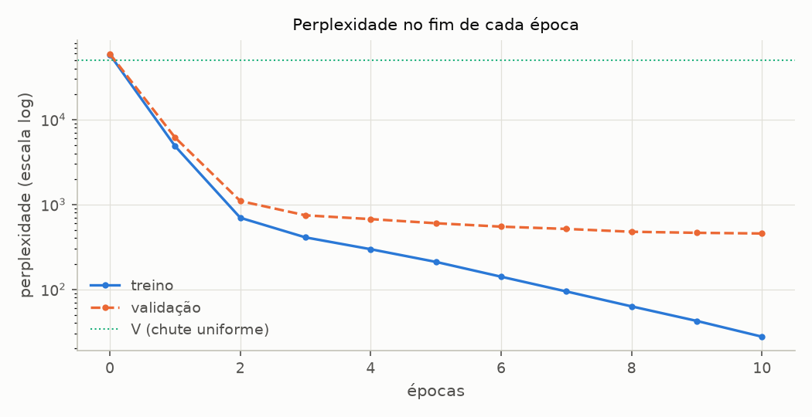
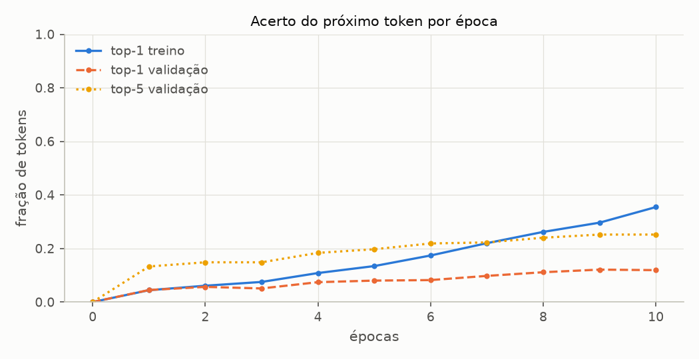
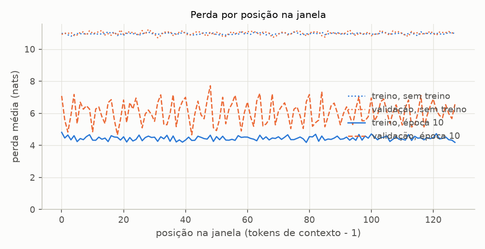
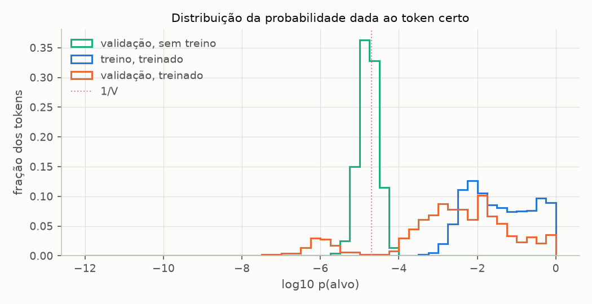

# Sprint 5 - Avaliação do modelo: resultados dos experimentos

Gerado por `experimentos/sprint05/avaliacao_experimentos.py`. Não editar à mão: rode o script novamente.

Modelo: BASE_CONFIG (28 920 832 parâmetros). Dados: The Verdict, 90% treino / 10% validação nos caracteres, janelas de 128 tokens sem sobreposição, lotes de 2. Perdas em nats (log natural), médias por token. Treino em CPU, seeds fixas: rodar de novo reproduz todos os números.

Conjuntos: treino com 36 janelas (18 lotes, 4 612 tokens); validação com 4 janelas (2 lotes, 534 tokens).

## AV1 - A perda passo a passo, no modelo sem treino

**Pergunta:** o que a cross-entropy mede, token a token? E por que o modelo sem treino fica perto de ln V?

**Configuração:** BASE_CONFIG com seed 42, sem treino, em `eval()`. O primeiro lote de validação (2 sequências de 128 tokens); a tabela mostra as 8 primeiras posições da primeira sequência.

| posição | entrada        | alvo           | p(alvo)   | p(alvo) · V | -log p(alvo) | alvo no ranking |
| ------- | -------------- | -------------- | --------- | ----------- | ------------ | --------------- |
| 0       | `'ue'`         | `"'"`          | 7.994e-06 | 0.40        | 11.737       | 45 312          |
| 1       | `"'"`          | `' collapsed'` | 1.499e-05 | 0.75        | 11.108       | 29 245          |
| 2       | `' collapsed'` | `' like'`      | 7.570e-06 | 0.38        | 11.791       | 46 054          |
| 3       | `' like'`      | `' a'`         | 3.613e-05 | 1.82        | 10.228       | 4 693           |
| 4       | `' a'`         | `' house'`     | 1.592e-05 | 0.80        | 11.048       | 27 176          |
| 5       | `' house'`     | `' of'`        | 3.171e-05 | 1.59        | 10.359       | 6 850           |
| 6       | `' of'`        | `' cards'`     | 7.031e-06 | 0.35        | 11.865       | 46 932          |
| 7       | `' cards'`     | `'.'`          | 2.405e-05 | 1.21        | 10.635       | 13 482          |

| grandeza                                                                 | valor   |
| ------------------------------------------------------------------------ | ------- |
| média de -log p(alvo) nas 128 posições da sequência 0                    | 11.0016 |
| média nas 2 x 128 posições do lote (`batch_loss`)                        | 11.0330 |
| mesma média pelo passo a passo (`-target_log_probabilities(...).mean()`) | 11.0330 |
| ln V (chute uniforme entre 50 257 tokens)                                | 10.8249 |
| perplexidade do lote, exp(perda)                                         | 61 882  |
| V                                                                        | 50 257  |
| posição mediana do alvo no ranking (lote inteiro)                        | 26 303  |

A coluna p(alvo) · V compara cada probabilidade com a do chute uniforme (1/V): valores perto de 1 querem dizer que o modelo não favorece o token certo nem o rejeita.

## AV2 - O estado inicial

**Pergunta:** de onde o treino parte? A perda inicial depende da inicialização, ou do conjunto (treino ou validação)?

**Configuração:** BASE_CONFIG com as seeds 42, 43, 44, 45, 46, sem treino, em `eval()`; perdas sobre os conjuntos inteiros. O desvio dos logits é medido no primeiro lote de validação.

| seed           | perda de treino  | perda de validação | perplexidade treino | perplexidade validação | desvio dos logits |
| -------------- | ---------------- | ------------------ | ------------------- | ---------------------- | ----------------- |
| 42             | 10.9713          | 10.9918            | 58 181              | 59 385                 | 0.5775            |
| 43             | 10.9783          | 10.9521            | 58 589              | 57 075                 | 0.5771            |
| 44             | 10.9968          | 10.9840            | 59 681              | 58 926                 | 0.5774            |
| 45             | 10.9871          | 10.9670            | 59 104              | 57 932                 | 0.5774            |
| 46             | 10.9765          | 10.9627            | 58 484              | 57 680                 | 0.5774            |
| média ± desvio | 10.9820 ± 0.0100 | 10.9715 ± 0.0162   |                     |                        |                   |

| referência                                               | perda   | perplexidade |
| -------------------------------------------------------- | ------- | ------------ |
| chute uniforme: ln V                                     | 10.8249 | 50 257       |
| logits aleatórios com variância σ² = 0.3333: ln V + σ²/2 | 10.9916 | 59 372       |

Para logits independentes com variância σ², a média de -log softmax no alvo é E[logsumexp] - E[logit do alvo] ≈ (ln V + σ²/2) - 0: o modelo sem treino perde um pouco MAIS que o chute uniforme, porque logits aleatórios já concentram probabilidade em tokens arbitrários.

## AV3 - A evolução durante o treino

**Pergunta:** como perda, perplexidade e acerto do próximo token evoluem durante o treino, no treino e na validação?

**Configuração:** BASE_TRAINING_CONFIG -- AdamW, lr 0.0004, weight decay 0.1, lotes de 2, 10 épocas, seed 42. Medidas no fim de cada época, nos conjuntos inteiros, em `eval()`. Acerto top-1: o alvo é o argmax; top-5: o alvo está entre os 5 mais prováveis.

| época | perda treino | perda validação | diferença | perplexidade treino | perplexidade validação | top-1 treino | top-1 validação | top-5 validação |
| ----- | ------------ | --------------- | --------- | ------------------- | ---------------------- | ------------ | --------------- | --------------- |
| 0     | 10.971       | 10.992          | 0.020     | 58 180.6            | 59 385.0               | 0.0%         | 0.0%            | 0.0%            |
| 1     | 8.490        | 8.722           | 0.233     | 4 863.6             | 6 139.0                | 4.4%         | 4.5%            | 13.3%           |
| 2     | 6.546        | 7.000           | 0.455     | 696.2               | 1 096.9                | 6.1%         | 5.7%            | 14.8%           |
| 3     | 6.014        | 6.613           | 0.599     | 409.0               | 744.4                  | 7.5%         | 5.1%            | 14.8%           |
| 4     | 5.693        | 6.510           | 0.817     | 296.6               | 671.6                  | 10.8%        | 7.4%            | 18.4%           |
| 5     | 5.349        | 6.398           | 1.049     | 210.4               | 600.4                  | 13.4%        | 8.0%            | 19.7%           |
| 6     | 4.947        | 6.305           | 1.359     | 140.7               | 547.4                  | 17.4%        | 8.2%            | 21.9%           |
| 7     | 4.547        | 6.243           | 1.696     | 94.4                | 514.6                  | 22.0%        | 9.8%            | 22.3%           |
| 8     | 4.142        | 6.166           | 2.025     | 62.9                | 476.5                  | 26.2%        | 11.1%           | 24.0%           |
| 9     | 3.747        | 6.138           | 2.391     | 42.4                | 463.1                  | 29.6%        | 12.1%           | 25.2%           |
| 10    | 3.319        | 6.119           | 2.800     | 27.6                | 454.6                  | 35.5%        | 11.9%           | 25.2%           |

Menor perda de validação no fim de época: 6.119 (perplexidade 454.6), na época 10. Em 512 tokens de validação, o acerto top-1 de 1/V seria 0.0020%.

## AV4 - A perda por posição na janela

**Pergunta:** a perda é a média sobre as 128 posições de cada janela. Todas as posições contribuem igual? Quanto o contexto anterior ajuda, antes e depois do treino?

**Configuração:** a perda média de cada posição t (o token t+1 previsto a partir dos tokens 0..t), no modelo sem treino e no fim do treino do AV3. Janelas de 128 tokens deslocadas de 16 em 16 (281 de treino, 26 de validação): cada token é previsto em até 8 posições diferentes. Com as janelas do treino (stride 128), a posição 0 seria sempre um dos 36 tokens que abrem as janelas, e a validação teria só 4 tokens por posição.

| posições | treino, sem treino | validação, sem treino | treino, época 10 | validação, época 10 |
| -------- | ------------------ | --------------------- | ---------------- | ------------------- |
| 0        | 10.969             | 10.925                | 4.813            | 7.083               |
| 1-3      | 10.905             | 11.007                | 4.483            | 5.431               |
| 4-15     | 10.964             | 10.999                | 4.422            | 6.128               |
| 16-31    | 10.962             | 10.998                | 4.443            | 6.020               |
| 32-63    | 10.966             | 10.996                | 4.421            | 6.092               |
| 64-127   | 10.972             | 10.990                | 4.451            | 6.048               |

## AV5 - A probabilidade dada ao token certo

**Pergunta:** a perda é a média de -log p(alvo). Como p(alvo) se distribui pelos tokens, e quanto da perda vem dos tokens em que o modelo mais erra?

**Configuração:** p(alvo) de cada token, no modelo sem treino e no fim da época 10 do AV3. "Piores 10%": os tokens de maior -log p(alvo).

| faixa de p(alvo)                             | validação, sem treino | treino, treinado | validação, treinado |
| -------------------------------------------- | --------------------- | ---------------- | ------------------- |
| 0.5 ≤ p ≤ 1                                  | 0.0%                  | 11.0%            | 4.5%                |
| 0.1 ≤ p < 0.5                                | 0.0%                  | 22.7%            | 6.6%                |
| 0.01 ≤ p < 0.1                               | 0.0%                  | 34.5%            | 25.6%               |
| 0.001 ≤ p < 0.01                             | 0.0%                  | 31.1%            | 30.5%               |
| 0.0001 ≤ p < 0.001                           | 0.0%                  | 0.7%             | 20.3%               |
| p < 0.0001                                   | 100.0%                | 0.0%             | 12.5%               |
| p < 1/V (abaixo do chute uniforme)           | 60.9%                 | 0.0%             | 11.3%               |
| p(alvo) mediana                              | 1.68e-05              | 2.97e-02         | 3.25e-03            |
| média geométrica de p(alvo) = 1/perplexidade | 1.68e-05              | 3.62e-02         | 2.20e-03            |
| parte da perda nos piores 10% dos tokens     | 10.9%                 | 18.5%            | 22.8%               |

**Que tokens ficam em cada ponta** (validação, fim do treino; os 10 alvos mais frequentes de cada grupo, com quantas vezes aparecem):

| p(alvo) ≥ 0,1: 57 tokens, 20 distintos | p(alvo) < 1e-4: 64 tokens, 60 distintos |
| -------------------------------------- | --------------------------------------- |
| `'\n'` (9)                             | `' question'` (3)                       |
| `','` (6)                              | `' alive'` (2)                          |
| `'roud'` (6)                           | `' late'` (2)                           |
| `'.'` (5)                              | `' collapsed'` (1)                      |
| `"'t"` (4)                             | `' cards'` (1)                          |
| `' and'` (4)                           | `' sne'` (1)                            |
| `'"'` (3)                              | `'er'` (1)                              |
| `' .'` (3)                             | `'he'` (1)                              |
| `' the'` (3)                           | `' quietly'` (1)                        |
| `' I'` (2)                             | `'Are'` (1)                             |

