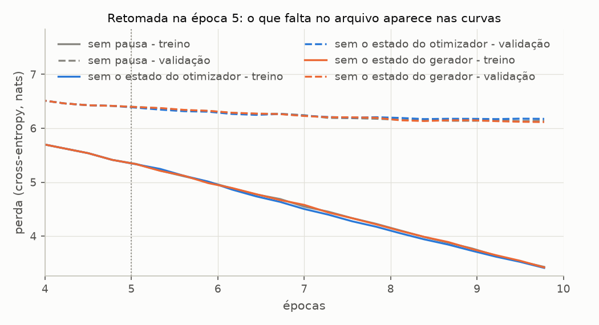

# Sprint 5 - Salvamento e carregamento: resultados dos experimentos

Gerado por `experimentos/sprint05/checkpoint_experimentos.py`. Não editar à mão: rode o script novamente.

Modelo: BASE_CONFIG, treinado com BASE_TRAINING_CONFIG (seed 42) por 10 épocas, em duas metades com uma pausa salva na época 5. Arquivos gravados e lidos por `save_checkpoint` e `load_checkpoint` (`src/training/checkpoint.py`). O modelo final fica em `checkpoints/sprint05-base-10-epocas.pth`, fora do repositório (`*.pth` no `.gitignore`); os arquivos intermediários, numa pasta temporária. Treino em CPU, seeds fixas: rodar de novo reproduz tudo, exceto os tempos. Figuras em `resultados/figuras/`.

Conferência com `resultados/treino.md`: última avaliação (passo 175) com treino 3.429 e validação 6.140; o T1 publica 3.429 e 6.140: **confere**. Salvar no meio não mudou o treino.

## C1 - O que vai no arquivo

**Pergunta:** o que precisa ser salvo para o treino poder ser usado e continuado depois, quanto cada parte ocupa, e quanto custa gravar e ler?

**Configuração:** o modelo do treino de referência depois de 10 épocas (180 passos), salvo por `save_checkpoint` com o otimizador e o estado do gerador. Tamanho de cada parte = bytes dos tensores (float32, 4 bytes por número) ou do JSON equivalente.

| chave                             | conteúdo                                                                            | tamanho   | para quê                               |
| --------------------------------- | ----------------------------------------------------------------------------------- | --------- | -------------------------------------- |
| `model_state_dict`                | 61 tensores: 28 920 832 parâmetros em 57 tensores e 4 buffers (as máscaras causais) | 110.4 MB  | gerar texto e avaliar                  |
| `optimizer_state_dict`            | 171 tensores: passo, m e v de cada um dos 57 tensores de parâmetros                 | 220.6 MB  | retomar o treino                       |
| `history`                         | 36 avaliações, 180 perdas de lote, 10 amostras                                      | 7.0 kB    | curvas de perda e contagem de passos   |
| `model_config`                    | 12 campos do GPTConfig                                                              | 246 bytes | remontar a arquitetura                 |
| `training_config`                 | 11 campos do TrainingConfig                                                         | 228 bytes | recriar o otimizador e os dados        |
| `rng_state`                       | tensor de 5056 bytes                                                                | 4.9 kB    | retomada idêntica (lotes e dropout)    |
| `format_version`, `torch_version` | 1, `2.13.0+cpu`                                                                     | -         | recusar formato desconhecido; registro |

| arquivo                               | tamanho em disco | salvar (s) | carregar (s) |
| ------------------------------------- | ---------------- | ---------- | ------------ |
| só pesos (sem otimizador nem gerador) | 110.4 MB         | 0.10       | 0.17         |
| completo                              | 331.1 MB         | 0.25       | 0.28         |

Treinar as 10 épocas levou 135 s nesta máquina; carregar o arquivo completo, 0.28 s: 486 vezes menos. Tempos: mediana de 3 execuções, com o arquivo já no cache do sistema.

## C2 - Ida e volta: o modelo carregado gerando texto

**Pergunta:** o modelo reconstruído do arquivo é o mesmo que estava na memória? Ele gera o mesmo texto, inclusive num processo novo?

**Configuração:** `load_checkpoint` sobre o arquivo do C1, num `GPTModel` novo. Comparação com o modelo que ficou na memória depois do treino: pesos, perdas sobre os conjuntos inteiros e 50 tokens gerados a partir de `Every effort moves you`, com a decodificação gulosa e com top-k 50 e T = 0,7 (gerador com seed 42). Por fim, o mesmo arquivo carregado por outro processo do Python (`--gerar`).

| o que se compara            | na memória                    | carregado do arquivo | resultado |
| --------------------------- | ----------------------------- | -------------------- | --------- |
| tensores do state_dict      | 61                            | 61                   | igual     |
| maior diferença entre pesos | -                             | 0.0e+00              | igual     |
| perda de treino             | 3.319154                      | 3.319154             | igual     |
| perda de validação          | 6.119448                      | 6.119448             | igual     |
| GPTConfig                   | BASE_CONFIG                   | do arquivo           | igual     |
| TrainingConfig              | BASE_TRAINING_CONFIG          | do arquivo           | igual     |
| histórico                   | 36 avaliações                 | 36 avaliações        | igual     |
| modo do modelo              | train() (como o treino deixa) | eval()               | -         |

**O modelo carregado gerando texto:**

| estratégia        | texto do modelo carregado                                                                                                                                                        | contra o da memória | contra o de outro processo |
| ----------------- | -------------------------------------------------------------------------------------------------------------------------------------------------------------------------------- | ------------------- | -------------------------- |
| gulosa            | `Every effort moves you know. "I have to me--and that I had been the fact.        "I.     "I. "I I had been the Riv it, and in the picture`                                      | igual               | igual                      |
| top-k 50, T = 0,7 | `Every effort moves you know. He was I felt to the him, and he was one of and I had been it. Gisburn, with that he was dead it, you know. Gisburn's long of his own.  " his his` | igual               | igual                      |

## C3 - Retomar o treino do arquivo

**Pergunta:** um treino pausado, salvo e retomado é o mesmo treino? O que muda se o estado do otimizador, ou o do gerador, não for restaurado?

**Configuração:** o treino de referência é salvo no fim da época 5 e segue até a 10 sem parar (é o T1). O arquivo da pausa é então carregado três vezes, cada uma num modelo novo, e treinado pelas 5 épocas que faltam:

- **otimizador + gerador:** `load_checkpoint(..., restore_rng=True)` e o AdamW que veio do arquivo;
- **sem o estado do otimizador:** os mesmos pesos e o mesmo gerador, com um AdamW novo (`create_optimizer`): m e v recomeçam do zero;
- **sem o estado do gerador:** pesos e AdamW do arquivo, e `torch.manual_seed(42)` no lugar do estado salvo -- o que faria quem guardou só a seed.

| retomada                   | perda do 1º lote depois da pausa | perda do 2º lote | validação mínima depois da pausa | treino final | validação final | maior diferença de validação para o treino sem pausa | maior diferença entre pesos |
| -------------------------- | -------------------------------- | ---------------- | -------------------------------- | ------------ | --------------- | ---------------------------------------------------- | --------------------------- |
| sem pausa (T1)             | 5.3265                           | 5.1599           | 6.135                            | 3.429        | 6.140           | -                                                    | -                           |
| otimizador + gerador       | 5.3265                           | 5.1599           | 6.135                            | 3.429        | 6.140           | 0.000                                                | 0.0e+00                     |
| sem o estado do otimizador | 5.3265                           | 5.1809           | 6.171                            | 3.409        | 6.175           | 0.043                                                | 2.9e-02                     |
| sem o estado do gerador    | 5.4067                           | 5.2022           | 6.115                            | 3.418        | 6.115           | 0.025                                                | 3.3e-02                     |

Régua: entre seeds diferentes, a validação do treino de referência varia 0.027 (desvio-padrão, T1). O histórico da retomada segue a contagem do arquivo: 180 passos e 10 épocas no fim, como no treino sem pausa.

Amostra gulosa do fim da época 10:

| retomada                   | amostra                                                                                                                                                          |
| -------------------------- | ---------------------------------------------------------------------------------------------------------------------------------------------------------------- |
| sem pausa (T1)             | `Every effort moves you know. "I have to me--and that I had been the fact.        "I.     "I. "I I had been the Riv it, and in the picture`                      |
| otimizador + gerador       | `Every effort moves you know. "I have to me--and that I had been the fact.        "I.     "I. "I I had been the Riv it, and in the picture`                      |
| sem o estado do otimizador | `Every effort moves you know't you.  "I had been the fact, and he was not to the fact, and in the of the picture.         "I must of the Riv, I had been, I had` |
| sem o estado do gerador    | `Every effort moves you know. "I the picture to have him, and I had a little.  "I.   "I.    "I looked, and I said, and of the Riv it. "I turned`                 |

## C4 - O que o formato recusa

**Pergunta:** que enganos ao carregar pesos viram erro, e quais passariam em silêncio se o arquivo tivesse só o `state_dict`, como no livro?

**Configuração:** cada linha tenta uma carga. As quatro primeiras fazem como o livro: montam um `GPTModel` com uma configuração escrita à mão e chamam `load_state_dict` com os pesos do arquivo. As outras usam `load_checkpoint`.

| tentativa                                                                  | erro            | mensagem (resumo)                                                                                                                                                     |
| -------------------------------------------------------------------------- | --------------- | --------------------------------------------------------------------------------------------------------------------------------------------------------------------- |
| `load_state_dict` num modelo com `emb_dim` 128 em vez de 256               | RuntimeError    | `size mismatch for embedding.token_embedding.table.weight: copying a param with shape torch.Size([50257, 256]) from checkpoint, the shape in current model is ...`    |
| `load_state_dict` num modelo com 2 blocos em vez de 4                      | RuntimeError    | `Unexpected key(s) in state_dict: "trf_blocks.2.att.mask", "trf_blocks.2.att.W_query.weight", "trf_blocks.2.att.W_key.weight", ...`                                   |
| `load_state_dict` num modelo com `context_length` 256 em vez de 128        | RuntimeError    | `size mismatch for embedding.positional_embedding.table.weight: copying a param with shape torch.Size([128, 256]) from checkpoint, the shape in current model is ...` |
| `load_state_dict` num modelo com `drop_rate` 0,5 em vez de 0,1             | nenhum erro     | carrega e segue                                                                                                                                                       |
| `load_checkpoint` de um arquivo só com o `state_dict`                      | ValueError      | `recusa.pth: não é um checkpoint do projeto; faltam as chaves ['format_version', 'model_state_dict', 'model_config', 'training_config', 'history']`                   |
| `load_checkpoint` de um arquivo com `format_version` 2                     | ValueError      | `recusa.pth: formato 2, e este código lê o 1`                                                                                                                         |
| `load_checkpoint(..., restore_rng=True)` de um arquivo salvo sem o gerador | ValueError      | `so-pesos.pth: salvo sem rng_state; não há o que restaurar`                                                                                                           |
| `load_checkpoint` de um arquivo com um objeto que não é tensor             | UnpicklingError | `Unsupported global: GLOBAL relatorio.Report was not an allowed global by default`                                                                                    |

