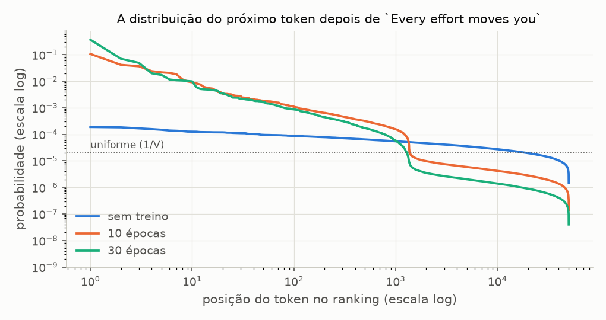
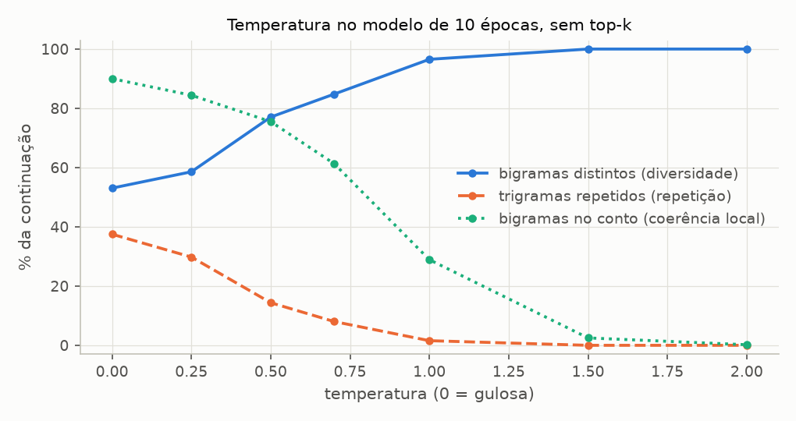
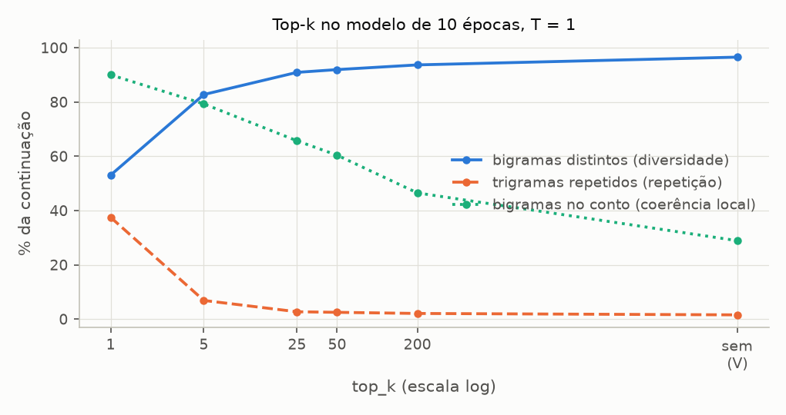
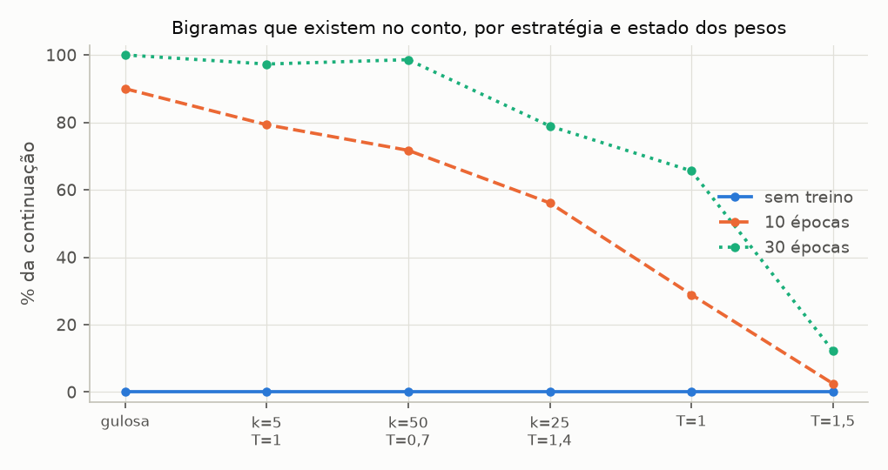
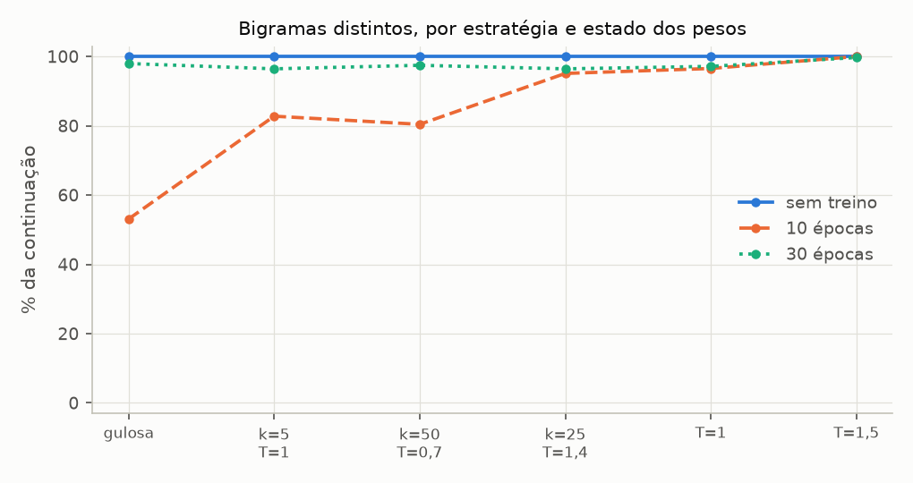

# Sprint 5 - Estratégias de geração: resultados dos experimentos

Gerado por `experimentos/sprint05/geracao_experimentos.py`. Não editar à mão: rode o script novamente.

Modelo: BASE_CONFIG, treinado com BASE_TRAINING_CONFIG (seed 42) em três estados: sem treino, 10 épocas e 30 épocas, tirados de um treino só. Contexto: `Every effort moves you`, 50 tokens novos por continuação. Estratégias que sorteiam: 20 continuações num lote, com `torch.Generator` semeado em 42; as tabelas trazem a média delas. A gulosa gera uma continuação. Decodificação de `src/generation/`, a mesma da Sprint 4. Treino e geração em CPU, seeds fixas: rodar de novo reproduz tudo. Figuras em `resultados/figuras/`.

## Os três estados dos pesos

| estado     | épocas | perda de treino | perda de validação | perplexidade de validação |
| ---------- | ------ | --------------- | ------------------ | ------------------------- |
| sem treino | 0      | 10.971          | 10.992             | 59 385                    |
| 10 épocas  | 10     | 3.319           | 6.119              | 455                       |
| 30 épocas  | 30     | 0.041           | 7.065              | 1 170                     |

Perdas dos pesos usados na geração, medidas em `eval()` sobre os conjuntos inteiros depois do último passo de cada estado. Treino das 30 épocas: 358 s em CPU.

Conferência com `resultados/treino.md` (última avaliação das épocas do T1 e do T2, treino / validação): é o mesmo treino, e portanto os mesmos pesos.

| época | passo | este script   | treino.md     | resultado |
| ----- | ----- | ------------- | ------------- | --------- |
| 10    | 175   | 3.429 / 6.140 | 3.429 / 6.140 | confere   |
| 30    | 535   | 0.043 / 7.067 | 0.043 / 7.067 | confere   |

## D1 - A distribuição que cada estratégia recebe

**Pergunta:** toda estratégia parte da mesma distribuição do próximo token. Que forma ela tem antes do treino, depois de 10 épocas e depois de 30? Quanto dela a temperatura e o top-k alteram em cada caso?

**Configuração:** distribuição do próximo token (T = 1, sem top-k) na última posição de `Every effort moves you`, e a média das mesmas medidas sobre as posições do conjunto de validação. Candidatos efetivos = e^entropia: o tamanho de um vocabulário uniforme com a mesma entropia. Massa do top-k = soma das probabilidades dos k tokens mais prováveis. Referência: ln V = 10.825 nats. O texto de treino usa 1 360 tokens diferentes dos 50 257 do vocabulário; "massa nunca vista" é a probabilidade somada dos outros 48 897, que não aparecem nele nenhuma vez.

**Na última posição de `Every effort moves you`:**

| estado     | token mais provável | maior probabilidade | entropia (nats) | candidatos efetivos | massa do top-5 | massa do top-50 | tokens para 90% da massa | massa nunca vista |
| ---------- | ------------------- | ------------------- | --------------- | ------------------- | -------------- | --------------- | ------------------------ | ----------------- |
| sem treino | `' ski'`            | 0.0002              | 10.659          | 42 569              | 0.1%           | 0.6%            | 38 133                   | 97.2%             |
| 10 épocas  | `' know'`           | 0.1070              | 6.767           | 868                 | 23.1%          | 42.7%           | 6 843                    | 14.0%             |
| 30 épocas  | `'?"'`              | 0.3666              | 4.486           | 89                  | 52.3%          | 68.7%           | 575                      | 4.6%              |

Os 5 tokens mais prováveis em cada estado:

| posição | sem treino         | 10 épocas        | 30 épocas        |
| ------- | ------------------ | ---------------- | ---------------- |
| 1       | `' ski'` 0.0002    | `' know'` 0.1070 | `'?"'` 0.3666    |
| 2       | `'versive'` 0.0002 | `' in'` 0.0415   | `' say'` 0.0701  |
| 3       | `' Kirin'` 0.0002  | `' of'` 0.0367   | `' know'` 0.0493 |
| 4       | `'ctx'` 0.0002     | `' say'` 0.0240  | `' in'` 0.0200   |
| 5       | `' armed'` 0.0001  | `' was'` 0.0216  | `'ement'` 0.0173 |

**Média sobre as posições do conjunto de validação:**

| estado     | maior probabilidade | entropia (nats) | candidatos efetivos | tokens para 90% da massa | massa nunca vista |
| ---------- | ------------------- | --------------- | ------------------- | ------------------------ | ----------------- |
| sem treino | 0.0002              | 10.658          | 42 543              | 38 157                   | 97.3%             |
| 10 épocas  | 0.1778              | 5.711           | 302                 | 2 340                    | 7.4%              |
| 30 épocas  | 0.3948              | 3.672           | 39                  | 367                      | 2.5%              |

Onde começa a cauda: a posição, no ranking, do token nunca visto mais provável, e quantos dos 1 360 primeiros do ranking são tokens do texto de treino.

| estado     | melhor nunca visto, em `Every effort moves you` | na validação: menor posição | na validação: mediana | tokens do treino entre os 1 360 primeiros, em `Every effort moves you` |
| ---------- | ----------------------------------------------- | --------------------------- | --------------------- | ---------------------------------------------------------------------- |
| sem treino | 1                                               | 1                           | 1                     | 37                                                                     |
| 10 épocas  | 1 356                                           | 1 310                       | 1 359                 | 1 357                                                                  |
| 30 épocas  | 1 324                                           | 1 018                       | 1 340                 | 1 348                                                                  |

O que o top-k mantém e o que ele custa, na validação. "Massa" é a probabilidade somada dos k tokens mantidos; "alvo dentro" é a fração das posições em que o token que de fato vem a seguir está entre os k.

| top_k | sem treino: massa / alvo dentro | 10 épocas: massa / alvo dentro | 30 épocas: massa / alvo dentro |
| ----- | ------------------------------- | ------------------------------ | ------------------------------ |
| 1     | 0.0% / 0.0%                     | 17.8% / 11.9%                  | 39.5% / 11.7%                  |
| 5     | 0.1% / 0.0%                     | 32.5% / 25.2%                  | 57.1% / 22.3%                  |
| 25    | 0.3% / 0.0%                     | 47.7% / 47.5%                  | 71.3% / 38.5%                  |
| 50    | 0.6% / 0.0%                     | 54.4% / 56.1%                  | 76.8% / 46.1%                  |
| 200   | 1.9% / 0.6%                     | 68.9% / 73.4%                  | 86.6% / 64.6%                  |
| 1 000 | 6.9% / 1.8%                     | 89.4% / 86.1%                  | 96.6% / 84.4%                  |

Candidatos efetivos por temperatura, na última posição de `Every effort moves you`:

| temperatura | sem treino | 10 épocas | 30 épocas |
| ----------- | ---------- | --------- | --------- |
| 0.5         | 25 982     | 5         | 1         |
| 0.7         | 35 848     | 31        | 4         |
| 1           | 42 569     | 868       | 89        |
| 1.5         | 46 674     | 15 385    | 7 097     |
| 2           | 48 207     | 32 334    | 25 377    |

## D2 - Estratégias lado a lado (10 épocas)

**Pergunta:** com os mesmos pesos e o mesmo contexto, o que muda no texto quando só a estratégia de decodificação muda?

**Configuração:** modelo de 10 épocas, contexto `Every effort moves you`, 50 tokens novos. As estratégias que sorteiam geram 20 continuações (um lote, gerador com seed 42), e a tabela traz a média das 20; a gulosa gera uma só. Medidas, todas sobre a continuação, sem o contexto:

- **tokens distintos**, **bigramas distintos**: diferentes sobre o total (diversidade dentro do texto);
- **continuações diferentes**: quantas das 20 são textos distintos (diversidade entre execuções);
- **maior repetição**: a maior sequência do mesmo token em seguida;
- **trigramas repetidos**: fração dos trigramas que já tinham aparecido antes no mesmo texto;
- **log-prob média**: média de ln p(token) segundo o próprio modelo (T = 1, sem top-k), numa passada sobre o texto final;
- **tokens nunca vistos no treino**: fração dos tokens gerados que não aparecem nenhuma vez no texto de treino;
- **bigramas no conto**: fração dos pares de tokens vizinhos que existem em algum lugar do The Verdict (treino + validação) -- o texto é localmente plausível;
- **maior cópia do treino**: o maior trecho contíguo que aparece, token a token, no texto de treino -- separa o plausível do copiado.

| estratégia                | tokens distintos | bigramas distintos | maior repetição | trigramas repetidos | log-prob média | tokens nunca vistos no treino | bigramas no conto | maior cópia do treino | continuações diferentes |
| ------------------------- | ---------------- | ------------------ | --------------- | ------------------- | -------------- | ----------------------------- | ----------------- | --------------------- | ----------------------- |
| gulosa (T = 0)            | 44.0%            | 53.1%              | 8.0             | 37.5%               | -1.917         | 0.0%                          | 90.0%             | 4.0                   | 1 de 1                  |
| top-k 5, T = 1            | 55.4%            | 82.8%              | 3.0             | 6.9%                | -2.530         | 0.0%                          | 79.3%             | 4.9                   | 20 de 20                |
| top-k 50, T = 0,7         | 56.6%            | 80.4%              | 5.0             | 10.4%               | -2.739         | 0.0%                          | 71.7%             | 4.7                   | 20 de 20                |
| top-k 25, T = 1,4 (livro) | 65.7%            | 95.1%              | 2.1             | 0.9%                | -3.635         | 0.0%                          | 56.1%             | 4.0                   | 20 de 20                |
| T = 1, sem top-k          | 82.3%            | 96.5%              | 2.4             | 1.6%                | -5.488         | 7.2%                          | 28.9%             | 3.6                   | 20 de 20                |
| T = 1,5, sem top-k        | 98.5%            | 100.0%             | 1.0             | 0.0%                | -9.636         | 39.3%                         | 2.5%              | 1.7                   | 20 de 20                |

Desvio-padrão de cada medida entre as 20 continuações (a régua para comparar duas linhas da tabela acima):

| estratégia                | tokens distintos | bigramas distintos | maior repetição | trigramas repetidos | log-prob média | tokens nunca vistos no treino | bigramas no conto | maior cópia do treino |
| ------------------------- | ---------------- | ------------------ | --------------- | ------------------- | -------------- | ----------------------------- | ----------------- | --------------------- |
| top-k 5, T = 1            | 6.0%             | 9.9%               | 1.9             | 8.4%                | 0.184          | 0.0%                          | 5.4%              | 0.8                   |
| top-k 50, T = 0,7         | 5.4%             | 6.9%               | 4.1             | 8.0%                | 0.257          | 0.0%                          | 5.0%              | 0.6                   |
| top-k 25, T = 1,4 (livro) | 6.3%             | 3.8%               | 1.0             | 1.7%                | 0.185          | 0.0%                          | 5.5%              | 0.9                   |
| T = 1, sem top-k          | 5.2%             | 4.4%               | 1.4             | 2.6%                | 0.442          | 3.1%                          | 8.4%              | 0.9                   |
| T = 1,5, sem top-k        | 1.8%             | 0.0%               | 0.0             | 0.0%                | 0.507          | 7.3%                          | 1.8%              | 0.6                   |

Primeiro token gerado: quantos diferentes nas 20 continuações.

| estratégia                | primeiros tokens distintos (de 20) |
| ------------------------- | ---------------------------------- |
| top-k 5, T = 1            | 4                                  |
| top-k 50, T = 0,7         | 9                                  |
| top-k 25, T = 1,4 (livro) | 15                                 |
| T = 1, sem top-k          | 19                                 |
| T = 1,5, sem top-k        | 20                                 |

Textos gerados (a primeira continuação de cada estratégia; o contexto é o começo de todos):

- **gulosa (T = 0):** `Every effort moves you know. "I have to me--and that I had been the fact.        "I.     "I. "I I had been the Riv it, and in the picture`
- **top-k 5, T = 1:** `Every effort moves you know. "--as to I had not that I felt of it was not. "I had not to me, with the to have. "I looked was a had been his pictures. Gisburn. I me to`
- **top-k 50, T = 0,7:** `Every effort moves you know. "'t bear't you get it--and that- he was not.         He her through of it'sI'd was the to me--I.    "I me to`
- **top-k 25, T = 1,4 (livro):** `Every effort moves you! She at me't an't an: not--- that- he was I. " one of the hisisburn. I couldn for the moment the him, on the to me."  "Well--as of, so.`
- **T = 1, sem top-k:** `Every effort moves you frame. happened think't followed't painted myself claimed the breathing tently out of time quality 2021. shecing not his holding culicated going her he't as the curtains peopleWhen on nearhadond When sent are.  "Amid, when`
- **T = 1,5, sem top-k:** `Every effort moves you Juno it happened think'tforestation Only, myself claimedinlineCC sourcedently NULLigned time quality 2021 eng overwhelmed manners not Panzer holding culicated going her he canonicalIt the curtains peopleWhenauts nearhad ABC When Dism are hall Coral hide sprungAmid Match Mountains`

## D3 - Temperatura (10 épocas)

**Pergunta:** como diversidade, repetição e coerência variam com a temperatura, e existe uma faixa em que o texto é diverso sem deixar de ser plausível?

**Configuração:** modelo de 10 épocas, sem top-k, temperaturas de 0 (gulosa) a 2. 20 continuações de 50 tokens por temperatura; medidas do D2.

| temperatura | tokens distintos | bigramas distintos | maior repetição | trigramas repetidos | log-prob média | tokens nunca vistos no treino | bigramas no conto | maior cópia do treino | continuações diferentes |
| ----------- | ---------------- | ------------------ | --------------- | ------------------- | -------------- | ----------------------------- | ----------------- | --------------------- | ----------------------- |
| 0 (gulosa)  | 44.0%            | 53.1%              | 8.0             | 37.5%               | -1.917         | 0.0%                          | 90.0%             | 4.0                   | 1 de 1                  |
| 0.25        | 41.7%            | 58.6%              | 6.8             | 29.8%               | -2.023         | 0.0%                          | 84.4%             | 4.9                   | 20 de 20                |
| 0.5         | 54.1%            | 77.0%              | 4.9             | 14.4%               | -2.511         | 0.0%                          | 75.5%             | 4.7                   | 20 de 20                |
| 0.7         | 62.0%            | 84.8%              | 4.0             | 8.0%                | -3.327         | 0.6%                          | 61.3%             | 4.5                   | 20 de 20                |
| 1           | 82.3%            | 96.5%              | 2.4             | 1.6%                | -5.488         | 7.2%                          | 28.9%             | 3.6                   | 20 de 20                |
| 1.5         | 98.5%            | 100.0%             | 1.0             | 0.0%                | -9.636         | 39.3%                         | 2.5%              | 1.7                   | 20 de 20                |
| 2           | 99.6%            | 100.0%             | 1.0             | 0.0%                | -11.574        | 64.2%                         | 0.2%              | 1.1                   | 20 de 20                |

## D4 - Top-k (10 épocas)

**Pergunta:** o que o corte do top-k muda no texto, e o que ele faz que a temperatura não faz?

**Configuração:** modelo de 10 épocas, T = 1, k de 1 a 200 e sem top-k (o vocabulário inteiro, 50 257 tokens). 20 continuações de 50 tokens por valor; medidas do D2. Com k = 1 só o mais provável sobrevive: é a gulosa por outro caminho, e as continuações saem todas iguais.

| top_k     | tokens distintos | bigramas distintos | maior repetição | trigramas repetidos | log-prob média | tokens nunca vistos no treino | bigramas no conto | maior cópia do treino | continuações diferentes |
| --------- | ---------------- | ------------------ | --------------- | ------------------- | -------------- | ----------------------------- | ----------------- | --------------------- | ----------------------- |
| 1         | 44.0%            | 53.1%              | 8.0             | 37.5%               | -1.917         | 0.0%                          | 90.0%             | 4.0                   | 1 de 20                 |
| 5         | 55.4%            | 82.8%              | 3.0             | 6.9%                | -2.530         | 0.0%                          | 79.3%             | 4.9                   | 20 de 20                |
| 25        | 63.7%            | 90.9%              | 2.9             | 2.7%                | -3.167         | 0.0%                          | 65.7%             | 4.5                   | 20 de 20                |
| 50        | 66.5%            | 91.9%              | 2.8             | 2.5%                | -3.415         | 0.0%                          | 60.4%             | 4.5                   | 20 de 20                |
| 200       | 73.8%            | 93.7%              | 2.4             | 2.1%                | -4.051         | 0.0%                          | 46.5%             | 4.0                   | 20 de 20                |
| sem top-k | 82.3%            | 96.5%              | 2.4             | 1.6%                | -5.488         | 7.2%                          | 28.9%             | 3.6                   | 20 de 20                |

Temperatura x top-k: em cada célula, bigramas no conto / bigramas distintos / maior cópia do treino.

| temperatura | top_k = 5           | top_k = 50          | sem top-k           |
| ----------- | ------------------- | ------------------- | ------------------- |
| T = 0.7     | 81.1% / 77.1% / 4.8 | 71.7% / 80.4% / 4.7 | 61.3% / 84.8% / 4.5 |
| T = 1       | 79.3% / 82.8% / 4.9 | 60.4% / 91.9% / 4.5 | 28.9% / 96.5% / 3.6 |
| T = 1.5     | 76.1% / 88.1% / 4.7 | 42.6% / 96.9% / 3.4 | 2.5% / 100.0% / 1.7 |

## D5 - Estratégia x treino

**Pergunta:** do que se vê no texto gerado, o que é efeito da estratégia de decodificação e o que é efeito do treino dos pesos?

**Configuração:** as 6 estratégias do D2 em cada um dos 3 estados dos pesos, com o mesmo contexto e a mesma seed nos sorteios: 18 combinações. Uma tabela por medida, com a estratégia nas linhas e o estado nas colunas.

**Tokens distintos:**

| estratégia                | sem treino | 10 épocas | 30 épocas |
| ------------------------- | ---------- | --------- | --------- |
| gulosa (T = 0)            | 100.0%     | 44.0%     | 84.0%     |
| top-k 5, T = 1            | 99.9%      | 55.4%     | 81.1%     |
| top-k 50, T = 0,7         | 100.0%     | 56.6%     | 83.8%     |
| top-k 25, T = 1,4 (livro) | 100.0%     | 65.7%     | 81.0%     |
| T = 1, sem top-k          | 100.0%     | 82.3%     | 84.7%     |
| T = 1,5, sem top-k        | 100.0%     | 98.5%     | 96.5%     |

**Bigramas distintos:**

| estratégia                | sem treino | 10 épocas | 30 épocas |
| ------------------------- | ---------- | --------- | --------- |
| gulosa (T = 0)            | 100.0%     | 53.1%     | 98.0%     |
| top-k 5, T = 1            | 100.0%     | 82.8%     | 96.4%     |
| top-k 50, T = 0,7         | 100.0%     | 80.4%     | 97.4%     |
| top-k 25, T = 1,4 (livro) | 100.0%     | 95.1%     | 96.4%     |
| T = 1, sem top-k          | 100.0%     | 96.5%     | 97.1%     |
| T = 1,5, sem top-k        | 100.0%     | 100.0%    | 99.7%     |

**Maior repetição:**

| estratégia                | sem treino | 10 épocas | 30 épocas |
| ------------------------- | ---------- | --------- | --------- |
| gulosa (T = 0)            | 1.0        | 8.0       | 2.0       |
| top-k 5, T = 1            | 1.0        | 3.0       | 1.9       |
| top-k 50, T = 0,7         | 1.0        | 5.0       | 1.9       |
| top-k 25, T = 1,4 (livro) | 1.0        | 2.1       | 2.2       |
| T = 1, sem top-k          | 1.0        | 2.4       | 2.0       |
| T = 1,5, sem top-k        | 1.0        | 1.0       | 1.2       |

**Trigramas repetidos:**

| estratégia                | sem treino | 10 épocas | 30 épocas |
| ------------------------- | ---------- | --------- | --------- |
| gulosa (T = 0)            | 0.0%       | 37.5%     | 0.0%      |
| top-k 5, T = 1            | 0.0%       | 6.9%      | 0.6%      |
| top-k 50, T = 0,7         | 0.0%       | 10.4%     | 0.1%      |
| top-k 25, T = 1,4 (livro) | 0.0%       | 0.9%      | 1.1%      |
| T = 1, sem top-k          | 0.0%       | 1.6%      | 1.1%      |
| T = 1,5, sem top-k        | 0.0%       | 0.0%      | 0.0%      |

**Log-prob média:**

| estratégia                | sem treino | 10 épocas | 30 épocas |
| ------------------------- | ---------- | --------- | --------- |
| gulosa (T = 0)            | -8.605     | -1.917    | -0.072    |
| top-k 5, T = 1            | -8.727     | -2.530    | -0.343    |
| top-k 50, T = 0,7         | -9.012     | -2.739    | -0.233    |
| top-k 25, T = 1,4 (livro) | -8.935     | -3.635    | -1.969    |
| T = 1, sem top-k          | -10.676    | -5.488    | -2.876    |
| T = 1,5, sem top-k        | -10.783    | -9.636    | -8.558    |

**Tokens nunca vistos no treino:**

| estratégia                | sem treino | 10 épocas | 30 épocas |
| ------------------------- | ---------- | --------- | --------- |
| gulosa (T = 0)            | 100.0%     | 0.0%      | 0.0%      |
| top-k 5, T = 1            | 97.0%      | 0.0%      | 0.0%      |
| top-k 50, T = 0,7         | 97.1%      | 0.0%      | 0.0%      |
| top-k 25, T = 1,4 (livro) | 98.2%      | 0.0%      | 0.0%      |
| T = 1, sem top-k          | 97.2%      | 7.2%      | 2.3%      |
| T = 1,5, sem top-k        | 96.9%      | 39.3%     | 29.0%     |

**Bigramas no conto:**

| estratégia                | sem treino | 10 épocas | 30 épocas |
| ------------------------- | ---------- | --------- | --------- |
| gulosa (T = 0)            | 0.0%       | 90.0%     | 100.0%    |
| top-k 5, T = 1            | 0.0%       | 79.3%     | 97.3%     |
| top-k 50, T = 0,7         | 0.0%       | 71.7%     | 98.6%     |
| top-k 25, T = 1,4 (livro) | 0.0%       | 56.1%     | 78.9%     |
| T = 1, sem top-k          | 0.0%       | 28.9%     | 65.6%     |
| T = 1,5, sem top-k        | 0.0%       | 2.5%      | 12.2%     |

**Maior cópia do treino:**

| estratégia                | sem treino | 10 épocas | 30 épocas |
| ------------------------- | ---------- | --------- | --------- |
| gulosa (T = 0)            | 0.0        | 4.0       | 50.0      |
| top-k 5, T = 1            | 0.9        | 4.9       | 37.5      |
| top-k 50, T = 0,7         | 0.8        | 4.7       | 44.1      |
| top-k 25, T = 1,4 (livro) | 0.7        | 4.0       | 9.5       |
| T = 1, sem top-k          | 0.7        | 3.6       | 9.8       |
| T = 1,5, sem top-k        | 0.8        | 1.7       | 2.7       |

**De onde vem a variação.** A soma de quadrados das 18 médias de cada medida, repartida entre os pesos (as médias das colunas), a estratégia (as médias das linhas) e a interação (a estratégia agindo de forma diferente em cada estado):

| medida                        | pesos | estratégia | interação |
| ----------------------------- | ----- | ---------- | --------- |
| tokens distintos              | 60.1% | 18.8%      | 21.1%     |
| bigramas distintos            | 35.0% | 21.8%      | 43.1%     |
| maior repetição               | 38.6% | 22.5%      | 38.9%     |
| trigramas repetidos           | 25.4% | 23.9%      | 50.8%     |
| log-prob média                | 62.0% | 31.2%      | 6.8%      |
| tokens nunca vistos no treino | 94.5% | 3.4%       | 2.0%      |
| bigramas no conto             | 61.8% | 24.8%      | 13.3%     |
| maior cópia do treino         | 51.1% | 17.3%      | 31.6%     |

**O mesmo sorteio em pesos diferentes.** Fração dos tokens gerados que são os mesmos do modelo sem treino, na mesma posição da mesma continuação (20 x 50 posições). O gerador tem a mesma seed nos três estados: quando o token coincide, quem o escolheu foi o sorteio, não os pesos.

| estratégia                | 10 épocas | 30 épocas |
| ------------------------- | --------- | --------- |
| top-k 5, T = 1            | 0.0%      | 0.0%      |
| top-k 50, T = 0,7         | 0.0%      | 0.0%      |
| top-k 25, T = 1,4 (livro) | 0.0%      | 0.0%      |
| T = 1, sem top-k          | 8.6%      | 3.6%      |
| T = 1,5, sem top-k        | 36.7%     | 28.6%     |

**Textos** (a primeira continuação de cada combinação):

- **gulosa (T = 0), sem treino:** `Every effort moves you ski lightweight deceit civilisation cunningGMT 59 fightoreAnd>"Urlrelitschunitedmart cheactivate Hugeience Aly abyssSince balcon tu Nationwideopianč adoptivevuiftingput discrim Kempkeepers boomingPF%), tertzona Orbitalictive Allows mixture flyersmetal catGordon Correctional ::Nav`
- **gulosa (T = 0), 10 épocas:** `Every effort moves you know. "I have to me--and that I had been the fact.        "I.     "I. "I I had been the Riv it, and in the picture`
- **gulosa (T = 0), 30 épocas:** `Every effort moves you?"  "Yes--quite insensible to the irony. She wanted him vindicated--and by me!"  He laughed again, and threw back his head to look up at the sketch of the donkey. "There were days when I`
- **top-k 50, T = 0,7, sem treino:** `Every effort moves youctxergiscoveryarrasshmongaopter adjustments clients Griffith grassroots pref Scope trunc Haleredients microscope symbols stumbling Calaisimate Byzantine miscarriage Colinming Philippines Pir 240BetExc wherein builtMON webs 1981 Typh Agent Roundsestinal endpointinsombie405 41 342 Founders weighicipated Confederation filesystem`
- **top-k 50, T = 0,7, 10 épocas:** `Every effort moves you know. "'t bear't you get it--and that- he was not.         He her through of it'sI'd was the to me--I.    "I me to`
- **top-k 50, T = 0,7, 30 épocas:** `Every effort moves you?"  "Yes--quite insensible to the irony. She wanted him vindicated--and by me!"  He laughed again, and threw back his head to look up at the sketch of the donkey. "There were days when I`
- **T = 1, sem top-k, sem treino:** `Every effort moves you Juno flux spilledricanes Creditforestation rethink048 checkpoints claimantinlineCC sourcedDetect NULLigned professionalism hosp 2021 eng overwhelmed manners copies Panzer Lotus321 funnel Mesh her Coyotes canonical 202 handful hitabasesadj choke Refugee deposits ABC When Boydrequ store Coral deport sprungAmid Match Mountains`
- **T = 1, sem top-k, 10 épocas:** `Every effort moves you frame. happened think't followed't painted myself claimed the breathing tently out of time quality 2021. shecing not his holding culicated going her he't as the curtains peopleWhen on nearhadond When sent are.  "Amid, when`
- **T = 1, sem top-k, 30 épocas:** `Every effort moves you frame it happened aside't bear Only, I claimed."  "I'd rather quality as an exquisburn's an unusualicated placed so that it getting off curtains people about would have out he had sent. The more modest place became the picture`
- **T = 1,5, sem top-k, sem treino:** `Every effort moves you Juno flux spilledricanes Creditforestation rethink048 checkpoints claimantinlineCC sourcedDetect NULLigned professionalism hosp 2021 eng overwhelmed manners standardized Panzer Lotus cul funnel Mesh her Coyotes canonical 202 handful hitTEadj choke Refugee deposits ABC When Dismiculty Advisory Coral deport sprungAmid Match Mountains`
- **T = 1,5, sem top-k, 10 épocas:** `Every effort moves you Juno it happened think'tforestation Only, myself claimedinlineCC sourcedently NULLigned time quality 2021 eng overwhelmed manners not Panzer holding culicated going her he canonicalIt the curtains peopleWhenauts nearhad ABC When Dism are hall Coral hide sprungAmid Match Mountains`
- **T = 1,5, sem top-k, 30 épocas:** `Every effort moves you frame flux happened aside'tforestation't donations myself----CC sourcedently outigned time quality 2021 eng overwhelmed manners one his holding culicated placed her he learnedrather moved curtains peopleWhen onGhadond When Dism are hall! deport passagesAmid Match Mountains`

**Outro contexto.** A mesma grade a partir dos 32 primeiros tokens do texto de validação, que o modelo não viu no treino: `ue' collapsed like a house of cards. He didn't sneer, you understand, poor Stroud--he just lay there quietly watching, and on his`. Em cada célula, bigramas no conto / bigramas distintos / maior cópia do treino.

| estratégia                | sem treino          | 10 épocas           | 30 épocas              |
| ------------------------- | ------------------- | ------------------- | ---------------------- |
| gulosa (T = 0)            | 0.0% / 100.0% / 0.0 | 84.0% / 57.1% / 5.0 | 100.0% / 100.0% / 17.0 |
| top-k 5, T = 1            | 0.0% / 100.0% / 0.8 | 82.2% / 81.2% / 4.8 | 96.8% / 98.6% / 20.8   |
| top-k 50, T = 0,7         | 0.0% / 100.0% / 0.8 | 74.8% / 80.7% / 4.7 | 97.3% / 98.4% / 22.1   |
| top-k 25, T = 1,4 (livro) | 0.0% / 100.0% / 0.8 | 59.2% / 95.9% / 3.8 | 80.2% / 97.9% / 8.8    |
| T = 1, sem top-k          | 0.0% / 100.0% / 0.7 | 29.2% / 98.3% / 3.6 | 75.2% / 98.0% / 10.3   |
| T = 1,5, sem top-k        | 0.0% / 100.0% / 0.8 | 1.7% / 100.0% / 1.6 | 15.5% / 99.8% / 2.9    |

