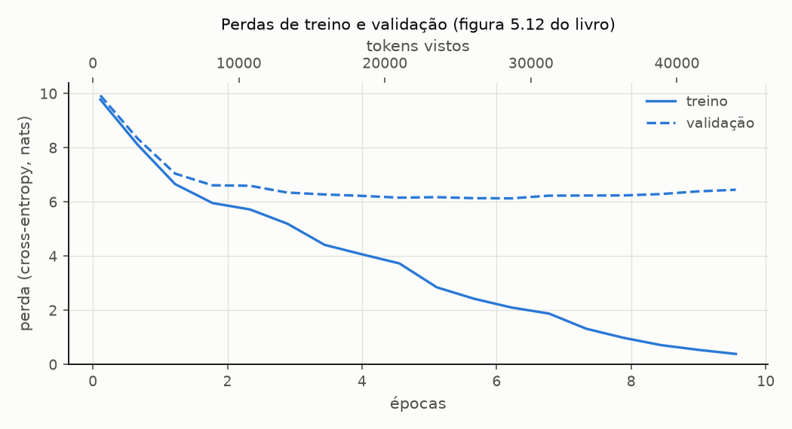

# Sprint 5 - Exemplos do livro reproduzidos (seções 5.1 e 5.2)

Gerado por `experimentos/sprint05/livro_exemplos.py`. Não editar à mão: rode o script novamente.

Cada exemplo das seções 5.1 e 5.2 foi refeito com o código de `src/`, com a seed do livro (123) e em CPU, e comparado com o valor impresso. Valores de 4 casas conferem com tolerância de meia unidade na última casa; perdas do log, na 3ª casa; Token IDs, contagens e textos, com igualdade exata (nas amostras de texto, ignorando a quantidade de espaços). Fonte dos valores do livro: `tests/book_reference.py`.

## Resumo

**45 de 45 comparações conferem.**

| seção do livro | comparações | conferem |
| -------------- | ----------- | -------- |
| 5.1.1 | 2 | 2 |
| 5.1.2 | 20 | 20 |
| 5.1.3 | 7 | 7 |
| 5.2 | 16 | 16 |

## L1 - Seção 5.1.1: geração antes do treino (p. 130-132)

**Exemplo do livro:** o GPT-2 small com contexto 256, criado com seed 123 e posto em `eval()`, gera 10 tokens gulosos a partir de `Every effort moves you`.

**Como foi refeito:** `GPTModel(BOOK_MODEL_CONFIG)` e o `generate()` da Sprint 4 com temperatura 0 (a decodificação gulosa do `generate_text_simple`).

| grandeza              | livro                                                                 | obtido                                                                | confere |
| --------------------- | --------------------------------------------------------------------- | --------------------------------------------------------------------- | ------- |
| Token IDs do contexto | [6109, 3626, 6100, 345]                                               | [6109, 3626, 6100, 345]                                               | sim     |
| texto gerado          | `Every effort moves you rentingetic wasn? refres RexMeCHicular stren` | `Every effort moves you rentingetic wasnم refres RexMeCHicular stren` | sim     |

Token IDs gerados: [34245, 5139, 2492, 25405, 17434, 17853, 5308, 3398, 13174, 43071]. A única diferença visível é `wasn?` no livro contra `wasnم` aqui: o modelo escolhe um token com a letra árabe mim (U+0645), que a impressão do livro mostra como `?`. Trocada essa letra por `?`, os textos coincidem letra a letra.

## L2 - Seção 5.1.2: a perda passo a passo (p. 133-140)

**Exemplo do livro:** dois textos de 3 tokens e seus alvos (a entrada deslocada de uma posição). O modelo sem treino dá probabilidades; a perda é a média de -log p(alvo) nas 6 posições; `F.cross_entropy` chega ao mesmo número; a perplexidade é o `exp` dela.

**Como foi refeito:** o mesmo modelo da L1. O passo a passo usa `target_log_probabilities` (log_softmax + a coluna do alvo); o atalho, `batch_loss`, o `calc_loss_batch` do projeto.

**Entrada, alvo e o que o modelo sem treino escolheria (argmax):**

| texto | entrada              | alvo                     | argmax (livro)        | argmax (obtido)       | confere |
| ----- | -------------------- | ------------------------ | --------------------- | --------------------- | ------- |
| 0     | `every effort moves` | ` effort moves you`      | [16657, 339, 42826]   | [16657, 339, 42826]   | sim     |
| 1     | `I really like`      | ` really like chocolate` | [49906, 29669, 41751] | [49906, 29669, 41751] | sim     |

| grandeza                 | livro               | obtido              | confere |
| ------------------------ | ------------------- | ------------------- | ------- |
| shape das probabilidades | (2, 3, 50257)       | (2, 3, 50257)       | sim     |
| Targets batch 1          | ` effort moves you` | ` effort moves you` | sim     |
| Outputs batch 1          | ` Armed heNetflix`  | ` Armed heNetflix`  | sim     |

**Figura 5.7, passos 1 e 2 (primeira posição do primeiro texto):**

| passo             | livro                                | obtido                               | confere |
| ----------------- | ------------------------------------ | ------------------------------------ | ------- |
| 1. logits         | [0.1113, -0.1057, -0.3666]           | [0.1113, -0.1057, -0.3666]           | sim     |
| 2. probabilidades | [1.8849e-05, 1.5172e-05, 1.1687e-05] | [1.8849e-05, 1.5172e-05, 1.1687e-05] | sim     |

**Passos 3 e 4: a probabilidade de cada alvo e o seu log:**

| texto | posição | alvo         | p(alvo) livro | p(alvo) obtido | log p livro | log p obtido | confere |
| ----- | ------- | ------------ | ------------- | -------------- | ----------- | ------------ | ------- |
| 0     | 0       | ` effort`    | 7.4541e-05    | 7.4541e-05     | -9.5042     | -9.5042      | sim     |
| 0     | 1       | ` moves`     | 3.1061e-05    | 3.1061e-05     | -10.3796    | -10.3796     | sim     |
| 0     | 2       | ` you`       | 1.1563e-05    | 1.1563e-05     | -11.3677    | -11.3677     | sim     |
| 1     | 0       | ` really`    | 1.0337e-05    | 1.0337e-05     | -11.4798    | -11.4798     | sim     |
| 1     | 1       | ` like`      | 5.6776e-05    | 5.6776e-05     | -9.7764     | -9.7764      | sim     |
| 1     | 2       | ` chocolate` | 4.7559e-06    | 4.7559e-06     | -12.2561    | -12.2561     | sim     |

**Passos 5 e 6, e os atalhos:**

| grandeza                             | livro      | obtido     | confere                  |
| ------------------------------------ | ---------- | ---------- | ------------------------ |
| 5. média dos log p                   | -10.7940   | -10.7940   | sim                      |
| 6. cross-entropy à mão (-média)      | 10.7940    | 10.7940    | sim                      |
| logits achatados                     | (6, 50257) | (6, 50257) | sim                      |
| alvos achatados                      | (6,)       | (6,)       | sim                      |
| `F.cross_entropy`                    | 10.7940    | 10.7940    | sim                      |
| `batch_loss` (projeto)               | 10.7940    | 10.7940    | sim                      |
| perplexidade (`torch.exp`, float32)  | 48725.8203 | 48725.8203 | sim                      |
| perplexidade (`perplexity`, float64) | 48725.8203 | 48725.8216 | (mesma conta em float64) |

O modelo sem treino hesita como se escolhesse entre 48 726 tokens (97% do vocabulário de 50 257). A perplexidade em float64 difere da do livro em 0.0013: o livro arredonda o `exp` em float32.

## L3 - Seção 5.1.3: perdas de treino e validação (p. 140-145)

**Exemplo do livro:** The Verdict dividido em 90% treino e 10% validação (nos caracteres), janelas de 256 tokens sem sobreposição, lotes de 2; a perda do modelo sem treino sobre os dois loaders.

**Como foi refeito:** `create_train_val_loaders` (que monta os dois `DataLoader` da Sprint 2 com os padrões do livro) e `evaluate` (o `evaluate_model` do projeto, com os conjuntos inteiros).

| grandeza           | livro    | obtido   | confere |
| ------------------ | -------- | -------- | ------- |
| caracteres         | 20 479   | 20 479   | sim     |
| tokens             | 5 145    | 5 145    | sim     |
| lotes de treino    | 9        | 9        | sim     |
| lotes de validação | 1        | 1        | sim     |
| shape de cada lote | (2, 256) | (2, 256) | sim     |

O corte cai no caractere 18 431: 18 431 caracteres de treino (4 612 tokens, 18 janelas) e 2 048 de validação (534 tokens, 2 janelas). As duas partes somam 5 146 tokens, um a mais que o conto inteiro: o corte partiu uma palavra em dois tokens.

| perda inicial | livro             | obtido            | diferença | confere |
| ------------- | ----------------- | ----------------- | --------- | ------- |
| treino        | 10.98758347829183 | 10.98758347829183 | 0.0e+00   | sim     |
| validação     | 10.98110580444336 | 10.98110580444336 | 0.0e+00   | sim     |

**A 7ª casa depende do pareamento.** A perda de treino é a média das 9 perdas de lote, cada uma calculada em float32. Os pesos são os mesmos em todas as linhas abaixo; muda só quantas vezes o loader foi iterado depois da seed, isto é, quais sequências caíram juntas em cada lote:

| passadas antes da medida | perda de treino    | diferença para o livro |
| ------------------------ | ------------------ | ---------------------- |
| 0                        | 10.98758347829183  | +0.0e+00               |
| 1                        | 10.98758347829183  | +0.0e+00               |
| 2                        | 10.98758347829183  | +0.0e+00               |
| 3                        | 10.98758347829183  | +0.0e+00               |
| 4                        | 10.987583796183268 | +3.2e-07               |

Matematicamente a média não depende da ordem; em float32, cada média de lote arredonda em ~1e-6 e o total oscila na 7ª casa. É por isso que a comparação usa tolerância de 1e-6, e não igualdade.

## L4 - Seção 5.2: o treino de 10 épocas (p. 147-150)

**Exemplo do livro:** `torch.manual_seed(123)`, um `GPTModel` novo, AdamW e o `train_model_simple` por 10 épocas, avaliando a cada 5 passos sobre 5 lotes e gerando uma amostra gulosa de 50 tokens no fim de cada época.

**Como foi refeito:** `train_gpt(BOOK_MODEL_CONFIG, BOOK_TRAINING_CONFIG, ...)` -- os loaders da L3, a seed, o modelo, o `create_optimizer` e o `train_model` do projeto, nessa ordem. Em CPU.

| hiperparâmetro            | livro  | projeto | confere |
| ------------------------- | ------ | ------- | ------- |
| taxa de aprendizado       | 0.0004 | 0.0004  | sim     |
| weight decay              | 0.1    | 0.1     | sim     |
| épocas                    | 10     | 10      | sim     |
| avaliação a cada (passos) | 5      | 5       | sim     |
| lotes por avaliação       | 5      | 5       | sim     |

**Log do treino** (18 avaliações; o livro imprime 6 e omite o resto com `[...]`):

| época | passo  | tokens vistos | treino | validação | livro (treino / validação) | confere |
| ----- | ------ | ------------- | ------ | --------- | -------------------------- | ------- |
| 1     | 000000 | 512           | 9.781  | 9.933     | 9.781 / 9.933              | sim     |
| 1     | 000005 | 3 072         | 8.111  | 8.339     | 8.111 / 8.339              | sim     |
| 2     | 000010 | 5 632         | 6.661  | 7.048     | 6.661 / 7.048              | sim     |
| 2     | 000015 | 8 192         | 5.961  | 6.616     | 5.961 / 6.616              | sim     |
| 3     | 000020 | 10 752        | 5.726  | 6.600     | [...]                      | -       |
| 3     | 000025 | 13 312        | 5.201  | 6.348     | [...]                      | -       |
| 4     | 000030 | 15 872        | 4.417  | 6.278     | [...]                      | -       |
| 4     | 000035 | 18 432        | 4.069  | 6.226     | [...]                      | -       |
| 5     | 000040 | 20 992        | 3.732  | 6.160     | [...]                      | -       |
| 6     | 000045 | 23 552        | 2.850  | 6.179     | [...]                      | -       |
| 6     | 000050 | 26 112        | 2.427  | 6.141     | [...]                      | -       |
| 7     | 000055 | 28 672        | 2.104  | 6.134     | [...]                      | -       |
| 7     | 000060 | 31 232        | 1.882  | 6.233     | [...]                      | -       |
| 8     | 000065 | 33 792        | 1.320  | 6.238     | [...]                      | -       |
| 8     | 000070 | 36 352        | 0.985  | 6.242     | [...]                      | -       |
| 9     | 000075 | 38 912        | 0.717  | 6.293     | [...]                      | -       |
| 9     | 000080 | 41 472        | 0.541  | 6.393     | 0.541 / 6.393              | sim     |
| 10    | 000085 | 44 032        | 0.391  | 6.452     | 0.391 / 6.452              | sim     |

**Amostra gulosa do fim de cada época** (50 tokens, quebras de linha como espaço):

| época | amostra (obtida)                                                                                                                                                                                                    | igual à do livro |
| ----- | ------------------------------------------------------------------------------------------------------------------------------------------------------------------------------------------------------------------- | ---------------- |
| 1     | Every effort moves you,,,,,,,,,,,,.                                                                                                                                                                                 | sim              |
| 2     | Every effort moves you, and, and, and, and, and, and, and, and, and, and, and, and, and, and, and, and, and, and, and, and, and, and,, and, and,                                                                    | sim              |
| 3     | Every effort moves you, and I had been.                                                                                                                                                                             | -                |
| 4     | Every effort moves you know the                          "I he had the donkey and I had the and I had the donkey and down the room, I had                                                                           | -                |
| 5     | Every effort moves you know it was not that the picture--I had the fact by the last I had been--his, and in the            "Oh, and he said, and down the room, and in                                              | -                |
| 6     | Every effort moves you know," was one of the picture. The--I had a little of a little: "Yes, and in fact, and in the picture was, and I had been at my elbow and as his pictures, and down the room, I had          | -                |
| 7     | Every effort moves you know," was one of the picture for nothing--I told Mrs.  "I was no--as! The women had been, in the moment--as Jack himself, as once one had been the donkey, and were, and in his             | -                |
| 8     | Every effort moves you know," was one of the axioms he had been the tips of a self-confident moustache, I felt to see a smile behind his close grayish beard--as if he had the donkey. "strongest," as his          | -                |
| 9     | Every effort moves you?"  "Yes--quite insensible to the irony. She wanted him vindicated--and by me!"  He laughed again, and threw back the window-curtains, I had the donkey. "There were days when I              | sim              |
| 10    | Every effort moves you know," was one of the axioms he laid down across the Sevres and silver of an exquisitely appointed luncheon-table, when, on a later day, I had again run over from Monte Carlo; and Mrs. Gis | sim              |

Tempo: 223 s no total, 24.4, 22.5, 22.5, 22.7, 20.5, 22.3, 22.4, 22.3, 21.9, 19.6 s por época, das quais 27% em avaliação e amostra. O livro cita "cerca de 5 minutos num MacBook Air".

**Onde as curvas se separam.** Última avaliação de cada época (a tabela que a figura mostra):

| época | treino | validação | diferença |
| ----- | ------ | --------- | --------- |
| 1     | 8.111  | 8.339     | 0.228     |
| 2     | 5.961  | 6.616     | 0.655     |
| 3     | 5.201  | 6.348     | 1.147     |
| 4     | 4.069  | 6.226     | 2.157     |
| 5     | 3.732  | 6.160     | 2.428     |
| 6     | 2.427  | 6.141     | 3.714     |
| 7     | 1.882  | 6.233     | 4.352     |
| 8     | 0.985  | 6.242     | 5.257     |
| 9     | 0.541  | 6.393     | 5.852     |
| 10    | 0.391  | 6.452     | 6.061     |

A menor perda de validação é 6.134, no passo 55 (época 7); daí em diante a validação sobe enquanto o treino continua caindo. O livro descreve a separação a partir da época 2: é quando a diferença entre as duas passa a crescer a cada época.

**Memorização (p. 150).** O livro procura `quite insensible to the irony` no conto: o trecho está no caractere 13 246 do texto de treino, e não na validação (confere: sim).

Maior trecho contíguo da continuação gerada (50 tokens) que aparece, token a token, no texto de treino e no de validação:

| época | copiado do treino (tokens) | em comum com a validação (tokens) |
| ----- | -------------------------- | --------------------------------- |
| 1     | 1                          | 1                                 |
| 2     | 3                          | 2                                 |
| 3     | 4                          | 2                                 |
| 4     | 5                          | 4                                 |
| 5     | 5                          | 3                                 |
| 6     | 6                          | 2                                 |
| 7     | 9                          | 5                                 |
| 8     | 16                         | 3                                 |
| 9     | 32                         | 3                                 |
| 10    | 49                         | 2                                 |

