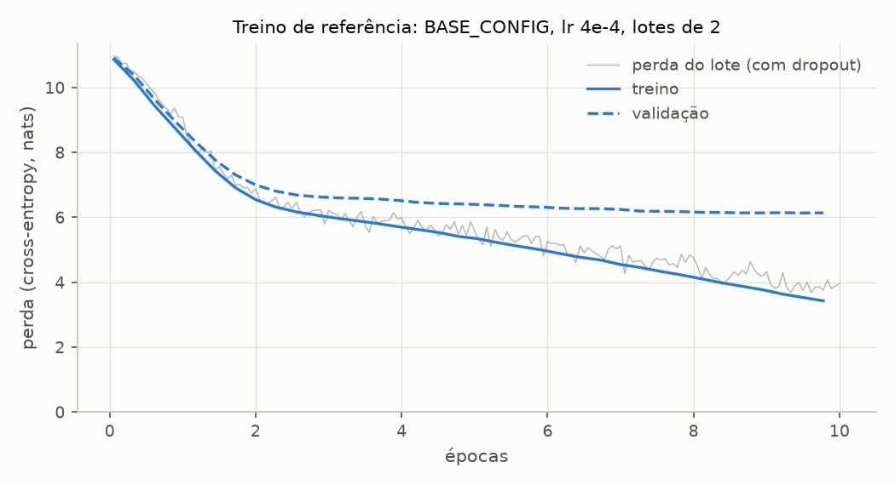
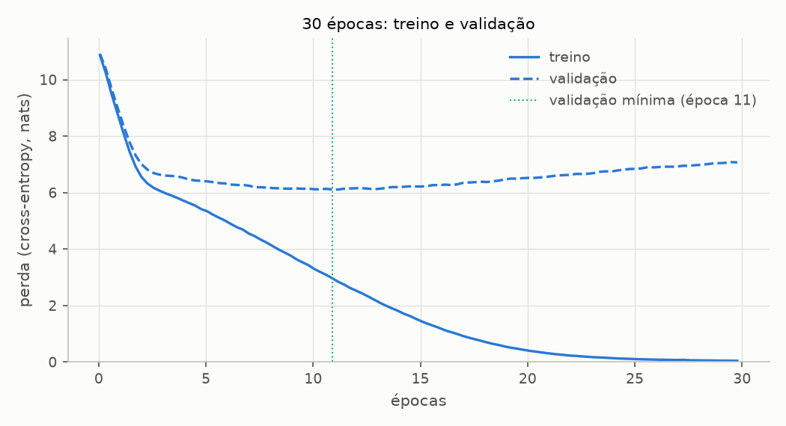
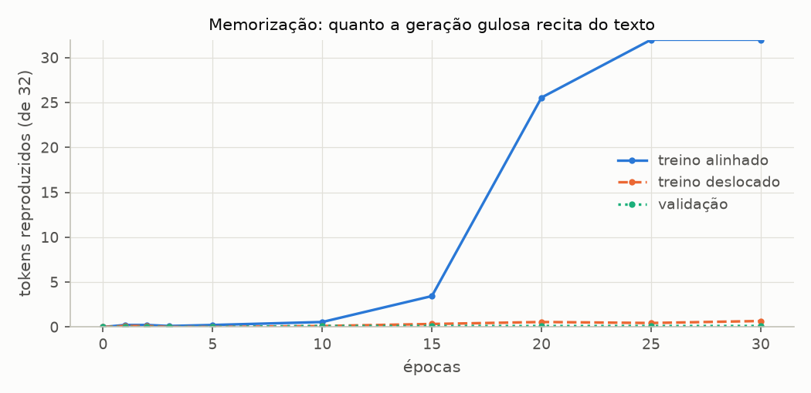
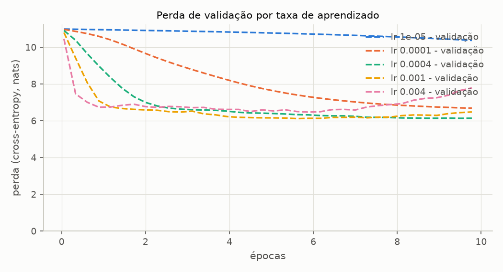
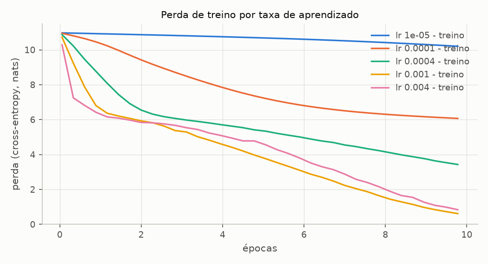
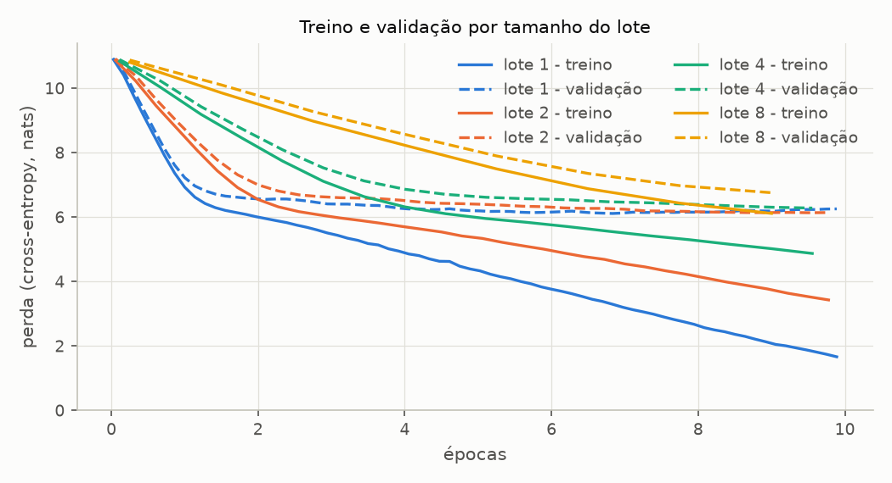
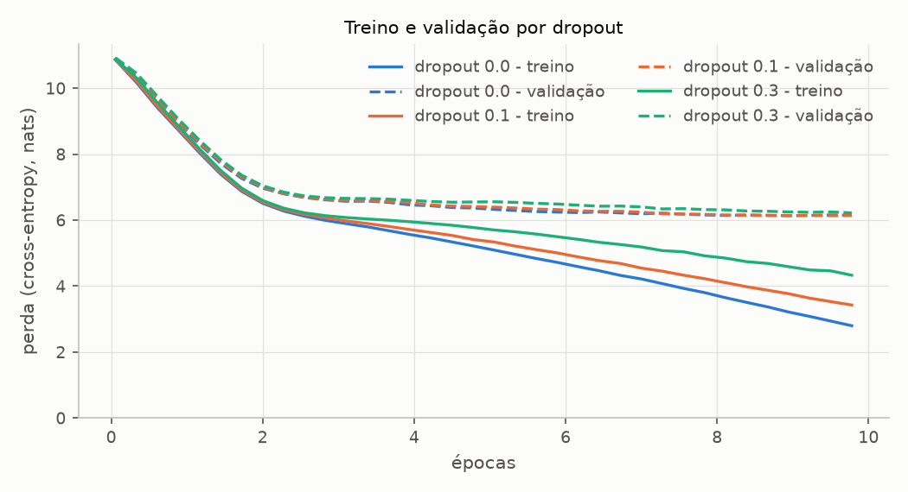
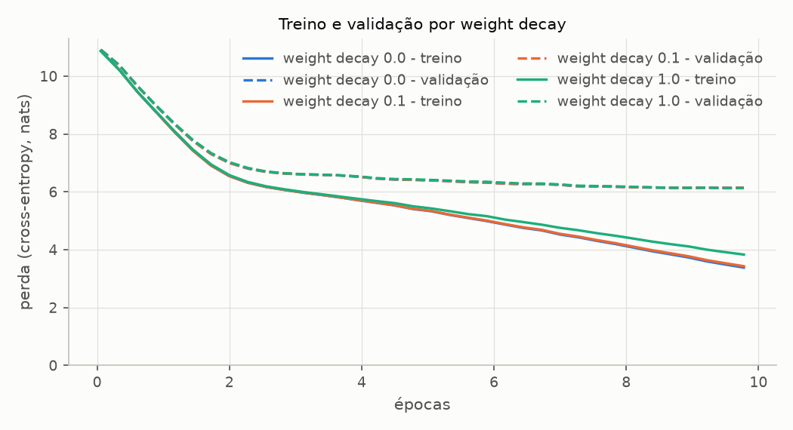
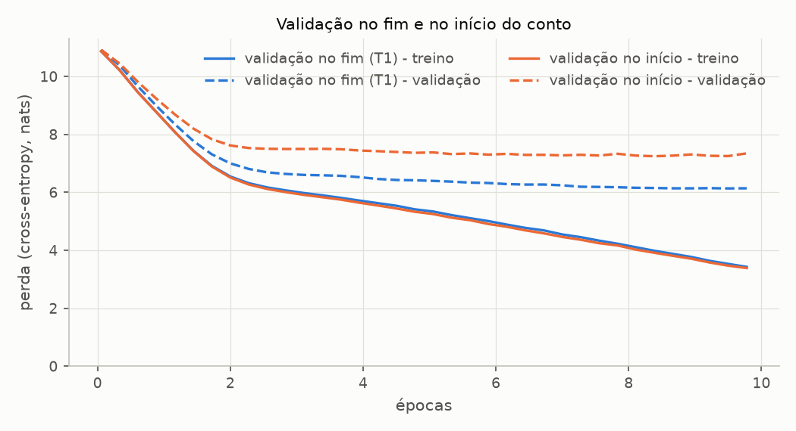
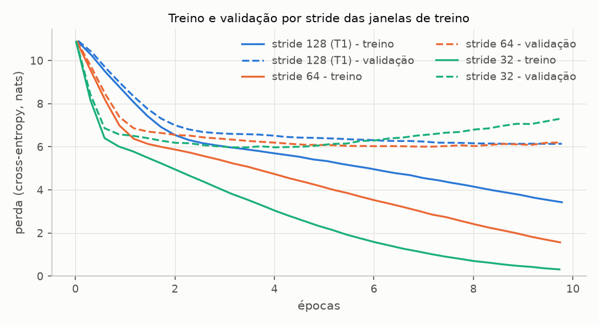

# Sprint 5 - Treinamento: resultados dos experimentos

Gerado por `experimentos/sprint05/treino_experimentos.py`. Não editar à mão: rode o script novamente.

Modelo: BASE_CONFIG. Treino de referência: BASE_TRAINING_CONFIG (AdamW, lr 0.0004, weight decay 0.1, lotes de 2, 10 épocas, avaliação a cada 5 passos sobre os conjuntos inteiros, seed 42). Cada experimento muda um hiperparâmetro e mantém os outros. Dados: The Verdict, 90% treino / 10% validação, janelas de 128 tokens sem sobreposição. Perdas em nats, médias por token; "validação mínima" é a menor perda entre todas as avaliações; "final", a da última avaliação (passo 175 de 180 no treino de 10 épocas). Treinos em CPU, seeds fixas: rodar de novo reproduz tudo, exceto as colunas de tempo. Figuras em `resultados/figuras/`.

## T1 - O treino de referência

**Pergunta:** o laço de treino está aprendendo a tarefa de prever o próximo token? Com que hiperparâmetros, e quanto varia de uma seed para outra?

**Configuração registrada** (lida dos objetos usados no treino):

| grupo      | hiperparâmetro     | valor                         |
| ---------- | ------------------ | ----------------------------- |
| modelo     | vocab_size         | 50257                         |
| modelo     | context_length     | 128                           |
| modelo     | emb_dim            | 256                           |
| modelo     | n_heads            | 4                             |
| modelo     | n_layers           | 4                             |
| modelo     | drop_rate          | 0.1                           |
| modelo     | qkv_bias           | False                         |
| modelo     | ff_hidden_dim      | None                          |
| modelo     | drop_rate_emb      | None                          |
| modelo     | drop_rate_attn     | None                          |
| modelo     | drop_rate_shortcut | None                          |
| modelo     | tie_weights        | False                         |
| modelo     | parâmetros         | 28 920 832                    |
| treino     | num_epochs         | 10                            |
| treino     | batch_size         | 2                             |
| treino     | learning_rate      | 0.0004                        |
| treino     | weight_decay       | 0.1                           |
| treino     | eval_freq          | 5                             |
| treino     | eval_iter          | None (conjuntos inteiros)     |
| treino     | train_ratio        | 0.9                           |
| treino     | stride             | None (= context_length = 128) |
| treino     | seed               | 42                            |
| treino     | start_context      | Every effort moves you        |
| treino     | sample_tokens      | 50                            |
| otimizador | classe             | AdamW                         |
| otimizador | lr                 | 0.0004                        |
| otimizador | betas              | (0.9, 0.999)                  |
| otimizador | eps                | 1e-08                         |
| otimizador | weight_decay       | 0.1                           |
| otimizador | amsgrad            | False                         |

Dados: 36 janelas de treino -> 18 lotes por época (4 608 tokens), 4 janelas de validação em 2 lotes. 180 passos de otimização ao todo.

**Log do treino** (perdas avaliadas em `eval()`, sobre os conjuntos inteiros):

| época | passo  | tokens vistos | treino | validação | perplexidade validação |
| ----- | ------ | ------------- | ------ | --------- | ---------------------- |
| 1     | 000000 | 256           | 10.868 | 10.913    | 54 887.6               |
| 1     | 000005 | 1 536         | 10.220 | 10.381    | 32 245.8               |
| 1     | 000010 | 2 816         | 9.450  | 9.651     | 15 530.5               |
| 1     | 000015 | 4 096         | 8.765  | 8.980     | 7 939.1                |
| 2     | 000020 | 5 376         | 8.078  | 8.348     | 4 220.2                |
| 2     | 000025 | 6 656         | 7.437  | 7.771     | 2 370.4                |
| 2     | 000030 | 7 936         | 6.913  | 7.311     | 1 496.6                |
| 2     | 000035 | 9 216         | 6.546  | 7.000     | 1 096.9                |
| 3     | 000040 | 10 496        | 6.317  | 6.808     | 905.1                  |
| 3     | 000045 | 11 776        | 6.170  | 6.690     | 804.7                  |
| 3     | 000050 | 13 056        | 6.068  | 6.635     | 761.2                  |
| 4     | 000055 | 14 336        | 5.975  | 6.602     | 736.4                  |
| 4     | 000060 | 15 616        | 5.896  | 6.589     | 726.7                  |
| 4     | 000065 | 16 896        | 5.810  | 6.570     | 713.2                  |
| 4     | 000070 | 18 176        | 5.716  | 6.524     | 681.6                  |
| 5     | 000075 | 19 456        | 5.627  | 6.462     | 640.0                  |
| 5     | 000080 | 20 736        | 5.538  | 6.427     | 618.6                  |
| 5     | 000085 | 22 016        | 5.414  | 6.416     | 611.5                  |
| 6     | 000090 | 23 296        | 5.338  | 6.396     | 599.3                  |
| 6     | 000095 | 24 576        | 5.214  | 6.370     | 584.1                  |
| 6     | 000100 | 25 856        | 5.108  | 6.336     | 564.6                  |
| 6     | 000105 | 27 136        | 5.008  | 6.322     | 556.7                  |
| 7     | 000110 | 28 416        | 4.886  | 6.285     | 536.5                  |
| 7     | 000115 | 29 696        | 4.773  | 6.269     | 527.9                  |
| 7     | 000120 | 30 976        | 4.687  | 6.270     | 528.4                  |
| 7     | 000125 | 32 256        | 4.547  | 6.243     | 514.6                  |
| 8     | 000130 | 33 536        | 4.453  | 6.192     | 489.0                  |
| 8     | 000135 | 34 816        | 4.333  | 6.187     | 486.5                  |
| 8     | 000140 | 36 096        | 4.227  | 6.176     | 481.2                  |
| 9     | 000145 | 37 376        | 4.105  | 6.157     | 472.1                  |
| 9     | 000150 | 38 656        | 3.983  | 6.150     | 468.8                  |
| 9     | 000155 | 39 936        | 3.877  | 6.139     | 463.7                  |
| 9     | 000160 | 41 216        | 3.770  | 6.139     | 463.4                  |
| 10    | 000165 | 42 496        | 3.636  | 6.145     | 466.3                  |
| 10    | 000170 | 43 776        | 3.531  | 6.135     | 461.9                  |
| 10    | 000175 | 45 056        | 3.429  | 6.140     | 464.2                  |

**Amostra gulosa do fim de cada época** (contexto `Every effort moves you`, 50 tokens):

| época | amostra                                                                                                                                      |
| ----- | -------------------------------------------------------------------------------------------------------------------------------------------- |
| 1     | Every effort moves you,,,,,,,,,,,,,,,,,,,,,,,,,,,,,,,,,,,,,,,,,,,,,,,,,,                                                                     |
| 2     | Every effort moves you,,,,,,,,,,,,,,,,,,,,,,,,,,,,,,,,,,,,,,,,,,,,,,,,, the                                                                  |
| 3     | Every effort moves you,                                                                                                                      |
| 4     | Every effort moves you.                                                                                                                      |
| 5     | Every effort moves you.                                    "I.                                                                               |
| 6     | Every effort moves you.  "I I had to the to the I had the to the.   "I.  "I.     " the to me, and I had.     "I.                             |
| 7     | Every effort moves you in the him, and I had been the--, and in the to the.   "I.  "I.     " you. "I I had been the Riv to the Riv, and.     |
| 8     | Every effort moves you know I had been the picture--I had--as in the to the--.  "I.   "I. I had been, and in the picture.   "I.   "I was not |
| 9     | Every effort moves you know't--and. "I had been the I had the to have.  "I.   "I.     " you. "I I had been the Riv it, and in the picture    |
| 10    | Every effort moves you know. "I have to me--and that I had been the fact.        "I.     "I. "I I had been the Riv it, and in the picture    |

Tempo: 61.3 s no total; 33.2 s nos passos de treino (1 388 tokens/s) e 26.7 s em avaliações e amostras (45% do tempo das épocas).

**Variação entre seeds** (mesma configuração; a seed muda os pesos iniciais, a ordem dos lotes e o dropout):

| seed               | validação no passo 0 | validação mínima | época da mínima | treino final | validação final |
| ------------------ | -------------------- | ---------------- | --------------- | ------------ | --------------- |
| 42                 | 10.913               | 6.135            | 10              | 3.429        | 6.140           |
| 123                | 10.893               | 6.113            | 10              | 3.420        | 6.118           |
| 7                  | 10.895               | 6.166            | 10              | 3.434        | 6.166           |
| desvio entre seeds |                      | 0.027            |                 | 0.007        | 0.024           |

## T2 - Número de épocas

**Pergunta:** o que muda com mais épocas, no treino, na validação e no texto gerado? Até quando vale a pena treinar?

**Configuração:** a do T1 com 30 épocas. Sem agendamento da taxa de aprendizado, as 10 primeiras épocas deste treino SÃO o T1: a maior diferença entre as 36 avaliações em comum é 0.0e+00. Treinar k épocas é parar este treino na época k.

Sonda de memorização: a partir de 32 tokens reais, quantos dos 32 seguintes a geração gulosa reproduz antes do primeiro erro (média de 9 trechos por grupo). "Treino alinhado": trechos que começam onde começa uma janela do treino (tokens 0, 512, 1 024, ...), nas mesmas posições em que o modelo os viu. "Treino deslocado": os mesmos trechos 64 tokens adiante -- o mesmo texto, em posições em que o modelo nunca o viu. "Validação": trechos espalhados pelo texto de validação.

| época | treino | validação | diferença | perplexidade treino | perplexidade validação | recita: treino alinhado | recita: treino deslocado | recita: validação | maior cópia na amostra |
| ----- | ------ | --------- | --------- | ------------------- | ---------------------- | ----------------------- | ------------------------ | ----------------- | ---------------------- |
| 1     | 8.765  | 8.980     | 0.215     | 6 406.0             | 7 939.1                | 0.2                     | 0.1                      | 0.0               | 0                      |
| 2     | 6.546  | 7.000     | 0.455     | 696.2               | 1 096.9                | 0.2                     | 0.1                      | 0.0               | 2                      |
| 3     | 6.068  | 6.635     | 0.567     | 431.9               | 761.2                  | 0.1                     | 0.0                      | 0.0               | 1                      |
| 5     | 5.414  | 6.416     | 1.002     | 224.5               | 611.5                  | 0.2                     | 0.0                      | 0.0               | 4                      |
| 10    | 3.429  | 6.140     | 2.712     | 30.8                | 464.2                  | 0.6                     | 0.1                      | 0.1               | 4                      |
| 15    | 1.532  | 6.215     | 4.682     | 4.6                 | 500.0                  | 3.4                     | 0.3                      | 0.1               | 7                      |
| 20    | 0.434  | 6.511     | 6.076     | 1.5                 | 672.4                  | 25.6                    | 0.6                      | 0.1               | 35                     |
| 25    | 0.109  | 6.835     | 6.726     | 1.1                 | 930.2                  | 32.0                    | 0.4                      | 0.1               | 50                     |
| 30    | 0.043  | 7.067     | 7.024     | 1.0                 | 1 173.0                | 32.0                    | 0.7                      | 0.1               | 50                     |

Antes do treino, a sonda reproduz 0.0 (treino alinhado), 0.0 (treino deslocado), 0.0 (validação). "Maior cópia na amostra": o maior trecho contíguo da continuação gerada no fim da época (50 tokens) que aparece, token a token, no texto de treino.

Menor perda de validação: 6.106 (perplexidade 448.5) no passo 195, época 11. No fim das 30 épocas: treino 0.043, validação 7.067.

**Amostras ao longo do treino:**

| época | amostra                                                                                                                                                                                                          |
| ----- | ---------------------------------------------------------------------------------------------------------------------------------------------------------------------------------------------------------------- |
| 1     | Every effort moves you,,,,,,,,,,,,,,,,,,,,,,,,,,,,,,,,,,,,,,,,,,,,,,,,,,                                                                                                                                         |
| 2     | Every effort moves you,,,,,,,,,,,,,,,,,,,,,,,,,,,,,,,,,,,,,,,,,,,,,,,,, the                                                                                                                                      |
| 3     | Every effort moves you,                                                                                                                                                                                          |
| 5     | Every effort moves you.                                    "I.                                                                                                                                                   |
| 10    | Every effort moves you know. "I have to me--and that I had been the fact.        "I.     "I. "I I had been the Riv it, and in the picture                                                                        |
| 15    | Every effort moves you know't know.  "I wish you know I had to me with a little with a dozen, and my own the Russian in the end of Jack's open count, I had. I had the Riviera.  "Oh,                            |
| 20    | Every effort moves you?"  "Yes--quite insensible to the irony. She wanted him vindicated--and by me!"  He laughed again, and threw back his head to the donkey again. I saw that, my eye fell on a small picture |
| 25    | Every effort moves you?"  "Yes--quite insensible to the irony. She wanted him vindicated--and by me!"  He laughed again, and threw back his head to look up at the sketch of the donkey. "There were days when I |
| 30    | Every effort moves you?"  "Yes--quite insensible to the irony. She wanted him vindicated--and by me!"  He laughed again, and threw back his head to look up at the sketch of the donkey. "There were days when I |

## T3 - Taxa de aprendizado

**Pergunta:** como a taxa de aprendizado muda a velocidade de convergência, a estabilidade e o ponto em que o sobreajuste começa?

**Configuração:** a do T1, com lr ∈ {1e-05, 0.0001, 0.0004, 0.001, 0.004}. lr 4e-4 é o próprio T1 (o do livro).

| variante  | validação fim da época 1 | validação mínima | época da mínima | treino final | validação final | diferença final | maior cópia na amostra final | tempo (s) | maior subida do treino |
| --------- | ------------------------ | ---------------- | --------------- | ------------ | --------------- | --------------- | ---------------------------- | --------- | ---------------------- |
| lr 1e-05  | 10.958                   | 10.374           | 10              | 10.201       | 10.374          | 0.174           | 2                            | 51        | 0.000                  |
| lr 0.0001 | 10.591                   | 6.687            | 10              | 6.068        | 6.687           | 0.619           | 2                            | 51        | 0.000                  |
| lr 0.0004 | 8.980                    | 6.135            | 10              | 3.429        | 6.140           | 2.712           | 4                            | 61        | 0.000                  |
| lr 0.001  | 7.079                    | 6.118            | 6               | 0.615        | 6.480           | 5.864           | 49                           | 54        | 0.000                  |
| lr 0.004  | 6.738                    | 6.473            | 6               | 0.837        | 7.785           | 6.948           | 5                            | 55        | 0.000                  |

"Maior subida do treino": o maior aumento da perda de treino entre duas avaliações seguidas -- 0 numa descida monótona, positivo quando o passo do otimizador piora o modelo.

| variante  | amostra final                                                                                                                                                                                                    |
| --------- | ---------------------------------------------------------------------------------------------------------------------------------------------------------------------------------------------------------------- |
| lr 1e-05  | Every effort moves you, I, theusion Fn       ",treatment, correctional unauthorizedÃÂÃÂ,., looserera, inhumanseraed         , outlaw?, the                                                                       |
| lr 0.0001 | Every effort moves you, the, the                                                                                                                                                                                 |
| lr 0.0004 | Every effort moves you know. "I have to me--and that I had been the fact.        "I.     "I. "I I had been the Riv it, and in the picture                                                                        |
| lr 0.001  | Every effort moves you?" I didn't know where to put it--_I had never known_. Only, with my sitters and my public, a showy splash of colour covered up the fact--I just threw paint into their faces. . . . Well, |
| lr 0.004  | Every effort moves you?"     I didn't--I turned at the donkey, when I said.                 "Oh his old life.    "Oh,                                                                                            |

## T4 - Tamanho do lote

**Pergunta:** com a mesma taxa de aprendizado e o mesmo número de épocas, o que muda com lotes maiores: a convergência por época, o número de atualizações e o custo?

**Configuração:** a do T1, com lotes de 1, 2, 4, 8 sequências; lr 4e-4 em todos. Lote 2 é o T1. Com `drop_last=True`, as janelas que não completam um lote ficam fora da época.

| variante | validação fim da época 1 | validação mínima | época da mínima | treino final | validação final | diferença final | maior cópia na amostra final | tempo (s) | passos por época | passos no total | s por época (só treino) | tokens/s |
| -------- | ------------------------ | ---------------- | --------------- | ------------ | --------------- | --------------- | ---------------------------- | --------- | ---------------- | --------------- | ----------------------- | -------- |
| lote 1   | 7.224                    | 6.112            | 7               | 1.664        | 6.254           | 4.590           | 4                            | 94        | 36               | 360             | 4.20                    | 1 097    |
| lote 2   | 8.980                    | 6.135            | 10              | 3.429        | 6.140           | 2.712           | 4                            | 61        | 18               | 180             | 3.32                    | 1 388    |
| lote 4   | 10.229                   | 6.280            | 10              | 4.872        | 6.280           | 1.409           | 5                            | 37        | 9                | 90              | 2.44                    | 1 890    |
| lote 8   | 10.874                   | 6.756            | 9               | 6.114        | 6.756           | 0.642           | 2                            | 27        | 4                | 40              | 1.91                    | 2 145    |

## T5 - Regularização: dropout e weight decay

**Pergunta:** os dois regularizadores do modelo reduzem o sobreajuste neste corpus? A que custo na perda de treino?

**Configuração:** a do T1, variando um de cada vez: dropout (`drop_rate` do modelo, nas três posições) ∈ {0.0, 0.1, 0.3} e weight decay do AdamW ∈ {0.0, 0.1, 1.0}. Dropout 0,1 com weight decay 0,1 é o T1.

**Dropout:**

| variante    | validação fim da época 1 | validação mínima | época da mínima | treino final | validação final | diferença final | maior cópia na amostra final | tempo (s) |
| ----------- | ------------------------ | ---------------- | --------------- | ------------ | --------------- | --------------- | ---------------------------- | --------- |
| dropout 0.0 | 8.944                    | 6.138            | 9               | 2.800        | 6.150           | 3.351           | 6                            | 49        |
| dropout 0.1 | 8.980                    | 6.135            | 10              | 3.429        | 6.140           | 2.712           | 4                            | 61        |
| dropout 0.3 | 9.061                    | 6.221            | 10              | 4.331        | 6.221           | 1.890           | 3                            | 51        |

**Weight decay:**

| variante         | validação fim da época 1 | validação mínima | época da mínima | treino final | validação final | diferença final | maior cópia na amostra final | tempo (s) |
| ---------------- | ------------------------ | ---------------- | --------------- | ------------ | --------------- | --------------- | ---------------------------- | --------- |
| weight decay 0.0 | 8.978                    | 6.138            | 10              | 3.381        | 6.143           | 2.762           | 5                            | 51        |
| weight decay 0.1 | 8.980                    | 6.135            | 10              | 3.429        | 6.140           | 2.712           | 4                            | 61        |
| weight decay 1.0 | 8.995                    | 6.126            | 10              | 3.830        | 6.128           | 2.298           | 3                            | 51        |

## T6 - Sobreajuste: treino x validação

**Pergunta:** a diferença entre as perdas de treino e validação é sobreajuste, ou parte dela vem de a validação ser o desfecho do conto, um trecho diferente do resto?

**Configuração:** a do T1 com a validação tirada do COMEÇO do conto. O texto é girado em 2 048 caracteres (os 10% iniciais passam para o fim) e cortado como sempre: a validação vira o início da história, e o treino, o resto inteiro.

| variante              | validação no passo 0 | validação fim da época 1 | validação mínima | época da mínima | treino final | validação final | diferença final | maior cópia na amostra final |
| --------------------- | -------------------- | ------------------------ | ---------------- | --------------- | ------------ | --------------- | --------------- | ---------------------------- |
| validação no fim (T1) | 10.913               | 8.980                    | 6.135            | 10              | 3.429        | 6.140           | 2.712           | 4                            |
| validação no início   | 10.917               | 9.227                    | 7.247            | 9               | 3.388        | 7.345           | 3.957           | 6                            |

## T7 - Janelas sobrepostas: o stride do treino

**Pergunta:** com janelas sem sobreposição (stride = 128), cada token do conto aparece sempre na mesma posição da janela, época após época. O modelo aprende o texto ou aprende o texto naquelas posições? Janelas sobrepostas mudam isso, e a que custo?

**Configuração:** a do T1 com stride de treino 128, 64, 32 (128 é o T1); a validação não muda. Com stride menor, a época tem mais janelas e mais passos, e a avaliação roda a cada 5 x (128 / stride) passos, o mesmo número de vezes por época. Depois do treino, a perda do texto de treino é medida em duas grades de janelas sem sobreposição: a do treino (começando no token 0) e a mesma deslocada de 16 tokens -- o mesmo texto, com cada token numa posição em que o modelo nunca o viu (16 não é múltiplo de nenhum dos três strides).

| variante        | validação fim da época 1 | validação mínima | época da mínima | treino final | validação final | diferença final | maior cópia na amostra final | tempo (s) | janelas por época | passos no total | validação com 45 056 tokens vistos | treino, grade do treino | treino, grade deslocada 16 | diferença entre grades |
| --------------- | ------------------------ | ---------------- | --------------- | ------------ | --------------- | --------------- | ---------------------------- | --------- | ----------------- | --------------- | ---------------------------------- | ----------------------- | -------------------------- | ---------------------- |
| stride 128 (T1) | 8.980                    | 6.135            | 10              | 3.429        | 6.140           | 2.712           | 4                            | 61        | 36                | 180             | 6.140                              | 3.319                   | 4.580                      | 1.261                  |
| stride 64       | 7.380                    | 6.007            | 8               | 1.569        | 6.200           | 4.631           | 11                           | 95        | 71                | 350             | 6.076                              | 1.476                   | 3.236                      | 1.760                  |
| stride 32       | 6.582                    | 5.974            | 4               | 0.313        | 7.297           | 6.984           | 50                           | 185       | 141               | 700             | 6.072                              | 0.290                   | 2.584                      | 2.294                  |

"Validação com 45 056 tokens vistos": a primeira avaliação depois de o treino ter processado tantos tokens quanto o T1 na sua última avaliação -- a comparação com o mesmo custo de treino.

## T8 - Custo computacional

**Pergunta:** quanto custa treinar, em tempo, memória e operações, e como isso escala do modelo do projeto para o do livro?

**Configuração:** um passo de treino (forward, backward, AdamW) com lotes de 2 sequências cheias; mediana de 10 passos depois de 3 de aquecimento. CPU: 10 threads do PyTorch; GPU: NVIDIA GeForce RTX 3050 6GB Laptop GPU. Memória do estado de treino: pesos, gradientes e os dois momentos do AdamW, 16 bytes por parâmetro em float32 (sem as ativações).

| modelo                                  | device | parâmetros  | estado de treino (MB) | pico na GPU (MB) | GFLOP por passo | ms por passo | tokens/s | GFLOP/s |
| --------------------------------------- | ------ | ----------- | --------------------- | ---------------- | --------------- | ------------ | -------- | ------- |
| BASE_CONFIG (projeto)                   | CPU    | 28 920 832  | 441                   | -                | 25.0            | 155          | 1 651    | 161     |
| BASE_CONFIG (projeto)                   | CUDA   | 28 920 832  | 441                   | 577              | 25.0            | 33           | 7 794    | 761     |
| BOOK_MODEL_CONFIG (livro, contexto 256) | CPU    | 162 419 712 | 2 478                 | -                | 394.0           | 1808         | 283      | 218     |
| BOOK_MODEL_CONFIG (livro, contexto 256) | CUDA   | 162 419 712 | 2 478                 | 3 139            | 394.0           | 236          | 2 171    | 1670    |

GFLOP por passo: 3 x os FLOPs do forward (o backward custa ~2 forwards), contando só as multiplicações de matriz.

| avaliação (treino + validação) | ms por avaliação |
| ------------------------------ | ---------------- |
| 5 lotes (livro)                | 194              |
| conjuntos inteiros (projeto)   | 572              |

No T1, um passo de treino custa 185 ms em média, e a avaliação roda a cada 5 passos: avaliações e amostras ficaram com 45% do tempo das épocas.

